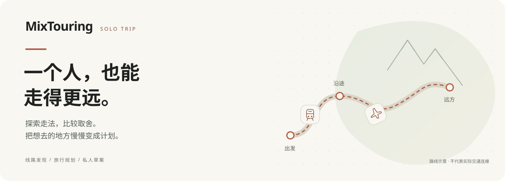

<p align="center">
  
</p>

<p align="center">
  <a href="https://github.com/lucashuang-an/MixTouring/actions/workflows/verify.yml"></a>
  
  
</p>

<p align="center">
  <strong>独立旅行者的线路发现与规划助手</strong><br>
  探索走法，比较取舍，把想去的地方慢慢变成计划。
</p>

<p align="center">
  <a href="#从一个旅行想法开始">产品体验</a> ·
  <a href="#本地运行">本地运行</a> ·
  <a href="#项目导航">项目导航</a> ·
  <a href="https://github.com/lucashuang-an/MixTouring/issues">反馈问题</a>
</p>

## 为什么做 MixTouring

想去一个地方，往往要在机票、火车、地图和攻略之间来回切换。直达是否合适？换个中转城市会怎样？沿途值得停一下吗？有限的时间和预算，应该花在哪里？

MixTouring 从一次北京去喀什的混合交通旅行中诞生，希望把这些分散的思考放进同一个规划过程：先找到值得考虑的走法，再看清交通、停留和体验之间的取舍。直达更合适时，也如实保留直达。

## 从一个旅行想法开始

> 北京出发去阿拉木图，想兼顾城市和自然，不开车，日期还没定。先帮我看看有哪些走法。

| 规划过程 | 你可以做什么 |
| --- | --- |
| 说出想法 | 输入起终点或一句话，逐步补充日期、预算与交通偏好 |
| 探索走法 | 查看直达与途经城市的候选，比较铁路、飞机等交通组合及待查项 |
| 决定停留 | 在路线基础上考虑沿途停留与目的地玩法；具体内容覆盖随城市而异 |
| 调整草案 | 选择走法，编辑景点、住宿和安排，保留尚未确定的部分 |
| 保存再继续 | 将私人草案保存在当前浏览器，之后从“我的行程”继续规划 |

当前为持续迭代的探索原型。路线候选用于帮助决策；指定日期的班次、价格、接驳及开放信息，需要逐项核实。去程与返程分别取证，历史资料不会自动成为当期事实。项目提供内容与规划，不提供购票或交易。

## 本地运行

需要 **Node.js ≥ 22.9** 和 npm。

```bash
git clone https://github.com/lucashuang-an/MixTouring.git
cd MixTouring
npm ci --prefix server
cd server
npm start
```

打开 [http://localhost:3000/index.html](http://localhost:3000/index.html)。后端同时提供页面和 API，无需另外启动前端构建服务。

### 配置 AI 与搜索

在 `server/` 下新建 `.env`，按使用的服务配置。下列值均为占位符，请替换为账号实际可用的密钥、接口和模型 ID。

```dotenv
# OpenAI 兼容模型通道
LLM_API_KEY=你的模型密钥
LLM_BASE_URL=https://api.openai.com/v1
LLM_MODEL=你的模型ID
```

火山通道使用 `VOLC_SEARCH_API_KEY`，可通过 `VOLC_COMPOSE_MODEL` 与 `VOLC_SEARCH_MODEL` 分别指定组合和搜索模型。通道实现见 [server/lib/llm.mjs](server/lib/llm.mjs)，修改配置后重启服务。

主规划 AI 对话需要可用模型；未配置或调用失败时，AI 能力不完整。旧方案库与部分规则接口可以独立运行。密钥仅保存在服务端，`.env` 已被 Git 忽略。

### 分支与开发进展

`main` 是本 README 默认对应的代码版本。[codex/ai-conversation](https://github.com/lucashuang-an/MixTouring/tree/codex/ai-conversation) 分支正在迭代主对话、来源与结论关联、上下文和有界补查，具体完成情况与待修项以该分支的工作记录为准。

该开发分支已提供 Tavily 适配，可在其 `server/.env` 中设置 `TRAVEL_SEARCH_PROVIDER=tavily` 和 `TAVILY_API_KEY`；`main` 的配置请以主分支实际代码为准。真实来源覆盖与回答质量仍在验收，工程检查通过不代表旅行信息已经核实。

## 技术与数据

原生 HTML / CSS / JavaScript 构成前端，Node.js ESM 与 Koa 提供服务。路线数据由现有规则派生；模型调用统一经过服务端出口。

```text
mixtouring-hifi/       页面、交互与设计样式
server/               Koa API、规划服务与回归检查
pipeline/             方案数据、派生规则与离线管道
.github/workflows/    自动化工程验证
```

私人草案目前存于当前浏览器的 `localStorage`，默认私有，不是云端备份。长期偏好等开发能力的范围与授权规则，请查对应版本的产品文档。

## 开发与验证

```bash
# 在仓库根目录执行
node pipeline/check-pages.mjs
node pipeline/check-geo.mjs

# 另一个终端已有服务运行时
node server/verify.mjs
```

`verify` 的确定性基线使用不加载 `.env`、无继承模型或搜索密钥的独立服务：在 `server/` 下以 `node index.mjs` 启动。若端口不同，通过 `PORT` 与 `VERIFY_BASE` 对齐；不要将无密钥断言直接用于已配置真实服务的实例。

完整检查以 [.github/workflows/verify.yml](.github/workflows/verify.yml) 为准。工程回归、真实模型／搜索质量、浏览器体验分别验证。

## 项目导航

| 文档 | 用途 |
| --- | --- |
| [产品方案 Solo Trip v1.2](产品方案_SoloTrip_v1.2.md) | 产品定位、交互约定与范围 |
| [开发流程 Solo Trip v1.2](开发流程_SoloTrip_v1.2.md) | 开发卡、质量门槛与验收 |
| [工作记录](工作记录.md) | 版本演进、验证结果与剩余问题 |
| [协作指南](AGENTS.md) | 开工入口、实现边界与按影响验证 |
| [Issue #5](https://github.com/lucashuang-an/MixTouring/issues/5) | 开发与产品评审决策 |

欢迎通过 [Issues](https://github.com/lucashuang-an/MixTouring/issues) 提供旅行规划中遇到的问题，附上预期行为、实际结果与复现步骤即可。提交改动前请阅读协作指南，并避免上传密钥或私人行程数据。
