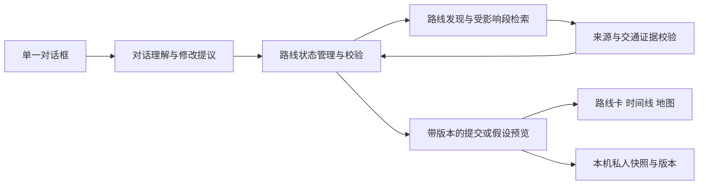

# MixTouring 路线发现与动态状态架构提案

## 2026-10-31 验收修复

本轮以实际失败轨迹补齐证据、局部编辑和完成判定，结果见[评测第29节](travel-agent-benchmarks.md#29-验收驱动的修复2026-10-31)。本节更新下方历史实现说明中的相应行为。

- **事实片段身份**：代码从待核对原文生成span编号，模型选择编号并提供来源原句；断言文本不能被来源文本、译文或同义改写替换。代码按来源元数据把旅行经验降为经验用途，运营与数值证据标准不变。核对输入动态拆批并保留同一份可见目录，去掉不相关工具日志及重复语境。
- **局部失败不撤销有效成果**：无论问题散落多少字段，都优先分批修复指定句子；已经通过的补丁保留，仅剔除未通过句子，不因一个字段失败重写整份日程。正文有实质活动且仅标题／概览失配时，可进行一次只读正文的元数据同步；正文缺活动、用户锁定体验等不能靠改标题通过。
- **明确日卡范围**：单日编辑走local_revision，只输出授权卡片及必要概览字段，不重写其他日期。事实与数字核对同样限于变更范围，返回verification_scope，未改内容保留而不标为本轮重新核实。单日“轻松一点”不更新全程pace。
- **路线含义**：routing保留用户主交通目的地；draft.route从出发地开始、必须包含该目的地，用户明确要求的required_stops可位于其后。未经要求的后续城市仍拒绝；已选路线顺序仍保留；回到出发地的交通在日卡中安排，不能为凑末尾字段虚构折返。
- **工作量与完成分离**：合法结构产生后，登记待核验字段数量。调用保护从基础20按字段批次扩展为`min(80, 20 + 2 * ceil(fieldCount / 12))`，取消和执行时限仍保留；数量上限不是任务完成判据。事实检查已通过的部分结果先保存，后续中断可恢复。明确verified_cross_border_only时，dated_transport也必须满足，不能用初稿完整替代日期交通核实。
- **词义边界**：“两块区域”不是金额，“纸币背面图案”的币值不是景点票价；相关景观描述仍需事实支持，真正票价、费用和预算边界继续校验。

当前验收覆盖基础草案、日卡局部修改、恢复与诚实失败边界；指定日期班次／场馆开放、全程实际可执行性和全局最优排程不由此证明。

> **当前入口（2026-10-30）**：规划闭环已按D1—D4增量接入，实施映射与限制见下节，验收结果见工作记录及统一评测档案。下方设计合同仍包含长期演进边界，不能把完整自动排程、日期交通核实或全局最优求解视为已实现。保留现有服务与模型出口，不迁移框架、不恢复预置库。

## D1—D4实施映射（2026-10-30）

| 阶段 | 当前实现 | 边界 |
|---|---|---|
| D1 | planning-state从已清洗日卡构建活动访问、路段、anchor缺口和任务合同，稳定区分重复访问；conversation返回派生workspace | 旧正文仍通过兼容适配进入结构，不信任客户端提交的观察与完成态；未解析正文保持legacy |
| D2 | planning-mobility校验Google观察与typed数值目录；主规划获得真实地点／路段信息；day-schedule按停留与前段到达时刻顺序查询，分别比较必选／可选分支 | 无明确日期、停留或首末段时不判全天可完成；Google参考不替代团接送、实时路况或指定日班次确认 |
| D3 | planning-loop按Reasoning→Acting→Observing提出同日既有活动排列，查询候选路段后仅接受严格参考耗时下降；显式局部修改保留其他日卡，预览沿用现有采纳合同 | 不删除活动、不跨日移动；团行程、固定钟点及明确先后关系不自动重排；跨日大改仍走原主编排与全稿校验 |
| D4 | planning-session接入生产conversation API；请求身份幂等、临时会话比较、迟到取消、原子检查点、本机跨进程恢复；planning-progress防重复与振荡 | 不是分布式数据库；检查点保留用户结构，恢复重查证据。用户取消不提交；交通阶段中断可保留已经验证的初稿并保持task active |

主生成的执行顺序是：理解与来源补充→生成／恢复结构→数字、事实及质量核对→地图观察与受限重排→交付。将地图放在内容核对之后，避免为随后被删去的无支持地点重复查询，也避免地图耗时吞掉正文验证阶段。重排仅排列原有活动块，不增加事实；有语义先后或团安排的日卡拒绝重排。新事实与替换地点继续走主证据流程。

地点检索在单次运行内复用城市与同名地点，查询结果和名称别名模型调用仍受当前请求的取消、次数和时限控制。主规划数值进入专用的typed目录供决策，不写入可持久化攻略正文；前端交通数值仅临时显示。

`POST /api/anywhere/day-schedule`接受用户此次填写的时间窗口、IANA时区、停留分钟、可选标记及可空首末地点；这些是核对假设，不自动更改旅行日期。返回required和with_optional两个独立结果，区分activity_schedule与含首末段的schedule。公交只返回步行、地点营业状态提示关闭、未定位或无路线均不能给出完整公交可行结论。

生产conversation请求可携带planning_session_id、request_id、resume_token。前端在重发时复用同一身份，输入、选择或偏好上下文变化后使用新身份。检查点位于被git忽略的`server/logs/planning-checkpoints/`，规则版本或请求签名不符不复用；读取有效期为24小时。已提交重放只恢复用户文档，不恢复可信证据状态；主模型生成失败时不以模板补稿。当前没有云端恢复或多设备共享。

工程反例入口：`check-planning-loop.mjs`、`check-planning-session.mjs`、`check-google-maps.mjs`，连同现有对话、证据、存储和页面检查运行。真实回放及浏览器实测结果单列，不从工程通过推导真实旅行可执行。

## 规划闭环设计（2026-10-30）

### 1. 边界与职责

设计开始时已有阶段编排、工具观察、证据核对、局部日卡修复和Google点间交通查询，地图主要服务界面。本设计让规划使用真实工具观察并按依赖调整行程；当前实现顺序与边界见上方实施映射。模型负责意图解释、候选安排和取舍；代码负责条件授权、调用、事实登记、时间计算、失效传播和提交。模型不自行写入完成态或可信事实。

逻辑顺序固定为 **Reasoning → Acting → Observing → 下一轮Reasoning**。Reasoning对外保存的是结构化行动决定及简短理由，不保存或索取隐藏思维链。理解意图在第一次行动之前，工具返回后先核验观察再决定继续、修改或交付。

```text
用户输入 → 授权核对 → 当前任务合同与目标条件
                         ↓
               Reasoning：选择一个有目标的动作
                         ↓
               Acting：执行器校验并调用真实工具
                         ↓
               Observing：验证身份、范围、时效与结果
                         ↓
          更新工作副本、证据引用、缺口及依赖版本
                         ↓
               代码检查交付与约束是否满足
            ↙ 继续决策    ↓交付/预览    ↘等待/中断
                    原子提交或保留旧稿
```

| 组件 | 输入与输出责任 | 现有落点／拟新增边界 |
|---|---|---|
| 意图与任务合同 | 用户原话→授权条件、操作、所需完成维度 | conversation与条件授权；提取纯合同构建器 |
| 上下文组装 | 权威状态、当前目标、相关证据、缺口→阶段上下文 | context-builder；按实体依赖裁剪 |
| 规划决策 | 当前缺口→一个动作、目标实体、预期新增信息 | 复用阶段模型调用；不开放任意工具执行 |
| 执行与观察 | 参数校验、调用、取消、去重、失败分类 | agent-runtime与各provider适配器 |
| 证据与约束 | 观察→可用事实引用；结构→确定性时间检查 | 现有证据／数字守门；新增时间检查器 |
| 修订事务 | 修改范围→工作副本、差异、失效集、比较并交换 | 现有revision／preview逐步扩展 |
| 交付 | 已校验结构→正文、局部补丁、完成维度 | compose、quality、travel-completion |

### 2. 单一权威状态与最小合同

以下为新增领域合同，不改变现有接口字段语义；实施时使用显式schema_version，旧稿经适配器生成工作副本。客户端仍保存私人用户结构；可信观察只由服务端登记，客户端回传引用不等于事实得到核实。

| 对象 | 必要字段与不变量 |
|---|---|
| TaskContract | request_id、base_revision、operation、target_conditions_hash、scope_entity_ids、required_dimensions；由代码依据用户操作确定，不允许模型为通过验收降低要求 |
| PlanWorkspace | schema_version、revision、conditions、days、activities、legs、claim_refs、gaps；当前稿、工作副本、preview分别存放，地图和正文均由同一结构派生 |
| Activity | 稳定activity_id、day_id、place_ref、目的、required/optional、locked、stay_range、time_window；stay_range必须注明user/planning_assumption/source，不把建议游玩时长当外部事实 |
| PlaceRef | 用户原名、provider、provider_id、解析状态；地点相同不等于活动相同，A→B→A保留两个访问事件 |
| Leg | 稳定leg_id、from_event_id、to_event_id、mode、departure_basis、observation_ref、dependency_hash；不能绕过未解析节点连接两端 |
| RouteObservation | 服务端id、provider、工具版本、端点ID及方向、requested_mode、actual_modes、departure_instant、destination_timezone、sampled_at、distance_m、duration_s、status、source_url、适用范围；数值只取校验过的工具结果 |
| Gap | gap_id、实体、类型、影响的完成维度、所需信息、尝试过的查询身份、状态；区分unknown、conflict、provider_unavailable、needs_user，不混成“无路线” |
| Proposal | proposal_id、base_revision、condition_hash、changed_entity_ids、patch、依赖签名、取舍说明；只能修改已授权实体与必要派生字段 |

机场、住宿或场站未知时保留未解析的anchor及相邻缺口，不能省略首末段后宣称全日完整。没有具体航班时，交通日可以作为预留日交付，但不能输出虚构到达时刻。活动结构化失败时保留旧正文和legacy状态，不从文本猜出可信时间。

### 3. Context engineering与工具合同

每次模型调用按以下顺序组装：阶段规则 → 本轮任务合同 → 用户授权条件及锁定项 → 目标实体与必要相邻只读结构 → 相关事实目录 → 当前缺口及已尝试动作 → 最近相关用户原话。历史摘要用于指代理解，不覆盖原始授权；地图UI缩放、选点、原始网页和全量历史不进入规划上下文。

裁剪优先删除重复资料与无关历史，不能裁掉硬条件、证据限定或失败原因；仍无法容纳时拆为实体子任务。模型只能引用当前目录id；重要结论不能仅靠摘要。查询时间、旅行日期、活动建议时刻三者分别传入，未定日期时参考查询不得更新travel字段。

新增规划动作使用白名单：resolve_places、query_route_leg、research_gap、propose_day_patch、validate_plan、deliver。它们是逻辑能力，复用现有工具出口；模型不能直接调用commit。每次动作必须带target_ids、gap_ids、dependency_hash与expected_gain（要补哪项缺口），无对应缺口的重复搜索由执行器拒绝。

路线工具身份包含provider/工具版本、端点顺序、方式、出发UTC时点、相关条件hash和工作副本版本。同轮只读复用仅限这些条件一致；返回值先校验有限非负数字、单位、端点、时刻与模式，再创建RouteObservation。TRANSIT只返回步行时保留actual_modes，不写成已经查到公交；DRIVE是道路参考，不自动授权自驾；查不到不自动切换方式。

地图观察经适配进入现有numeric_fact_catalog与evidence_catalog，二者引用同一个服务端观察id。API结构化字段使用可追溯字段路径作为支持，不能伪造网页quote。现有网页逐字支持合同保持不变，新增typed support分支须独立校验；正文引用经服务端格式化和舍入，禁止模型自行凑合计或扩大适用时间。

Google原始结果、坐标和路线数值维持当前不持久化边界，只在本次执行内使用；私人快照保存用户结构、允许保存的Place ID和待重查依赖，不能通过日志、摘要或生成正文副本间接长期保存路线数值。数值交通面板由临时观察派生；保存／恢复后重查。若未来改变此边界，须先单独核实供应商存储与展示政策。本设计不新增外部API能力假设。

### 4. 时间链与可行性

分两种计算，不能混用：

- reference：日期未定或仅手动参考时刻，各路段参考用于比较组织方式、发现长距离负担，不能推导本次全天可完成。
- sequential：具有具体日期、当地时区、出发窗口及停留假设后，按到达→停留→下一段出发推进；下一段依赖前段结果，不能并发用同一出发时刻查询后当成连续旅程。

每一天按访问事件顺序计算：`arrival(i+1) = departure(i) + travel(i,i+1)`；`departure(i+1) = max(arrival(i+1), window_open(i+1)) + stay(i+1) + buffer(i+1)`。UTC用于相减与跨日计算，当地时区用于窗口与显示。stay／buffer的规划假设必须显式保留；服务保证所需的最短衔接不能用任意规划buffer替代。

输入为区间时保留上下界：最早可达已晚于硬截止→conflict；所有必要段已知、最晚边界可容纳→fits_under_assumptions；区间交叠或必要段未知→unknown。点查询只证明所查询出发时刻的参考结果，不能自动覆盖整个区间；无合法区间界限时保持unknown。fits_under_assumptions不是交通保证，也不升级dated_verified。

开放窗口只有来源支持时才是硬检查，未知开放不凭百科补值。可选活动默认形成“含／不含”两个分支，不把可选时长强行计入必选路线，也不把省略后的总时长称为全行程。两日团占用两天并锁定内部范围，不能用Google公共交通替代其接送或压缩成一天。

发现冲突时优先提出同日顺序调整、减少可选点、调整未锁定停留；跨日移动会扩大影响范围。不得自动删除用户必去地点、改变天数／返程／方式约束。没有合法方案时保留原稿与具体冲突，提出实际取舍，不增加无依据事实。

### 5. 修改依赖与提交

依赖方向：用户条件／活动顺序／地点身份 → 相邻路段 → 当日时间链 → 跨日衔接 → 对应正文与概览。依赖图由代码建立，模型不能声明“无影响”以跳过重算。

| 变化 | 必须失效或重算 | 应保留 |
|---|---|---|
| 活动仅改措辞 | 改动句事实支持与标题一致性 | 地点、路段与时间链 |
| A→B→C删除B | 旧AB/BC引用退出当前版，查询AC及后续依赖出发时刻 | 其他日期独立事实与活动ID |
| 更改停留时长 | 当日后续出发时刻及时间相关路段、跨日受影响段 | 无关地点解析与活动内容 |
| 更换交通方式／日期 | 对应范围路线观察、衔接与运营事实 | 用户必去点、未受影响静态地点资料 |
| 住宿未定→明确 | 首末anchor、相邻路段和时间链 | 中间活动身份 |
| 修改全程天数／必经城市 | 受影响多日结构，必要时全程验证 | 锁定条件，不静默删必经城市 |

自动规划首次交付可在工作副本内调整未锁定活动；已有稿因新地图证据产生的主动建议先给局部预览。用户明确“改成……”按已授权范围直接修订并可撤销，不增加一律二次确认。纯问答与“如果……”不提交当前状态。

事务顺序：校验base_revision → 克隆工作副本 → 应用领域补丁 → 计算失效集 → 获取必要观察 → 结构／事实／质量／时间检查 → 比较并交换一次提交。提交失败保留旧稿；用户已明确更新的条件可独立记录，并使旧稿标为待同步，不能假装旧稿已满足新条件。响应说明从实际diff生成。

新输入取消旧generation；每个异步结果携带request_id、base_revision、generation_id及dependency_hash。旧结果最多作为同身份只读缓存候选，必须重新核验才能复用，绝不能提交覆盖。采纳preview时再次检查版本及临时观察是否仍可用；失效则重新计算差异，不默默采纳过时结论。

### 6. 完成、等待与防循环

保留run.status与task.state的分离，不把预算加入语义完成原因。新增TaskContract.required_dimensions和delivery_assessment，各维度独立：

| 维度 | 判定 |
|---|---|
| content | 日序、具名活动、用户要求、标题／跨日一致性完整，或partial |
| grounding | 所有保留外部断言有适用支持，unsupported断言不得交付为事实 |
| mobility | required路段连接supported／partial／unknown；点已定位不代表连接已支持 |
| schedule | fits_under_assumptions／conflict／unknown／not_requested，并带覆盖范围及假设 |
| dated_transport | 逐段指定日支持程度；沿用既有证据门禁，不替代全程dated_verified |

基础初稿请求要求content与grounding通过，连接缺口显式保留；不强制日期和精确日程成为初稿前置。用户要求“核实这天能否按公交走完”时，mobility和schedule也进入required_dimensions；诚实指出资料不足是partial answer，不能把该核实目标标satisfied。明确“不可能容纳”的有依据结论可以回答可行性问题，无需硬造成功行程。对话仅显示影响决策的缺口和取舍，不堆内部状态标签。

| 退出情形 | 执行／任务状态 | 后续 |
|---|---|---|
| 所需维度满足，或有支持的否定结论回答了问题 | completed / satisfied | 交付实际结果 |
| 必需的用户选择或条件缺失 | completed / waiting_user | 只问一个阻碍判断的问题，不追问非必要预算日期 |
| 当前证据路径已穷尽但目标未解决 | completed / active，resolution=partial/unresolved | 保留可用稿和具体缺口；无自动自唤醒 |
| 用户取消、超时、调用资源上限 | interrupted / active | 保存可恢复结构，说明执行中断，不说任务完成 |
| 工具／合同不可恢复错误 | failed / active | 保留原稿与诊断，允许重试 |

无进展判断使用指纹：目标条件hash＋实体结构hash＋未解决gap集合＋证据版本＋已尝试动作身份。相同状态下相同动作不再执行；仅修改措辞或planner声称done不是进展。有效进展是新增适用证据、关闭缺口、消除冲突或产生实质不同且合法的备选。A→B→A回到已见状态时阻止循环；同一被拒候选不能换句话再次提交。

每个gap维护有限的、由现有工具能力生成的候选查询路径；替换语言／来源只有能针对明确缺口时才允许。路径均已尝试且没有新用户条件、来源或工具恢复信号时交付partial，不自动无限扩展查询。瞬时错误允许现有执行器的有界重试，重试次数不计为任务进展。资源保护仅中断run，不能成为task完成或证据不足的证明。

### 7. 检查点、恢复与观测

只在已校验阶段边界记录检查点：条件已解析、结构已生成、补丁已验证、提交已完成。内容为schema／规则／工具版本、请求身份、目标hash、稳定实体、缺口、步骤状态和允许持久化的引用；不保存隐藏推理、密钥、原始网页或禁止存储的供应商内容。检查点先实现本机私人存储，不引入云端账号数据库。

恢复先核对当前revision、规则版本与依赖签名；用户授权结构可复用，临时观察必须重查。仅展示恢复的旧稿不自动发起搜索；用户选择继续后从最早失效步骤执行。工具调用完成但提交前崩溃时，幂等request_id避免重复提交；没有完整事务记录时回到旧版，不猜测“可能已经完成”。

日志只记录阶段、实体ID、动作身份、观察状态、缺口变化、失效范围、完成维度、耗时与用量；不记录供应商数值正文或个人精确位置。分开统计合同失败、事实拒绝、时间冲突、无进展结束和执行中断。评测同时报告可用交付率与错误完成率，不能仅追求satisfied比例。

### 8. 分步落地与验收接口

按D1→D2→D3→D4实施，具体开发卡与反例见[开发流程中的系统设计落地验收](../开发流程_SoloTrip_v1.2.md#系统设计落地验收2026-10-30)。D1建立领域结构及兼容适配；D2把地图观察接入证据与时间链；D3打通局部事务、预览及完成判定；D4补恢复、无进展治理和跨场景评测。每一步单独可回退到现有流程，回退必须明示未完成维度，不能重新把地图定位当时间可行性。

第一期不做全局最优路线求解、多Agent协商、实时库存／预订、完整交互地图或全量框架迁移。稳定结构、真实观察和局部约束闭环先于这些扩展。是否满足新设计以新增验收通过为准，历史43项工程检查不能替代本设计的完成证明。

> v0.60.40实施更新（2026-10-27）：本轮按真实轨迹修复条件预览、候选过期与正式生成入口，分离意图理解／资料后回复／整稿编排，限制辅助校对的写入范围，并接入在线城市定位与可选DeepSeek中文搜索。草案可按日交付，保存与刷新使用快照，核验缺口留在后台及后续对话。真实回放和验收以[统一评测档案第14节](travel-agent-benchmarks.md#14-修复实施与验收2026-10-27)为准；下文仍保留历史审查，不把完整TripState、按日景点地图或所有论文建议宣称已经实施。

> 运行规则迁移已落地（2026-10-26，v0.60.38）：产品提示词现由根目录[AGENTS.md](../AGENTS.md)按阶段加载，开发/测试约定迁入[DEVELOPMENT.md](../DEVELOPMENT.md)。这项迁移保持原提示词语义，下面的harness能力改造仍按实际交付状态理解。

> 最新工程审查（2026-10-26）：见[旅行 Agent 竞品评测档案第11节](travel-agent-benchmarks.md#11-mixtouring-agent-harness整体审查2026-10-26)，基于当前`6882342`及实际模块复现。下文保留2026-10-14历史提案与后续记录；其中旧库、地理解析和地图状态须以最新用户裁决及本轮代码审查为准。当前已有Leaflet组件，但新搜索链路坐标全空；完整旅行对象和按日深化仍未贯通。

> 进一步的harness设计依据：同一档案[第12节](travel-agent-benchmarks.md#12-基于论文与公开项目的harness优化分析2026-10-26)将ReAct、LLMCompiler、Microsoft、Anthropic和OpenAI的公开实践映射到任务完成合同、研究进展、可恢复执行、工具协议、上下文依赖、文档提交与评测消融。属于优化建议，尚未实施。

日期：2026-10-14。审计基线：`8eb771dbfee55077a43025fe451351836cd250fd`，本地分支 `codex/ai-conversation`，规划器 v0.52.6。状态：研究提案，等待确认后实施；不是 Layla 内部架构的描述。

后续进展：用户已授权先完成对话与动态路线卡，v0.53.0 已实现结构化 route/cards、卡片局部渲染、可见候选顺序、假设预览采纳与双端展示，并完成本机回放。完整 TripState／领域事务与地理地图仍属于后续方案；实际交付和限制见根目录工作记录，不把本篇全部提案标为已实现。

v0.54.0 增量：当前会话实际增加 `requirements:{required_stops:string[],trip_days:number|null,verified_cross_border_only:boolean}`，模型通过 `requirements_patch:{add_stops?,remove_stops?,trip_days?,verified_cross_border_only?}` 更新；省略保留原值，预览暂存拟议要求，采纳时连同草案提交。独立意图识别、一次字段修复、逐日覆盖校对在原编排内增量实现；必经城市遗漏由代码拒绝。前端增加连续城市分组、逐段待核实交通、实际差异摘要和聊天版本卡，历史恢复复用任务快照并重查交通。这些是 MixTouring 自行采用的实现，不能据此推断 Layla 服务端。本轮 fetch 成功，HEAD 与上游0/0，研究初始审计时的联网失败仅为历史状态。

## 1. 现有项目审计

开工已尝试 `git fetch origin`：沙箱内无法写 FETCH_HEAD，宿主重试则连接 GitHub 443 超时，未完成远端同步／rebase。本轮只审计该本地 SHA，不声称覆盖最新远端。已通过 GitHub 连接器读取 [Issue #5 最新可取得评审](https://github.com/lucashuang-an/MixTouring/issues/5#issuecomment-6148128919)：单输入框与来源体验增量通过，广泛目的地事实质量仍待验收。未向 Issue 发布本轮提案。

### 1.1 技术栈与可复用能力

| 位置 | 当前实现与代码证据 | 本次决定 |
|---|---|---|
| `server/package.json`、`server/index.mjs` | Node ESM、Koa、静态页面与 API 同源；运行要求 Node ≥22.9 | 保留，不先迁移框架或微服务 |
| `server/lib/conversation.mjs` | `conversationTurn` 读取最近16条消息、brief、routing、条件、草案和候选；模型输出动作及字段补丁；另做日期与草案校对 | 复用上下文、模型出口与失败保留逻辑，逐步转向领域操作 |
| `server/lib/conversation-routing.mjs` | 旅行范围与交通端点分开；国家未选城市保持讨论态 | 保留；节点解析不再以意图摘要为查询词 |
| `server/lib/anywhere.mjs` | Place 解析／确认、硬约束清洗、候选骨架、逐段线索 | 保留；扩展“必须经过的节点”输入，不能只把伊宁写进正文 |
| `server/lib/route-discovery.mjs` | 组合来源内城市，逐段连接守门，地理合理性检查，五分钟缓存 | 复用；新增节点后仅重查相邻连接，变化需重新校准 |
| `server/lib/progressive.mjs`、`server/index.mjs` | 25秒共享规划预算、模型／搜索调用上限与取消；NDJSON 的 base／complete 是规划快照 | 保留传输；现有渐进快照不能冒称通用 State Patch |
| `pipeline/lib/geo-skill.mjs`、`derive.mjs` | 地理候选／估算，旧方案派生与四因子风险 | 直接复用，未知原始值不能借旧规则输出确定风险等级 |
| `server/lib/trip.mjs`、`transport-references.mjs` | 时区、方向、日期适用性、成本与证据门禁；交通资料分级 | 复用；现有 dated_verified 含成本完整条件，MVP 不为去掉价格而悄悄放宽它 |
| `server/lib/journey.mjs` | 服务端暂存 plan，30分钟 TTL、最多200条；详情从服务端候选重取，返程另建假设 | 保持客户端交通事实不受信任的边界；plan_id 不是永久行程 ID |
| `mixtouring-hifi/pages/trip.html` | 单输入框、确认生成、并列草案、比较／详情、撤销、保存；大量状态和请求调度在页内 | 渐进提取状态入口，不重建整个应用 |
| `assets/trip-guide.js`、`task-preview.js`、`sight-planner.js` | 排序／结构键、同一快照派生预览、景点日期与预算 | 复用纯函数与已有检查，统一接入状态提交 |
| `assets/draft-store.js` | localStorage `mt:drafts`、稳定 vid、失败／损坏隔离，旧版保留 | 沿用版本存储，不自动覆盖或删旧草案 |
| `trip.html` 的 `rememberSession` | sessionStorage `mt:planning-session` 保存讨论／草案及撤销快照 | 明确与私人长期保存分层，刷新恢复不自动生成 |
| `assets/api.js`、`mock.js` | 旧接口兼容、派生离线样本；mock 是生成文件 | 不改生成文件，不把历史国内票价填入新路线 |
| `colors_and_type.css`、`desktop.css` | 现有设计令牌和响应式布局 | 保留视觉和单输入框习惯 |

### 1.2 主要缺口

1. `brief` 每轮完整输出，结构字段只有有限补丁；`draft.sections` 是无稳定 ID 的文字块，修改仍要求完整重写并再由模型校对。容易出现正文与字段不一致。
2. `conversation.revision` 主要随草案改稿增加，尚非整个任务的乐观并发版本。字段、路线、景点与正文不能作为一个事务校验和提交。
3. `activePlan / activeCandidate / guideState / anchors / conversation / sights` 分散管理；现有序号取消保护有价值，但缺少跨发现／校对／详情请求的统一依赖版本。
4. 候选通过结构键保留选择，尚无稳定 RouteStop／TransportLeg 编辑实体；候选可能随渐进结果和 plan_id 更新。第几条必须绑定用户看到的列表快照。
5. 未发现已接入的地图 SDK、交互地图容器或节点双向选中链路。地理编码和坐标库已存在，不能把它们当作地图功能完成。
6. 预算字段缺少完整的范围与可验证口径；“10天”未统一区分旅行总天数、目的地游玩天数与晚数。跨境“必须核实”尚无独立硬约束与三态满足结果。
7. 私人保存包含结构快照和文字，但可编辑逐日路线的权威结构不完整。没有账号跨设备同步；内存 plan 丢失后需恢复与重新核验。

### 1.3 本轮基线验证

实际运行并通过：`check-conversation`、`check-progressive`、`check-drafts`（39项）、`check-anywhere`（225项及详情断言）、`check-pages`（8页）、`check-geo`。均为确定性／静态检查。本轮未运行真实模型四轮回放、运行服务 verify 或 MixTouring 双端浏览器验收；不把旧工作记录里的通过当成本轮结果。

## 2. 目标分工与数据流

采用一个 Koa 服务内的模块分工。Conversation Agent 是理解与提议层，不需要先建设多个自治 Agent。



| 模块 | 输入与输出 | 不承担的职责 |
|---|---|---|
| Conversation Agent | 最新用户原话、仍有效条件、近期消息、当前版、来源 → 动作、约束提议、领域操作、必要问题 | 不自行写已核事实，不输出 HTML，不依赖完整聊天重放保存硬约束 |
| Route Discovery Engine | 已解析端点、必须节点、允许方式、时间／成本偏好 → 少量实质不同候选及取舍依据 | 不保证候选数，不把地理连线当运营服务 |
| Route State Manager | 当前结构、带版本提议、服务端结果 → 原子提交／冲突／预览 | 不让模型和浏览器任意覆盖锚点或证据 |
| Dynamic Route UI | 同一提交版本的派生视图 → 卡片、地图、时间线及节点聚焦事件 | 不从聊天正文另解析一份路线，不以地图线条暗示班次存在 |

## 3. 建议 TypeScript 数据契约

以下是待实施合同，现有项目仍是 `.mjs`。先增加类型与运行时 schema，JS 经适配器使用，不要求全仓迁移 TypeScript。ID 是稳定的本地实体标识；地点权威 ID 与候选临时 ID 分开。

```typescript
type Id = string;
type ISODate = string; // 运行时严格校验 YYYY-MM-DD
type EvidenceState = 'explore' | 'historical' | 'dated_partial'
  | 'dated_verified' | 'stale' | 'unsupported';
type Check = 'met' | 'violated' | 'unknown';
type Mode = 'rail' | 'plane' | 'coach' | 'ferry' | 'unknown';
interface Provenance {
  messageIds: Id[];
  author: 'user' | 'accepted_suggestion';
}
interface Constraint<T> {
  id: Id;
  value: T;
  strength: 'hard' | 'soft';
  provenance: Provenance;
}
interface UserConstraints {
  partySize: Constraint<number> | null;
  duration: Constraint<{ days: number;
    scope: 'whole_trip' | 'destination_play' | 'unspecified' }> | null;
  budget: Constraint<{ currency: 'CNY'; amount: number;
    scope: 'whole_trip' | 'transport' | 'unspecified' }> | null;
  requiredPlaceIds: Constraint<Id[]> | null;
  noSelfDrive: Constraint<boolean> | null;
  crossBorderPolicy: Constraint<'exploration_allowed' | 'verified_only'> | null;
  interests: Constraint<string[]> | null;
  allowedModes: Constraint<Mode[]> | null;
  preferences: Record<string, Constraint<string | boolean | number | string[]>>;
}
interface Place {
  id: Id;
  name: string;
  country: string | null;
  kind: 'city' | 'airport' | 'station' | 'poi';
  coordinates: { lat: number; lon: number } | null;
  timezone: string | null;
  resolution: 'curated' | 'confirmed' | 'unresolved';
  sourceUrl: string | null;
}
interface SourceEvidence {
  id: Id;
  url: string;
  title: string;
  kind: 'official' | 'operator' | 'traveler' | 'other';
  publishedAt: string | null;
  sampledAt: string;
  validFor: { from: ISODate; to: ISODate } | null;
  claims: Array<'place' | 'connection' | 'dated_service' | 'duration'>;
  fromPlaceId: Id | null;
  toPlaceId: Id | null; // 有向支持，不能反转复用
  excerpt: string | null;
}
type DurationAssessment =
  | { kind: 'unknown'; missing: string[] }
  | { kind: 'estimate'; minMinutes: number; maxMinutes: number;
      method: string; sourceIds: Id[] }
  | { kind: 'sourced'; minutes: number; sourceIds: Id[] };
type CostAssessment =
  | { kind: 'unknown'; missing: string[] }
  | { kind: 'ordinal_estimate'; level: 'low' | 'medium' | 'high';
      scope: 'transport' | 'whole_trip'; rubricVersion: string;
      rationale: string; sourceIds: Id[] };
interface RouteStop {
  id: Id;
  routeId: Id;
  placeId: Id;
  role: 'origin' | 'stopover' | 'destination';
  locked: boolean; // 用户确认必经节点后锁定
  stay: { playDays: number | null; nights: number | null;
    date: ISODate | null; basis: 'user' | 'suggestion' };
}
interface TransportLeg {
  id: Id;
  routeId: Id;
  fromStopId: Id;
  toStopId: Id;
  direction: 'outbound' | 'inbound' | 'local';
  mode: Mode;
  border: 'cross_border' | 'domestic' | 'unknown';
  connectionEvidence: 'none' | 'source_lead' | 'supported';
  evidenceState: EvidenceState;
  sourceIds: Id[];
  date: ISODate | null;
  duration: DurationAssessment;
  cost: CostAssessment;
  feasibility: Check;
  gaps: string[];
}
interface Route {
  id: Id;
  revision: number;
  stopIds: Id[];
  legIds: Id[];
  selectionState: 'candidate' | 'selected' | 'archived';
  reasons: string[];
  tradeoffs: string[];
  constraintChecks: Array<{ constraintId: Id; result: Check; reasons: string[] }>;
}
interface ConversationState {
  id: Id;
  messageIds: Id[];
  summary: string; // 辅助理解，不能覆盖 constraints
  wishes: string[];
  openQuestions: string[];
  stage: 'discuss' | 'ready' | 'draft';
  routing: { originPlaceId: Id | null; destinationPlaceId: Id | null };
  lastDisplayedCandidates: { viewId: Id; routeIds: Id[] } | null;
}
interface TripState {
  schemaVersion: 1;
  id: Id; // 私人任务身份，非内存 plan_id
  version: number; // 每次已提交的结构变化均递增
  conversation: ConversationState;
  constraints: UserConstraints;
  places: Record<Id, Place>;
  stops: Record<Id, RouteStop>;
  legs: Record<Id, TransportLeg>;
  routes: Record<Id, Route>;
  selectedRouteId: Id | null;
  tripType: 'pending' | 'one_way' | 'round_trip';
  dateWindows: { outbound: [ISODate, ISODate] | null;
    arrival: [ISODate, ISODate] | null; inbound: [ISODate, ISODate] | null };
  anchors: Array<{ id: Id; direction: 'outbound' | 'inbound';
    from: { placeId: Id; date: ISODate; time: string | null;
      timezone: string | null };
    to: { placeId: Id; date: ISODate; time: string | null;
      timezone: string | null }; userLocked: true }>;
  lodgingStays: Array<{ date: ISODate; placeId: Id; nights: number | null }>;
  sources: Record<Id, SourceEvidence>;
  narrative: Array<{ id: Id; stopIds: Id[]; legIds: Id[]; text: string }>;
  validation: { status: Check; gaps: string[] };
}
type ConstraintChange = {
  [K in keyof UserConstraints]: { op: 'set_constraint'; key: K;
    value: UserConstraints[K] }
}[keyof UserConstraints];
type UserOp = ConstraintChange
  | { op: 'select_route'; routeId: Id; viewId: Id }
  | { op: 'insert_stop'; routeId: Id; afterStopId: Id; placeId: Id;
      requireVisit: boolean }
  | { op: 'remove_stop'; routeId: Id; stopId: Id }
  | { op: 'reorder_stops'; routeId: Id; stopIds: Id[] }
  | { op: 'set_stay'; stopId: Id; stay: RouteStop['stay'] }
  | { op: 'set_trip_type'; value: TripState['tripType'] }
  | { op: 'set_date_window'; direction: keyof TripState['dateWindows'];
      value: [ISODate, ISODate] | null }
  | { op: 'undo'; commitId: Id };
interface StatePatch {
  schemaVersion: 1;
  requestId: Id;
  sessionId: Id; // 临时服务端事务空间身份
  tripId: Id;
  baseVersion: number;
  intent: 'commit' | 'preview' | 'question';
  sourceMessageId: Id;
  operations: UserOp[];
}
type PatchResult =
  | { status: 'committed'; version: number; commitId: Id;
      changedEntityIds: Id[]; snapshot: TripState; explanation: string }
  | { status: 'preview'; proposalId: Id; baseVersion: number;
      proposed: TripState; changes: string[]; expiresAt: string }
  | { status: 'conflict'; code: 'stale_version' | 'constraint_conflict'
      | 'selection_changed' | 'needs_clarification'; reasons: string[] }
  | { status: 'unavailable'; retryable: boolean; reason: string };
```

消息正文、来源支持的数字事实与安排建议分开。Place 可跨候选共享，Stop／Leg 归属于一条路线，编辑副本不得污染其他候选；必经条件按 Place ID 检查，避免候选之间不同 Stop ID 使约束失效。TypeScript 不替代运行时 schema、来源校验或数值范围检查；外部输入拒绝额外字段。领域操作集先覆盖本次四轮案例，锚点和住宿编辑沿既有显式入口，后续再增加受控操作。

## 4. 状态协议与一致性

### 4.1 权限与提交

LLM 仅提出 UserOp。服务端核验 message 归属与操作范围、地点、候选、锁定节点、日期和既有约束后，才计算新段和派生结果；模型不得提交 `sourceIds / evidenceState / feasibility` 或 arbitrary JSON path。来源与候选由服务端登记，来源文本是数据，不可成为指令。

MVP 本机私人快照仍是持久权威。服务端增加临时事务空间保存已校验版本，只用于当前会话的原子比较和计算，不建立账号数据库。恢复时创建新 sessionId，导入用户意图／节点结构，交通证据按服务端可信来源重新获取；浏览器传来的“已核实”一律不采用。内存过期明确返回 restore_required，经恢复流程重建，不静默使用客户端事实。

每个提交遵循：校验 `baseVersion` → 应用到副本 → 计算影响依赖 → 必要检索／预算检查 → 校验结果 → 以比较并交换提交一次 → 返回同版 snapshot。失败不部分写入。requestId 在会话期内幂等；重复请求返回原结果。消息日志可记录失败，但不因此递增 Trip 结构版本。多标签页发现旧版本要提示重新载入，不静默覆盖私人存储。

首次确认生成、批量删除锁定城市、修改已定交通需要明确采纳；普通可逆的停留调整直接提交并可撤销，延续现有交互规则。`null` 表示明确清除，缺字段表示保留；不得因模型省略而清空字段。

### 4.2 修改依赖与失效

- 在 A→B 中插入伊宁：保留 A、B 与其他节点 ID；原 A→B 段退出当前路线，建立 A→伊宁、伊宁→B 的新 ID；旧段来源不移植到新段。重新查询受影响连接、跨境与时间预算，其余路线不重写。
- 缩短天数：重算可调整停留与取舍说明，不移动已定交通和用户锁定城市。剩余时间无法容纳或交通耗时未知时，分别标 violated／unknown，不宣称必能完成。
- 更改日期：相关日期班次、时刻与衔接结论失效，保留来源历史供解释；返程独立核验。用户只说天数时不自动填日历。
- 改变偏好：重排候选与推荐理由；不自动改变用户已选路线。生成补充候选时保留选择；列表第几条绑定 viewId 和当时顺序，有歧义才澄清。
- 提高跨境证据要求：保存硬约束，重算约束满足态；证据不足时路线可保存为探索，但不能成为满足该硬约束的可执行推荐。
- 每个异步发现／检索／校对结果带 sessionId、baseVersion、generationId 与受影响实体集合。旧任务取消，旧响应拒绝提交；不能只靠某一个页面请求序号处理所有链路。

### 4.3 假设、冲突与撤销

“如果我只有7天呢？”默认生成独立 preview，展示停留如何压缩、哪些体验减少、哪些交通仍未知。当前十天版不变；用户说“就按七天”才以仍匹配的 baseVersion 采纳。预览过期或当前版变化需重新校验。若明确说“改成七天”，直接按修改处理。

冲突返回受影响的约束 ID、原因与可选择的解法，保留原稿；不可自动删除必经伊宁、增加天数或降低核实要求。撤销恢复提交前结构，来源随时间重新判级，过期证据不因撤销恢复成新鲜。说明文本根据实际提交差异生成，不能只相信模型说“已保留”。

## 5. 交通与成本可信边界

`EvidenceState` 延续现有六态；`source_lead` 独立记录为连接线索，不混入“指定日期已核实”。地点坐标确认与交通可行性也完全分开。某段需要核对方向、方式、实际站点、日期、当地时刻／时区、来源时间与适用范围；跨境还要有边境／客运条件缺口说明。旅行者经验只支持体验，不能证明运营。

现有 `dated_verified` 还要求成本完整。MVP 不查实时价格，因此新增**交通核查维度**，按实际证据标记连接得到支持、指定日期运营资料得到支持或仍未知；不绕过原全程 dated_verified 门禁，不给可购票承诺。用户没有日期时，官方开航资料最多支持连接，不能满足“本次跨境交通已核实”。第四轮必须解释日期与班期缺口。

费用仅保留用户预算与有依据的相对成本等级。等级须有同范围的规则版本和解释，否则显示未知；不能据“巴士通常便宜”宣称总行程满足8000元。耗时用已支持数据或结构化估算区间，列出缺少的候车、口岸和接驳；不将大圆距离直接换算成巴士全程耗时。数字从结构化字段插值，非枚举的文案数值需要证据绑定。

## 6. 动态路线卡与地图

桌面保留讨论期居中单输入框；确认生成后左侧聊天、右侧当前路线／草案。右侧首先展示推荐和选择理由，比较其他走法按需展开，一个主保存动作。候选初次可展示一个推荐与至多两个实质备选；仅有一个或零个合格候选时诚实说明，不凑数。地图位于路线区并可折叠，避免把界面变成预订工作台。

卡片稳定挂载于 routeId／stopId／legId，仅更新受影响片段。聊天只说已提交的变化，草案正文保留稳定 section ID，关联受影响节点；没有结构变化的问答不重绘行程。更新保留输入焦点、展开状态与滚动位置；变化区域短暂提示并提供自然语言撤销。

地图初版建议采用 Leaflet 适配层，但依赖／版本和瓦片服务须在开发前核对官方文档、许可、访问稳定性与使用政策；本轮不安装。接口只接受已校验 Place 和路线结构：点卡片聚焦节点，点地图标记高亮对应卡片，跨候选切换同一 selectedRouteId。图层派生不维护另一份 Trip；缩放和高亮属于临时 UI 状态，不写进模型上下文。

城市连接线标为“路线示意，非实际交通轨迹”；未知交通段用虚线和文字状态，已核连接也不画成经过核实的道路几何。缺坐标的节点保留卡片并标定位待确认。地图／瓦片失败时显示节点列表，已有草案可阅读和保存。移动端使用聊天／路线／地图视图切换或抽屉，持续只有一个输入框；节点焦点可跨视图同步，触控目标与色彩沿现有设计令牌。

## 7. 接口演进与恢复

保留现有 `/api/anywhere/conversation`、`/plan`、`/journey`；通过显式新合同版本接入，不能将旧调用方自动切换。

建议新增事务入口（名称待实施确认）：

- `POST /api/trip-state/restore`：用户结构快照 → 校验后的 sessionId、TripState 与证据待复核清单。
- `POST /api/trip-state/turn`：版本、消息与当前候选 viewId → 理解结果及 PatchResult。
- `POST /api/trip-state/apply`：用户明确采纳的 proposalId、baseVersion → 提交结果。

继续用 NDJSON 承载阶段事件；阶段进度不可伪装为已提交修改。完整事务成功后才发送 committed，快照与 changedEntityIds 同版。MVP 先返回完整结构快照方便恢复，前端按 ID 局部更新；减少网络体积不优先于一致性。后续才考虑差量事件重连或更复杂日志。

旧草案加载经适配器生成新实体 ID；旧文字不能自动变成已核路线。无法确定的逐日活动保留 legacy narrative、标记待结构化，不猜日期。迁移新副本成功后才允许保存新版；原版 vid 和原文始终保留。存储拒写明确提示并保留内存态；新协议不写入旧 plans.json，未来策展库写入仍须沿三重守门。

## 8. 四轮案例的设计落点

| 用户轮次 | 状态与行为 | 必须保留／解释 |
|---|---|---|
| 北京→阿拉木图、10天、独行、8000、自然文化、巴士 | 先讨论与确认；确认后生成有依据的多候选；天数 scope 未明确时保持 unspecified，预算范围未定时不用于精确筛选 | 不自动写出发日期／返程，不宣称预算满足；图上只画示意 |
| 第二条加伊宁 | 按当时 viewId 选择并插入已解析伊宁，锁为用户要求节点；重建相邻段 | 保留端点、人数、天数、预算、兴趣和允许巴士；缺连接显示探索／冲突 |
| 如果只有7天 | 建立假设分支，压缩可调整停留并解释取舍；明确采纳后提交 | 北京、伊宁、阿拉木图与其他已确认城市不静默删除；未知交通导致时间可行性未知 |
| 跨境必须核实 | crossBorderPolicy=verified_only，检查选中路线各跨境段 | 缺日期／来源就标未满足；提供逐段核查入口或合格备选；不虚构班次和预订 |

原北京⇄阿拉木图、2026国庆样本继续用于历史回归。现在已是2026-10-14，真实前瞻班次核验需用户新的未来日期；不能默默把本轮无日期的十天任务绑定到过去国庆。


## 通用运行协议（2026-10-29）

`agent-runtime.mjs`承载工具注册与参数校验、ToolCall/ToolResult/Observation、同轮只读调用复用、取消后迟到结果丢弃、模型调用前上下文重建和执行结算。主对话、研究补查及地图API已接入；源搜索服务和模型出口保持原实现，没有引入框架依赖。观察记录只有工具名、调用ID、状态、结果摘要哈希与原因码，不将原始网页内容写成用户条件；工具内容仍经来源目录和证据核对进入成稿。

`run.status`表示一次执行：completed / interrupted / failed。`task.scope=current_request`限定本次请求；`task.state`表示active / waiting_user / satisfied。completed不推出satisfied，初稿满足也不代表交通已核实。研究任务保留原task.id等字段，增加同样的任务状态。基础设施轮次、时间及调用限制记入run.reason，stop_reason统一为execution_interrupted，任务仍active；不再用资源限制表达业务完成。旧页面记录中的预算原因仅兼容展示。

模型请求前prepareRequest读取当前已核对目标条件并克隆出本轮视图，再经context-builder裁剪；修复模型只接收必要字段，不能将工具Observation当作来源证据或授权。旅行交付检查器`travel-completion.mjs`独立检查路线端点、必经城市、日序、卡片内容、数字和证据核对状态，并在最终修复后、状态提交前执行。旧阶段式草案的局部修改保持兼容；正式生成必须满足完整日序。现有语义及数值核对仍保留，检查器不是新的事实来源。

当前为通用运行层加已有分阶段工作流适配，并非把主对话整体改成自主工具选择循环。中断仍保留原条件和草案，用户可重试；没有持久化执行检查点或跨进程原地续跑承诺。路线探索独立入口尚未整体迁入新运行层。补查复用同一工具协议，但仍有自身规划与进展策略，后续可逐步迁移，不能用本批状态字段冒充完整ReAct迁移。


## 服务端后续动作与完成判定（2026-10-29）

对话响应新增next_action={type:none|generate|discover_routes,revision}，由已解析意图和已提交会话状态生成；页面只执行匹配当前revision的动作，不再因为stage=ready或条件变化自动搜索。明确比较交通走法才返回discover_routes，明确生成才返回generate；路线探索仍使用原实现，但触发决定收归服务端。旧候选在条件变化后失效，不能静默刷新以替代用户动作。

研究规划器的done仅结束探索，不再表示问题已解决。回答输出resolution=answered|partial|unresolved；只有answered、事实核对complete、存在支持结论、无缺口且未中断时，研究任务才可satisfied。主对话不再因旧稿／旧预览存在而认为本轮已交付；咨询完成与新稿／新预览交付分开。

同条件同参数的只读工具连续失败两次后，后续相同调用返回repeated_failure，不再访问外部服务。该观察用于改变策略，不结束任务，也不等同于语义问题已无法解决；新条件或新请求可重新尝试。成功只读结果继续复用。此机制不是完整的语义循环检测，跨查询的重复内容仍由研究循环的来源增益判断处理。


## 最终成稿质量门（2026-10-29）

最终证据删句完成后，itinerary-quality.mjs先做确定性空心日卡检查，再调用独立quality_review审查当天主要活动、标题／概览与正文一致性、跨日占用和用户条件。检查不要求每个地点都带反引号，不把交通日和主动休整日当作活动缺口；但只剩返回、提醒，或只有团型说明和沿途用餐，不能满足标题承诺的峡谷／湖泊等主要体验。

有问题时只允许一次quality_repair：最多四张受影响日卡的title/content，以及获准的overview／既有sections正文路径。ID、城市、日期、路线、无关卡片与段落标题不能改变。输入只带正文需要的字段，不把activities/tips等派生索引交给修复模型复制。跨日调整可同步概览，但不借机整稿润色。

补丁只对修改内容重新做数字和证据核对；无支持的新增断言可删除，删除后的真实正文必须再次通过质量审查。证据核对不通过、审查输出损坏、问题范围过大或复核未完成时，不把任务标成satisfied。allowRepair=false现在同时禁止证据校验器的局部和整稿重写，防止补丁验收暗中递归改稿。

结构或事实安全失败仍保留原状态；结构与证据有效、但完整性不足的初稿可保留，返回task_status=partial、task.state=active及delivery_quality，回复明确部分日程尚需完善。draft.quality_status和后台pending随私人草案保存恢复；改为“休整”不能掩盖原本缺失的活动日。质量问题不再仅记入pending而继续报完成。

本检查评估行程内部一致性，不独立证明班次、开放或无车可达；外部事实仍由原证据体系约束。模型审查仍可能漏判，因此确定性反例持续加入回归，不把一次模型passed当作整体旅行质量保证。


## 当天点间交通参考（2026-10-30）

本节记录v0.60.58的初版边界；后续主规划与连续时间核对接入见文首D1—D4实施映射。

Google日地图可接收transport_mode、departure_time、sequence。服务端先用Places定位，再用Routes computeRoutes逐段查询真实道路／公交路线距离与时长；只使用真实Place ID，密钥走请求头和现有专用代理。默认不自动切换交通方式；公交结果若仅含步行会单独标记，WALK／DRIVE无结果不能被TRANSIT或直线距离替代。

sequence来自日卡活动中的地点顺序，保留甲→乙→甲这类重访，只合并连续重复；未定位的中间点保留为未查段，不跳过后拼接其他点。单次最多12个顺序节点，未纳入的节点明确报告。每段采用同一参考时刻独立查询，合计仅用于比较交通占用，不是连续乘车时间表；缺段只汇总已查结果。超过90分钟的段给核对提示，不据此断言行程不可能。

UI可切换方式与参考日期时间，改变条件后提示更新、查询期间隐藏旧结果，旧响应不得覆盖新选择。路线与时长不持久化；已有Place ID快照仍可恢复。地图工具只有地点和交通查询均完整时才把当前查询标为满足。

此轮提供日程内的交通参考与长路段提示，尚未自动重排地点、自动改写草案或将该API数值注入主对话的证据目录。机场／酒店等未标注节点不在计算范围内，一日团实际接送与公共交通参考不能互相替代。
