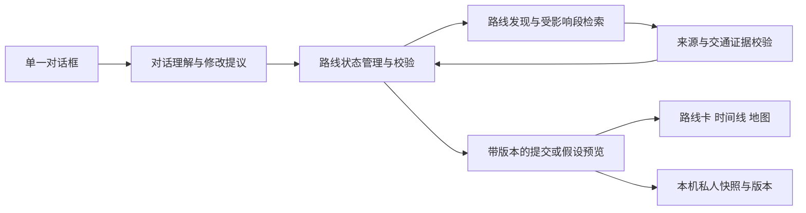

# MixTouring 路线发现与动态状态架构提案

日期：2026-10-14。审计基线：`8eb771dbfee55077a43025fe451351836cd250fd`，本地分支 `codex/ai-conversation`，规划器 v0.52.6。状态：研究提案，等待确认后实施；不是 Layla 内部架构的描述。

后续进展：用户已授权先完成对话与动态路线卡，v0.53.0 已实现结构化 route/cards、卡片局部渲染、可见候选顺序、假设预览采纳与双端展示，并完成本机回放。完整 TripState／领域事务与地理地图仍属于后续方案；实际交付和限制见根目录工作记录，不把本篇全部提案标为已实现。

v0.54.0 增量：当前会话实际增加 `requirements:{required_stops:string[],trip_days:number|null,verified_cross_border_only:boolean}`，模型通过 `requirements_patch:{add_stops?,remove_stops?,trip_days?,verified_cross_border_only?}` 更新；省略保留原值，预览暂存拟议要求，采纳时连同草案提交。独立意图识别、一次字段修复、逐日覆盖校对在原编排内增量实现；必经城市遗漏由代码拒绝。前端增加连续城市分组、逐段待核实交通、实际差异摘要和聊天版本卡，历史恢复复用任务快照并重查交通。这些是 MixTouring 自行采用的实现，不能据此推断 Layla 服务端。本轮 fetch 成功，HEAD 与上游0/0，研究初始审计时的联网失败仅为历史状态。

## 1. 现有项目审计

开工已尝试 `git fetch origin`：沙箱内无法写 FETCH_HEAD，宿主重试则连接 GitHub 443 超时，未完成远端同步／rebase。本轮只审计该本地 SHA，不声称覆盖最新远端。已通过 GitHub 连接器读取 [Issue #5 最新可取得评审](https://github.com/lucashuang-an/MixTouring/issues/5#issuecomment-6148128919)：单输入框与来源体验增量通过，广泛目的地事实质量仍待验收。未向 Issue 发布本轮提案。

### 1.1 技术栈与可复用能力

| 位置 | 当前实现与代码证据 | 本次决定 |
|---|---|---|
| `server/package.json`、`server/index.mjs` | Node ESM、Koa、静态页面与 API 同源；运行要求 Node ≥22.9 | 保留，不先迁移框架或微服务 |
| `server/lib/conversation.mjs` | `conversationTurn` 读取最近16条消息、brief、routing、条件、草案和候选；模型输出动作及字段补丁；另做日期与草案校对 | 复用上下文、模型出口与失败保留逻辑，逐步转向领域操作 |
| `server/lib/conversation-routing.mjs` | 旅行范围与交通端点分开；国家未选城市保持讨论态 | 保留；节点解析不再以意图摘要为查询词 |
| `server/lib/anywhere.mjs` | Place 解析／确认、硬约束清洗、候选骨架、逐段线索 | 保留；扩展“必须经过的节点”输入，不能只把伊宁写进正文 |
| `server/lib/route-discovery.mjs` | 组合来源内城市，逐段连接守门，地理合理性检查，五分钟缓存 | 复用；新增节点后仅重查相邻连接，变化需重新校准 |
| `server/lib/progressive.mjs`、`server/index.mjs` | 25秒共享规划预算、模型／搜索调用上限与取消；NDJSON 的 base／complete 是规划快照 | 保留传输；现有渐进快照不能冒称通用 State Patch |
| `pipeline/lib/geo-skill.mjs`、`derive.mjs` | 地理候选／估算，旧方案派生与四因子风险 | 直接复用，未知原始值不能借旧规则输出确定风险等级 |
| `server/lib/trip.mjs`、`transport-references.mjs` | 时区、方向、日期适用性、成本与证据门禁；交通资料分级 | 复用；现有 dated_verified 含成本完整条件，MVP 不为去掉价格而悄悄放宽它 |
| `server/lib/journey.mjs` | 服务端暂存 plan，30分钟 TTL、最多200条；详情从服务端候选重取，返程另建假设 | 保持客户端交通事实不受信任的边界；plan_id 不是永久行程 ID |
| `mixtouring-hifi/pages/trip.html` | 单输入框、确认生成、并列草案、比较／详情、撤销、保存；大量状态和请求调度在页内 | 渐进提取状态入口，不重建整个应用 |
| `assets/trip-guide.js`、`task-preview.js`、`sight-planner.js` | 排序／结构键、同一快照派生预览、景点日期与预算 | 复用纯函数与已有检查，统一接入状态提交 |
| `assets/draft-store.js` | localStorage `mt:drafts`、稳定 vid、失败／损坏隔离，旧版保留 | 沿用版本存储，不自动覆盖或删旧草案 |
| `trip.html` 的 `rememberSession` | sessionStorage `mt:planning-session` 保存讨论／草案及撤销快照 | 明确与私人长期保存分层，刷新恢复不自动生成 |
| `assets/api.js`、`mock.js` | 旧接口兼容、派生离线样本；mock 是生成文件 | 不改生成文件，不把历史国内票价填入新路线 |
| `colors_and_type.css`、`desktop.css` | 现有设计令牌和响应式布局 | 保留视觉和单输入框习惯 |

### 1.2 主要缺口

1. `brief` 每轮完整输出，结构字段只有有限补丁；`draft.sections` 是无稳定 ID 的文字块，修改仍要求完整重写并再由模型校对。容易出现正文与字段不一致。
2. `conversation.revision` 主要随草案改稿增加，尚非整个任务的乐观并发版本。字段、路线、景点与正文不能作为一个事务校验和提交。
3. `activePlan / activeCandidate / guideState / anchors / conversation / sights` 分散管理；现有序号取消保护有价值，但缺少跨发现／校对／详情请求的统一依赖版本。
4. 候选通过结构键保留选择，尚无稳定 RouteStop／TransportLeg 编辑实体；候选可能随渐进结果和 plan_id 更新。第几条必须绑定用户看到的列表快照。
5. 未发现已接入的地图 SDK、交互地图容器或节点双向选中链路。地理编码和坐标库已存在，不能把它们当作地图功能完成。
6. 预算字段缺少完整的范围与可验证口径；“10天”未统一区分旅行总天数、目的地游玩天数与晚数。跨境“必须核实”尚无独立硬约束与三态满足结果。
7. 私人保存包含结构快照和文字，但可编辑逐日路线的权威结构不完整。没有账号跨设备同步；内存 plan 丢失后需恢复与重新核验。

### 1.3 本轮基线验证

实际运行并通过：`check-conversation`、`check-progressive`、`check-drafts`（39项）、`check-anywhere`（225项及详情断言）、`check-pages`（8页）、`check-geo`。均为确定性／静态检查。本轮未运行真实模型四轮回放、运行服务 verify 或 MixTouring 双端浏览器验收；不把旧工作记录里的通过当成本轮结果。

## 2. 目标分工与数据流

采用一个 Koa 服务内的模块分工。Conversation Agent 是理解与提议层，不需要先建设多个自治 Agent。



| 模块 | 输入与输出 | 不承担的职责 |
|---|---|---|
| Conversation Agent | 最新用户原话、仍有效条件、近期消息、当前版、来源 → 动作、约束提议、领域操作、必要问题 | 不自行写已核事实，不输出 HTML，不依赖完整聊天重放保存硬约束 |
| Route Discovery Engine | 已解析端点、必须节点、允许方式、时间／成本偏好 → 少量实质不同候选及取舍依据 | 不保证候选数，不把地理连线当运营服务 |
| Route State Manager | 当前结构、带版本提议、服务端结果 → 原子提交／冲突／预览 | 不让模型和浏览器任意覆盖锚点或证据 |
| Dynamic Route UI | 同一提交版本的派生视图 → 卡片、地图、时间线及节点聚焦事件 | 不从聊天正文另解析一份路线，不以地图线条暗示班次存在 |

## 3. 建议 TypeScript 数据契约

以下是待实施合同，现有项目仍是 `.mjs`。先增加类型与运行时 schema，JS 经适配器使用，不要求全仓迁移 TypeScript。ID 是稳定的本地实体标识；地点权威 ID 与候选临时 ID 分开。

```typescript
type Id = string;
type ISODate = string; // 运行时严格校验 YYYY-MM-DD
type EvidenceState = 'explore' | 'historical' | 'dated_partial'
  | 'dated_verified' | 'stale' | 'unsupported';
type Check = 'met' | 'violated' | 'unknown';
type Mode = 'rail' | 'plane' | 'coach' | 'ferry' | 'unknown';
interface Provenance {
  messageIds: Id[];
  author: 'user' | 'accepted_suggestion';
}
interface Constraint<T> {
  id: Id;
  value: T;
  strength: 'hard' | 'soft';
  provenance: Provenance;
}
interface UserConstraints {
  partySize: Constraint<number> | null;
  duration: Constraint<{ days: number;
    scope: 'whole_trip' | 'destination_play' | 'unspecified' }> | null;
  budget: Constraint<{ currency: 'CNY'; amount: number;
    scope: 'whole_trip' | 'transport' | 'unspecified' }> | null;
  requiredPlaceIds: Constraint<Id[]> | null;
  noSelfDrive: Constraint<boolean> | null;
  crossBorderPolicy: Constraint<'exploration_allowed' | 'verified_only'> | null;
  interests: Constraint<string[]> | null;
  allowedModes: Constraint<Mode[]> | null;
  preferences: Record<string, Constraint<string | boolean | number | string[]>>;
}
interface Place {
  id: Id;
  name: string;
  country: string | null;
  kind: 'city' | 'airport' | 'station' | 'poi';
  coordinates: { lat: number; lon: number } | null;
  timezone: string | null;
  resolution: 'curated' | 'confirmed' | 'unresolved';
  sourceUrl: string | null;
}
interface SourceEvidence {
  id: Id;
  url: string;
  title: string;
  kind: 'official' | 'operator' | 'traveler' | 'other';
  publishedAt: string | null;
  sampledAt: string;
  validFor: { from: ISODate; to: ISODate } | null;
  claims: Array<'place' | 'connection' | 'dated_service' | 'duration'>;
  fromPlaceId: Id | null;
  toPlaceId: Id | null; // 有向支持，不能反转复用
  excerpt: string | null;
}
type DurationAssessment =
  | { kind: 'unknown'; missing: string[] }
  | { kind: 'estimate'; minMinutes: number; maxMinutes: number;
      method: string; sourceIds: Id[] }
  | { kind: 'sourced'; minutes: number; sourceIds: Id[] };
type CostAssessment =
  | { kind: 'unknown'; missing: string[] }
  | { kind: 'ordinal_estimate'; level: 'low' | 'medium' | 'high';
      scope: 'transport' | 'whole_trip'; rubricVersion: string;
      rationale: string; sourceIds: Id[] };
interface RouteStop {
  id: Id;
  routeId: Id;
  placeId: Id;
  role: 'origin' | 'stopover' | 'destination';
  locked: boolean; // 用户确认必经节点后锁定
  stay: { playDays: number | null; nights: number | null;
    date: ISODate | null; basis: 'user' | 'suggestion' };
}
interface TransportLeg {
  id: Id;
  routeId: Id;
  fromStopId: Id;
  toStopId: Id;
  direction: 'outbound' | 'inbound' | 'local';
  mode: Mode;
  border: 'cross_border' | 'domestic' | 'unknown';
  connectionEvidence: 'none' | 'source_lead' | 'supported';
  evidenceState: EvidenceState;
  sourceIds: Id[];
  date: ISODate | null;
  duration: DurationAssessment;
  cost: CostAssessment;
  feasibility: Check;
  gaps: string[];
}
interface Route {
  id: Id;
  revision: number;
  stopIds: Id[];
  legIds: Id[];
  selectionState: 'candidate' | 'selected' | 'archived';
  reasons: string[];
  tradeoffs: string[];
  constraintChecks: Array<{ constraintId: Id; result: Check; reasons: string[] }>;
}
interface ConversationState {
  id: Id;
  messageIds: Id[];
  summary: string; // 辅助理解，不能覆盖 constraints
  wishes: string[];
  openQuestions: string[];
  stage: 'discuss' | 'ready' | 'draft';
  routing: { originPlaceId: Id | null; destinationPlaceId: Id | null };
  lastDisplayedCandidates: { viewId: Id; routeIds: Id[] } | null;
}
interface TripState {
  schemaVersion: 1;
  id: Id; // 私人任务身份，非内存 plan_id
  version: number; // 每次已提交的结构变化均递增
  conversation: ConversationState;
  constraints: UserConstraints;
  places: Record<Id, Place>;
  stops: Record<Id, RouteStop>;
  legs: Record<Id, TransportLeg>;
  routes: Record<Id, Route>;
  selectedRouteId: Id | null;
  tripType: 'pending' | 'one_way' | 'round_trip';
  dateWindows: { outbound: [ISODate, ISODate] | null;
    arrival: [ISODate, ISODate] | null; inbound: [ISODate, ISODate] | null };
  anchors: Array<{ id: Id; direction: 'outbound' | 'inbound';
    from: { placeId: Id; date: ISODate; time: string | null;
      timezone: string | null };
    to: { placeId: Id; date: ISODate; time: string | null;
      timezone: string | null }; userLocked: true }>;
  lodgingStays: Array<{ date: ISODate; placeId: Id; nights: number | null }>;
  sources: Record<Id, SourceEvidence>;
  narrative: Array<{ id: Id; stopIds: Id[]; legIds: Id[]; text: string }>;
  validation: { status: Check; gaps: string[] };
}
type ConstraintChange = {
  [K in keyof UserConstraints]: { op: 'set_constraint'; key: K;
    value: UserConstraints[K] }
}[keyof UserConstraints];
type UserOp = ConstraintChange
  | { op: 'select_route'; routeId: Id; viewId: Id }
  | { op: 'insert_stop'; routeId: Id; afterStopId: Id; placeId: Id;
      requireVisit: boolean }
  | { op: 'remove_stop'; routeId: Id; stopId: Id }
  | { op: 'reorder_stops'; routeId: Id; stopIds: Id[] }
  | { op: 'set_stay'; stopId: Id; stay: RouteStop['stay'] }
  | { op: 'set_trip_type'; value: TripState['tripType'] }
  | { op: 'set_date_window'; direction: keyof TripState['dateWindows'];
      value: [ISODate, ISODate] | null }
  | { op: 'undo'; commitId: Id };
interface StatePatch {
  schemaVersion: 1;
  requestId: Id;
  sessionId: Id; // 临时服务端事务空间身份
  tripId: Id;
  baseVersion: number;
  intent: 'commit' | 'preview' | 'question';
  sourceMessageId: Id;
  operations: UserOp[];
}
type PatchResult =
  | { status: 'committed'; version: number; commitId: Id;
      changedEntityIds: Id[]; snapshot: TripState; explanation: string }
  | { status: 'preview'; proposalId: Id; baseVersion: number;
      proposed: TripState; changes: string[]; expiresAt: string }
  | { status: 'conflict'; code: 'stale_version' | 'constraint_conflict'
      | 'selection_changed' | 'needs_clarification'; reasons: string[] }
  | { status: 'unavailable'; retryable: boolean; reason: string };
```

消息正文、来源支持的数字事实与安排建议分开。Place 可跨候选共享，Stop／Leg 归属于一条路线，编辑副本不得污染其他候选；必经条件按 Place ID 检查，避免候选之间不同 Stop ID 使约束失效。TypeScript 不替代运行时 schema、来源校验或数值范围检查；外部输入拒绝额外字段。领域操作集先覆盖本次四轮案例，锚点和住宿编辑沿既有显式入口，后续再增加受控操作。

## 4. 状态协议与一致性

### 4.1 权限与提交

LLM 仅提出 UserOp。服务端核验 message 归属与操作范围、地点、候选、锁定节点、日期和既有约束后，才计算新段和派生结果；模型不得提交 `sourceIds / evidenceState / feasibility` 或 arbitrary JSON path。来源与候选由服务端登记，来源文本是数据，不可成为指令。

MVP 本机私人快照仍是持久权威。服务端增加临时事务空间保存已校验版本，只用于当前会话的原子比较和计算，不建立账号数据库。恢复时创建新 sessionId，导入用户意图／节点结构，交通证据按服务端可信来源重新获取；浏览器传来的“已核实”一律不采用。内存过期明确返回 restore_required，经恢复流程重建，不静默使用客户端事实。

每个提交遵循：校验 `baseVersion` → 应用到副本 → 计算影响依赖 → 必要检索／预算检查 → 校验结果 → 以比较并交换提交一次 → 返回同版 snapshot。失败不部分写入。requestId 在会话期内幂等；重复请求返回原结果。消息日志可记录失败，但不因此递增 Trip 结构版本。多标签页发现旧版本要提示重新载入，不静默覆盖私人存储。

首次确认生成、批量删除锁定城市、修改已定交通需要明确采纳；普通可逆的停留调整直接提交并可撤销，延续现有交互规则。`null` 表示明确清除，缺字段表示保留；不得因模型省略而清空字段。

### 4.2 修改依赖与失效

- 在 A→B 中插入伊宁：保留 A、B 与其他节点 ID；原 A→B 段退出当前路线，建立 A→伊宁、伊宁→B 的新 ID；旧段来源不移植到新段。重新查询受影响连接、跨境与时间预算，其余路线不重写。
- 缩短天数：重算可调整停留与取舍说明，不移动已定交通和用户锁定城市。剩余时间无法容纳或交通耗时未知时，分别标 violated／unknown，不宣称必能完成。
- 更改日期：相关日期班次、时刻与衔接结论失效，保留来源历史供解释；返程独立核验。用户只说天数时不自动填日历。
- 改变偏好：重排候选与推荐理由；不自动改变用户已选路线。生成补充候选时保留选择；列表第几条绑定 viewId 和当时顺序，有歧义才澄清。
- 提高跨境证据要求：保存硬约束，重算约束满足态；证据不足时路线可保存为探索，但不能成为满足该硬约束的可执行推荐。
- 每个异步发现／检索／校对结果带 sessionId、baseVersion、generationId 与受影响实体集合。旧任务取消，旧响应拒绝提交；不能只靠某一个页面请求序号处理所有链路。

### 4.3 假设、冲突与撤销

“如果我只有7天呢？”默认生成独立 preview，展示停留如何压缩、哪些体验减少、哪些交通仍未知。当前十天版不变；用户说“就按七天”才以仍匹配的 baseVersion 采纳。预览过期或当前版变化需重新校验。若明确说“改成七天”，直接按修改处理。

冲突返回受影响的约束 ID、原因与可选择的解法，保留原稿；不可自动删除必经伊宁、增加天数或降低核实要求。撤销恢复提交前结构，来源随时间重新判级，过期证据不因撤销恢复成新鲜。说明文本根据实际提交差异生成，不能只相信模型说“已保留”。

## 5. 交通与成本可信边界

`EvidenceState` 延续现有六态；`source_lead` 独立记录为连接线索，不混入“指定日期已核实”。地点坐标确认与交通可行性也完全分开。某段需要核对方向、方式、实际站点、日期、当地时刻／时区、来源时间与适用范围；跨境还要有边境／客运条件缺口说明。旅行者经验只支持体验，不能证明运营。

现有 `dated_verified` 还要求成本完整。MVP 不查实时价格，因此新增**交通核查维度**，按实际证据标记连接得到支持、指定日期运营资料得到支持或仍未知；不绕过原全程 dated_verified 门禁，不给可购票承诺。用户没有日期时，官方开航资料最多支持连接，不能满足“本次跨境交通已核实”。第四轮必须解释日期与班期缺口。

费用仅保留用户预算与有依据的相对成本等级。等级须有同范围的规则版本和解释，否则显示未知；不能据“巴士通常便宜”宣称总行程满足8000元。耗时用已支持数据或结构化估算区间，列出缺少的候车、口岸和接驳；不将大圆距离直接换算成巴士全程耗时。数字从结构化字段插值，非枚举的文案数值需要证据绑定。

## 6. 动态路线卡与地图

桌面保留讨论期居中单输入框；确认生成后左侧聊天、右侧当前路线／草案。右侧首先展示推荐和选择理由，比较其他走法按需展开，一个主保存动作。候选初次可展示一个推荐与至多两个实质备选；仅有一个或零个合格候选时诚实说明，不凑数。地图位于路线区并可折叠，避免把界面变成预订工作台。

卡片稳定挂载于 routeId／stopId／legId，仅更新受影响片段。聊天只说已提交的变化，草案正文保留稳定 section ID，关联受影响节点；没有结构变化的问答不重绘行程。更新保留输入焦点、展开状态与滚动位置；变化区域短暂提示并提供自然语言撤销。

地图初版建议采用 Leaflet 适配层，但依赖／版本和瓦片服务须在开发前核对官方文档、许可、访问稳定性与使用政策；本轮不安装。接口只接受已校验 Place 和路线结构：点卡片聚焦节点，点地图标记高亮对应卡片，跨候选切换同一 selectedRouteId。图层派生不维护另一份 Trip；缩放和高亮属于临时 UI 状态，不写进模型上下文。

城市连接线标为“路线示意，非实际交通轨迹”；未知交通段用虚线和文字状态，已核连接也不画成经过核实的道路几何。缺坐标的节点保留卡片并标定位待确认。地图／瓦片失败时显示节点列表，已有草案可阅读和保存。移动端使用聊天／路线／地图视图切换或抽屉，持续只有一个输入框；节点焦点可跨视图同步，触控目标与色彩沿现有设计令牌。

## 7. 接口演进与恢复

保留现有 `/api/anywhere/conversation`、`/plan`、`/journey`；通过显式新合同版本接入，不能将旧调用方自动切换。

建议新增事务入口（名称待实施确认）：

- `POST /api/trip-state/restore`：用户结构快照 → 校验后的 sessionId、TripState 与证据待复核清单。
- `POST /api/trip-state/turn`：版本、消息与当前候选 viewId → 理解结果及 PatchResult。
- `POST /api/trip-state/apply`：用户明确采纳的 proposalId、baseVersion → 提交结果。

继续用 NDJSON 承载阶段事件；阶段进度不可伪装为已提交修改。完整事务成功后才发送 committed，快照与 changedEntityIds 同版。MVP 先返回完整结构快照方便恢复，前端按 ID 局部更新；减少网络体积不优先于一致性。后续才考虑差量事件重连或更复杂日志。

旧草案加载经适配器生成新实体 ID；旧文字不能自动变成已核路线。无法确定的逐日活动保留 legacy narrative、标记待结构化，不猜日期。迁移新副本成功后才允许保存新版；原版 vid 和原文始终保留。存储拒写明确提示并保留内存态；新协议不写入旧 plans.json，未来策展库写入仍须沿三重守门。

## 8. 四轮案例的设计落点

| 用户轮次 | 状态与行为 | 必须保留／解释 |
|---|---|---|
| 北京→阿拉木图、10天、独行、8000、自然文化、巴士 | 先讨论与确认；确认后生成有依据的多候选；天数 scope 未明确时保持 unspecified，预算范围未定时不用于精确筛选 | 不自动写出发日期／返程，不宣称预算满足；图上只画示意 |
| 第二条加伊宁 | 按当时 viewId 选择并插入已解析伊宁，锁为用户要求节点；重建相邻段 | 保留端点、人数、天数、预算、兴趣和允许巴士；缺连接显示探索／冲突 |
| 如果只有7天 | 建立假设分支，压缩可调整停留并解释取舍；明确采纳后提交 | 北京、伊宁、阿拉木图与其他已确认城市不静默删除；未知交通导致时间可行性未知 |
| 跨境必须核实 | crossBorderPolicy=verified_only，检查选中路线各跨境段 | 缺日期／来源就标未满足；提供逐段核查入口或合格备选；不虚构班次和预订 |

原北京⇄阿拉木图、2026国庆样本继续用于历史回归。现在已是2026-10-14，真实前瞻班次核验需用户新的未来日期；不能默默把本轮无日期的十天任务绑定到过去国庆。
