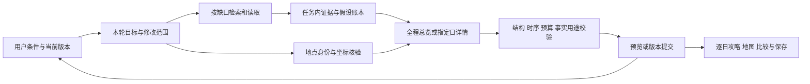

# 旅行 Agent 竞品评测与案例档案

更新日期：2026-10-28（北京时间）。本文统一保存小红书点点、Layla 及其他产品的历史研究；区分真实操作、历史公开资料、实现推测与 MixTouring 建议。**工程审查见第11节，论文与项目对照见第12节，初始真实回放见第13节，修复验收见第14节，火山搜索实测见第15节，开源资料选型见第16节，基础攻略优化见第17节，harness复盘见第18节，已确认详情样式下的机制优化见第19节**；第1—10节的竞品评测归档于2026-10-25。

> 已完成小红书新会话9轮输入（含一次深化按钮触发）及同浏览器刷新；成功生成十天V0，七天假设没有覆盖它，但跨境核实两次未完成，局部修正也未形成新版。历史记录不是当前功能保证；网页搜索提示、地图连线和流畅表述均不等于交通或价格已核实。

**研究结论**：小红书本例在需求收敛、路线/逐日呈现、按日攻略与假设讨论上值得借鉴；关键缺口是路线改变后预算未同步、详细时刻相互冲突，以及后续核实/修正只返回拟执行参数。Layla历史样本具有行程工作台与版本能力，但假设直接改稿、未定日期被补齐、排除酒店失效。两者均不能从“已生成”直接推导旅行可执行性。MixTouring需要同时保证有价值的探索与可验证的状态/结论，不以堆来源或泛化免责声明代替规划。

## 1. 口径与案例目录

- **直接观察**：正常 UI 实际输入、页面回复、交互与产出；仅代表这次样本。
- **历史记录**：注明原测试日期及来源；本轮未重新运行的内容不称当前实测。
- **推测**：提出可解释行为的 Agent 逻辑，同时列替代解释和验证方法；不声称取得服务端代码、提示词或模型调用轨迹。
- **建议**：对 MixTouring 的独立判断，不反推为竞品事实。
- 评测输入是合成旅行需求；不写入长期个人偏好。公开仓库不保存账号资料、私有会话 URL、访问查询令牌或原始网页快照。

| 案例 | 原研究日期 | 证据类型 | 本轮状态 |
|---|---|---|---|
| XHS-ALMATY：北京→阿拉木图，模糊需求到方案修改 | 2026-10-25 | 新会话真实桌面操作 | 完成9轮＋刷新；成功与失败分项记录 |
| XHS-SEA：越南＋印尼十五天 | 2026-10-25 | 用户已有对话只读研究；详细页抽查 | 已汇编 |
| LAYLA-ALMATY：十天生成、七天改稿、跨境核实 | 2026-10-14 | 历史登录态真实操作记录 | 归档，不重跑 |
| Google、Mindtrip、Wanderlog、携程/TripGenie、飞猪、Rome2Rio、Kiwi、TripIt、Caravanistan | 2026-10-12 | 历史公开产品资料研究 | 归档，不升级为账号实测 |

## 2. XHS-ALMATY：测试设计

从“想从北京去阿拉木图玩一趟，还没想好怎么走，你帮我看看？”开始；逐轮测试需求澄清、直飞与新疆沿途比较、明确生成、假设修改、跨境证据追问、局部纠正及刷新恢复。后续输入视实际回复调整，原样记录已提交的内容。没有把过去的2026国庆场景当成未来旅行；本例明确日期未定。

对照口径：与 Layla 的北京→阿拉木图十天、独行、8000元、自然文化、不要酒店/预订场景部分重叠；首轮模糊程度、测试日期、账号和产品版本不同，因此只比较具体行为，不计算性能排名或因果优劣。

## 3. 本轮逐轮记录与产出

### 3.1 条件和路线的演进

本次从普通点点新会话输入开始，未手动启用旅行按钮；回复后输入区出现“做旅游攻略”技能标记。X1同时给出目的地介绍与两步问卷，第一步是3/5/7天/还没想好/手动输入。测试未逐项点击问卷，改用主输入框一次补充条件。

| 轮次 | 实际输入/操作 | 直接观察 |
|---|---|---|
| X1 模糊入口 | 想从北京去阿拉木图玩一趟，还没想好怎么走，你帮我看看？ | “搜索并总结15人真实经验”；简介中给直飞约5小时与常见3—5天玩法，再要求确认两个关键信息。此时没有擅自生成具体日期或十天行程。 |
| X2 条件与比较 | 大约10天，一个人，预算8000元，希望看自然和当地文化。日期还没定，先比较北京直飞和经新疆沿途玩再过去的走法，不要酒店或预订。 | 给伊宁3天＋阿拉木图7天和阿拉木图深度自然线两类路线，带主题/理由/星级热度；凭200元跨境大巴推荐伊犁跨境线，未算北京往返完整链路。 |
| X3 完整口径 | 先不要生成行程。10天包含从北京出发和回到北京，8000元也包含全部往返交通。我不会自驾。请把两种走法的完整去返链路、交通占用天数、预算构成和仍未知的项放在一起比较，不能只凭200元跨境大巴判断哪条更便宜。 | 遵守“不生成”，以45篇参考展示去返、预算和未知项；直飞交通约2天、陆路约4天；改荐直飞更稳。仍有无指定日期的票价区间和原路返程大巴估计，不能作为当期报价/运营核实。 |
| X4 明确选路与生成 | 我还是想顺路玩伊宁。选北京→伊宁→阿拉木图→北京：去程经伊宁陆路跨境，回程飞北京。请生成一份可继续修改的10天每日详细攻略，10天含往返，预算8000元，不自驾，不推荐酒店和预订，日期继续保持未定。跨境交通没核实的地方请留待确认。 | 生成的是路线概览，尚未生成独立详细文档；保留伊宁3天、阿拉木图7天及回程航班。跨境大巴和返程航班明说估算/占位；预算却继续引用北京—伊宁机票往返＋大巴往返，和新路线冲突。 |
| X5 深化入口 | 点击“基于当前路线概览，生成每日详细行程”，自动发送“基于当前路线概览，生成每日详细行程安排” | 按钮disabled，出现思考/检索过程；可见主题包括伊宁市区、赛里木湖公共交通、跨境巴士、阿拉木图市区、双湖一峡、徒步缆车、纪念品及博物馆/剧院。具体调用次数和读取成功情况未知。 |
| X6 假设修改 | 如果我只有7天呢？ | 聊天给七天压缩版、解释赛湖/徒步的删减，并询问是否生成；右侧十天V0保持原样，没有自动采纳假设。费用仍沿用错误的经伊宁往返预算。七天安排伊宁Day1—2，但预算仅算伊宁1晚，少算1晚。 |
| X7 证据追问 | 先保留右侧10天攻略，不采用7天。现在只核实伊宁→阿拉木图的跨境交通：请给出你实际查到的来源链接、原文发布日期、发车时刻的时区和适用日期，并区分官方运营资料与游客经历。出行日期仍未定，不能核实就明确说未核实，不要用反向班车或往年经验证明本次可乘。 | 未给核实结果，只显示“咨询/核实类请求”“只做搜索和核验，不生成或修改文件”等计划说明和三组查询参数；没有来源链接、发布日期、时区与适用日期。此轮不记搜索成功或结论已核实。 |
| X8 失败恢复 | 你上一条只显示了准备搜索的说明和三组查询参数，没有核实结果。请继续完成这次核实；若搜索或读取失败，请直接说明失败，不要把拟搜索的内容当成已经查证。右侧10天攻略仍不要修改。 | 自述上一条“没有真正执行”，然后再次显示相同查询参数，仍无结果。模型自述不是服务端调用证据；只能判定两次可见回答未完成目标。右侧十天V0未改。 |
| X9 明确局部修正 | 要求保持十天、城市与游玩顺序，只修正三段单程预算、赛湖时序、跨境未核实时区及第十天抵京条件；完整原话见附录。 | 回复“先盘点当前文件，读取攻略和概览基线，再…低影响修正”，随后仅显示`travel_doc_v*.json`与`daily_overview_v*.json`及会话目录文本，没有修正结果或V1。不能把拟读取文件参数当作读盘或保存成功。 |
| X10 恢复验证（无新提问） | 刷新同一标签页，再点“打开” | URL相同，九轮消息和失败回复保留；标题变为“北京赴阿拉木图十日游规划”，十天V0重新打开成功，原双向预算错误仍在。文档面板不会自动保持打开；未测跨设备、独立版本恢复、导出或分享。 |

### 3.2 十天概览的实际内容

| 天 | 位置与体验 | 交通与限制 |
|---|---|---|
| 1 | 北京→伊宁，六星街、手工冰淇淋、烤肉 | 飞行约5小时，假设上午飞/午后落地。 |
| 2 | 喀赞其、伊犁老城、伊犁河日落 | 未安排自驾。 |
| 3 | 赛里木湖、果子沟大桥 | “乘车”，具体无车衔接待补；描述“天山秋色”，用户未提供季节。 |
| 4 | 伊宁→阿拉木图跨境大巴 | 约9小时、经霍尔果斯，正文写上午出发/傍晚抵达；待办承认班次、过关耗时、能否当天到均未核实。 |
| 5 | 升天大教堂、潘菲洛夫公园、绿巴扎、科克托别山 | 市区文化。 |
| 6 | 恰伦大峡谷、科尔赛湖、卡因迪湖 | 两湖一峡谷一日团；是否能承受强度未先询问。 |
| 7 | 大阿拉木图湖管道徒步 | 打车到起点、徒步、原路下撤。 |
| 8 | 琼布拉克雪山缆车 | 三段缆车、3200米描述；精确数字未逐项展示支持。 |
| 9 | 中央国家博物馆、阿尔巴特、芭蕾/歌剧 | 演出日期/场次未定。 |
| 10 | 阿拉木图→北京 | 写傍晚赴机场/夜航返回，未证明第10天可抵北京。 |

日期用Day序号，没有观察到自动补日历日期；没有推荐具体酒店，但仍给“提前1—2天预订”建议。用户排除酒店/预订不等于排除食宿预算，正常列住宿成本不单独判为违反；这里区分“成本估算”“住宿区域”“具体酒店推荐”“预订引导”。

X3展示的数字原样口径：直飞机票约2700—3500元、北京—伊宁往返直飞约4000—5000元/中转约2800—3800元、跨境大巴往返约400元；陆路合计约3200—5400元；一日团约263元、赛里木湖约145元。它自己列日期会显著改变结论，但仍给“直飞通常更省预算”的泛化判断。这些是被测答案，不是研究者核实的旅行事实。X4随后沿用该双向陆路成本，构成明确的版本间口径漂移。

### 3.3 详细攻略的实际检查范围与问题

独立攻略名“伊宁阿拉木图10日精华游 V0”，界面创建时间2026-10-25 16:36。已保存完整总览及Day1、Day3、Day4、Day10可见正文；其他逐日页没有全量核验，不把抽查冒充全篇审计。正文的参考笔记是可点击链接，来源标题在附录保留，访问令牌不入库；未逐篇打开这些笔记核验数字和日期，因此不判“引用支持已通过”。

- **Day1**：六星街18:00—21:00、晚餐20:00—21:30，有活动时间重叠；介绍手风琴馆与“800多架”数字，附两条体验笔记。航班Tips继续列北京—伊宁往返价格，与单向去程冲突。住宿仅给六星街区域并明确不推荐具体酒店。
- **Day3**：伊宁→赛湖09:00—12:00；湖内12:00—17:00；返程卡17:00—20:00，正文却称18—19点发车、单程3小时，晚餐20:00—21:30，无法同时满足。给往返98元/单程49元、一日团198元、联票约129元/区间车15分钟一趟等细节，附参考笔记；日期适用性未核实。
- **Day4**：跨境卡09:00—20:00，Tips列9:30/10:00/10:30三班、约200元、小程序购票及纸票，同时写班次/能否当日到待确认；20:00入住、20:30晚餐仍按固定到达编排。该页未见逐条来源入口，时间未注明两地时区。
- **Day10**：上午买特产、午后机场、夜航约5小时；航班待确认。没有抵京日期/时刻，无法证明第十天到家。特产价格附两条笔记，不能代替航班核实。
- **版本不一致**：概览阶段写Day3果子沟大桥，详细总览未再提；大巴耗时概览约9小时/待办8—10小时，详细版改9—11小时。数字变化可能来自新资料或不同估算，但界面未解释变化依据。

七天聊天方案原顺序：Day1北京→伊宁/六星街，Day2喀赞其/伊犁河，Day3跨境，Day4阿拉木图市区，Day5双湖一峡，Day6琼布拉克或大阿拉木图湖二选一，Day7返京。它建议删赛湖并解释车程和体力代价，具有取舍价值；仅为聊天预览，未生成七天独立文档。

核实请求两轮可见的查询文本相同：`10 ["伊犁州汽车客运总站 阿拉木图 国际班车 班次 时刻表 官方"] ["web"]`、`10 ["伊宁 阿拉木图 国际客运班车 发车时间 2026 班次"] ["web"]`、`10 ["霍尔果斯口岸 国际班车 阿拉木图 时刻表 官方"] ["web"]`。它看似搜索调用参数，但本轮没有网络轨迹，不能判断是工具未调用、协议解析失败、生成降级还是界面渲染问题。

## 4. XHS-SEA：已有越南＋印尼案例

### 4.1 输入、回复与产物演进

来源：用户授权读取的已有对话，标题“15 天越南印尼小环线行程攻略”；文档“越南印尼15日精华游 V0”，界面创建时间2026-10-25 15:49。只读研究，没有继续向该旧对话提交问题。完整读取聊天和总览，详细页抽查Day1、Day11、Day13；其余详细分页未逐页核验。

| 轮次 | 用户原话 | 回复与产出记录 |
|---|---|---|
| S1 | 东南亚小环线 | 以30篇小红书/全网参考解释陆路环线，给越柬老、老泰柬越、加马新、海岛向四种方向；列历史花费和签证数字；询问天数、预算、出发城市。 |
| S2 | 去过泰国和马来了，我只规划大概半个月时间，预算1W | 给五条路线：越柬老、越柬印尼、越南纵贯、印尼深度、越柬菲律宾；每条列城市/天数、主题、理由、星级“小红书热度”。推荐越柬老，提供“直接选择”“自己挑选地点”入口。没有先补出发城市或预算范围。 |
| S3 | 你的地图调用了什么API | 回复称内部实现细节不透露，引导回到选路线。不能由拒答推定具体地图供应商。 |
| S4 | 可以，越南和印尼吧，不要柬埔寨了 | 保留15天与1万元方向，改为越南7天＋印尼8天；给五城市链、地图与Day1—15概览；说明大交通仅有方式/大致时长，班次待确认，询问是否细化。 |
| S5 | 基于当前路线概览，生成每日详细行程安排 | 页面报“遇到点小问题，请稍后重试”。没有把该轮记为生成成功。 |
| S6 | 重试 | 出现可打开的独立攻略“越南印尼15日精华游 V0”；右侧文档含行程概览、Day1—Day15标签、地图、可编辑正文、图片、复制与分享入口。未测试保存事务、版本恢复或分享结果。 |

S2五条方案的原始结构：越柬老为河内/岘港/胡志明/暹粒/琅勃拉邦各3天；越柬印尼为河内2、胡志明2、暹粒3、巴厘岛5、日惹3；越南纵贯为河内/岘港/芽庄/大叻/胡志明各3；印尼深度为巴厘岛6、佩尼达2、泗水4、日惹3；越柬菲律宾为胡志明2、暹粒3、宿务4、薄荷3、锡基霍尔3。

### 4.2 最终十五天产出细节

| 天 | 地点与内容 | 交通/时间信息 |
|---|---|---|
| 1 | 河内：还剑湖、三十六行街、火车街、河粉 | 假设午后落地；详细页14:00—16:00还剑湖、16:00—18:00行街、18:00—19:30火车街、19:30—21:00晚餐、21:00起住宿；住宿推荐还剑湖老城区，说明区域理由。 |
| 2 | 文庙、巴亭广场、越南国家美术馆、水上木偶戏 | 上午/午后/晚上分配。 |
| 3 | 河内→岘港，美溪沙滩、龙桥喷火 | 标飞行约1.5小时，未绑定具体日期或班次。 |
| 4 | 巴拿山佛手桥、美溪沙滩 | 上午/午后安排。 |
| 5 | 山茶半岛、会安古镇灯笼夜 | 未在概览中计算区域间接驳耗时。 |
| 6 | 岘港→胡志明，粉红教堂、中央邮局、范五老街 | 标飞行约1.5小时。 |
| 7 | 战争遗迹博物馆、统一宫、咖啡公寓、滨城市场 | 城市人文。 |
| 8 | 胡志明→巴厘岛，库塔海滩、烧烤 | 标飞行约3小时，假设午后落地。 |
| 9 | 乌布皇宫/市集、圣猴森林/稻田、SPA | 未在概览明确住宿是否随区域迁移。 |
| 10 | 佩尼达岛、精灵坠崖、天神浴池、破碎沙滩 | 上午乘船，傍晚回岛。 |
| 11 | 海神庙、库塔冲浪、金巴兰海滩 | 标题“海神庙日落”，总览却写“上午看海神庙潮汐与日落”；详细页海神庙10:00—13:00、冲浪15:00—17:30、金巴兰17:30—19:30、晚餐19:30—20:30。冲浪Tips给约80元/小时。 |
| 12 | 巴厘岛→日惹，马里奥波罗大街、夜市 | 标飞行约1.5小时。 |
| 13 | 婆罗浮屠、默拉皮火山 | 详细页05:30—09:00日出登顶、09:00—10:00早餐、10:30—14:00火山、14:00—15:00午餐、18:00—19:30晚餐。给普通票约455k印尼盾、日出另加约200k、包车约300k/车、提前约3天预约；抽查页未显示逐项来源或适用日期。 |
| 14 | 苏丹皇宫、水宫、普兰巴南日落 | 上午/下午/晚上分配。 |
| 15 | 日惹市区买伴手礼、机场返程 | 未明确回哪个城市、航班及是否能当天返回。 |

总览待办包括六段大交通待确认、婆罗浮屠登顶/日出票、佩尼达一日游、追海豚预约、支付与特产。追海豚未进入所见逐日总览。支付说明既写越南/印尼多处需现金，也写印尼“大部分可支付宝扫码，汇率更好”；本轮未核实这些泛化结论，不作为当前旅行建议。

### 4.3 来源与质量观察

S1参考入口可展开查询、标题、日期及来源抽屉；查询包括“东南亚小环线 路线 攻略”“东南亚小环线 怎么玩”。30条展示中混有不同出行天数、不同交通方式、重复/近似重复条目、跟团线路、邮轮产品和东南亚世界遗产课件。这说明首轮候选集合较宽，不能证明后续最终回答使用了每条候选，也不能证明后续没有再次检索。

具体问题：S2一边写“飞暹粒”一边称“全程陆路”；“再搭中老铁路到琅勃拉邦”省略前一城市至铁路接入点的链路；1万元“够用”缺出发地、国际往返与消费标准；星级热度的计算依据未显示；Day11标题、概览、详细页不一致；精确的时刻表和活动价格缺逐项可见支持。可取之处是自然语言选路、逐层展开、按日文档、图片/Tips与住宿区域理由，以及失败后通过“重试”生成成功的真实恢复路径。

本节为对话及产出结构的详细复述，不是所有攻略分页或所有来源正文的完整转录。原会话私有标识不进入仓库。

## 5. 历史公开资料研究

以下为2026-10-12研究的历史摘录，本轮未访问或重新核实链接，表中的当前指原调研日期。未保存这些产品的账号内对话，因此不补造会话。

### 2. 竞争格局：哪些能力已经普及

| 对照产品／类别 | 本次核实的公开能力与时间口径 | 对 MixTouring 的启示（判断） |
|---|---|---|
| Google AI Mode / Canvas | 2026-01-14 官方说明覆盖定制行程、追问修改、图片灵感、保存分享；2026-08-27 又介绍价格追踪及预订能力。地区和实验资格依公告而异。[Canvas](https://blog.google/products-and-platforms/products/search/tips-prompts-ai-mode-canvas-travel-planning/)、[旅行更新](https://blog.google/products-and-platforms/products/search/book-travel-ai-mode/) | 通用对话、生成与持续编辑已是强基线；单纯升级聊天界面容易被覆盖。 |
| Mindtrip | 当前官方 FAQ 覆盖社交／文章／视频灵感收集、灵活行程、共同规划、地图、预订；首页明确提出记住旅行风格。[官方 FAQ](https://resources.mindtrip.ai/travelers/help/traveler-faqs)、[产品页](https://mindtrip.ai/) | 偏好记忆、灵感导入与地图本身不足以形成独占卖点。 |
| Wanderlog | 官方产品页列出行程组织、AI 助手、预订导入、协作与路线优化；2023 年帮助文档将优化描述为单日顺序调整。[产品页](https://wanderlog.com/plan-a-trip)、[优化帮助](https://help.wanderlog.com/hc/en-us/articles/13545624787867-Optimize-route) | 完整行程工作台已有成熟产品。旧帮助文档不能证明其最新 AI 无法处理其他约束，需实测比较。 |
| 携程 AI 行程助手 / TripGenie | 当前官方页介绍规划至预订、地图拖拽、交通及开放资料核验和人工定制支持；TripGenie 提供旅行问答与个性化行程。[携程](https://www.ctrip.com/tripplanner)、[TripGenie](https://www.trip.com/tripgenie/) | 国内用户已有中文和供给优势明显的替代品；“中文 AI 旅行助手”“有来源”均不能单独构成定位。 |
| 飞猪 AskMe | 2025-04-17 飞猪发布稿介绍多代理规划、实时供给、预算调整、地图和预订链接。当时发布范围有限，本次未核实最新账号开放范围。[飞猪发布稿](https://www.prnewswire.com/apac/news-releases/fliggy-launches-ai-travel-assistant-askme-to-make-customized-travel-even-more-accessible-302431294.html) | 更复杂的 AI 编排技术属于实现手段；面向用户仍须证明决策结果有价值。 |
| Rome2Rio | 2025-12-05 官方 Trip Planner 说明支持多城市、逐段交通方式比较、换方式、排序、保存及分享；报价仍可能是估算。[官方功能说明](https://www.rome2rio.com/blog/2025/12/05/how-to-use-rome2rio-trip-planner/) | 早期“多式联运组合处是空白”的判断不成立。需要验证我们能否在旅行体验与取舍层面做得更好。 |
| Kiwi.com / Nomad | 当前帮助页说明可输入多个目的地及停留偏好，计算多城组合。[官方介绍](https://www.kiwi.com/us/cheap-flights/travel-hacks/) | 多城顺序优化和拼接低价已有竞争，全面实时最低价还要求持续供给与售后能力。 |
| TripIt Pro | 当前官方页列出航班状态、风险提醒、备选航班等旅中功能。[官方功能页](https://www.tripit.com/web/pro) | 自动提醒、异常应对属于成熟独立赛道，早期全面进入会增加运维与服务负担。 |
| Caravanistan | 中亚专题旅行指南、论坛和定制服务已经形成区域内容产品。[介绍](https://caravanistan.com/about/)、[吉尔吉斯斯坦指南](https://caravanistan.com/kyrgyzstan/)、[论坛](https://caravanistan.com/forum/index.php) | 区域专业知识已有强替代；中文表达加 AI 摘要的优势有限，需要证明能减少用户的实际取舍工作。 |

上述比较支持的结论是：**AI 规划基础能力趋于普及；差异化需要用特定旅行任务的完成效果证明。** 它不支持“其他产品都不会比较取舍”或“市场已存在无人服务的空白”。


## 6. 跨产品对照与 Agent 处理逻辑推测

### 6.1 当前证据支持的对照

以下比较小红书2026-10-25样本与Layla2026-10-14历史样本，不是同日、同账号或同模型的受控实验。

| 维度 | 小红书点点本例 | Layla历史实测 | 对MixTouring的启示 |
|---|---|---|---|
| 模糊入口 | 简介＋两步问卷，允许主输入框直接补条件；旅行技能标记自动出现 | 需求复述与右侧五项清单 | 澄清服务于决策，不应成为先填满所有字段的阻碍。 |
| 路线比较 | 两条城市/景点路线与理由；完整往返须追问后才补 | 直飞/陆路/混合三类文字比较，未见对应结构卡 | 城市链和交通策略应放在同一比较口径，预算与往返范围先讲清。 |
| 用户改变路线 | 接受经伊宁去、航班回，但价格段沿用旧双向路线 | 加入伊宁后生成对象，部分文字与交通卡不一致 | 共享路线身份仍需逐段预算、方向和叙述一致性校验。 |
| 未定日期 | 用Day序号，本例未见擅自生成日历日期；偶有“秋色”季节假设 | 自动填5月1—10日，未说明占位 | 允许无日期探索，季节判断也应标假设。 |
| 不要酒店/预订 | 详细攻略无具体酒店，保留住宿区域；部分票务预订建议仍出现 | 两次排除酒店后仍生成两家酒店与供给 | 区分住宿成本、区域建议、具体酒店与交易入口。 |
| 七天假设 | 聊天压缩方案＋取舍＋是否生成，十天V0保持 | 直接变七天，保留旧十天版本入口 | 本例小红书较好地区分讨论与提交，不能外推所有场景。 |
| 跨境核实 | 两次仅显示查询计划/参数，无结果 | 自称官方信息但未提供对应链接、日期与适用性 | 计划、执行、读到资料、结论支持须有独立状态。 |
| 持久文档 | 十天V0、总览/日页、可编辑正文、地图、图片与参考笔记 | 城市链/交通/住宿/体验及旧版本 | 对话能持续修改可保存的行程成果是基础体验。 |
| 刷新与正式局部修改 | 同URL恢复九轮消息及十天V0；明确局部修正未形成新版，旧预算仍在 | 七天内容、原预算消息和十天入口同浏览器刷新保留 | 不从同浏览器恢复直接推断云存储、事务或跨设备能力。 |

### 6.2 小红书可能的处理阶段

这是行为解释模型，置信度只针对解释是否贴合本样本，不代表知道其内部实现。

| 阶段推测 | 支持它的直接观察 | 替代解释/限制 | 后续可验证办法 |
|---|---|---|---|
| 入口识别旅行意图并进入旅行工作流 | 普通新会话提交旅行需求后出现“做旅游攻略”标记和旅行问卷 | 可能是规则路由、单模型分类或页面已有模式；不能确定独立意图Agent | 用旅行/非旅行/混合意图小样本对照，记录模式标记。 |
| 对话条件与候选方案分层 | 条件追问后给路线表，用户明确选择后才生成概览 | 可由整段会话重放和模板生成，无须结构化槽位服务 | 逐次撤回预算/日期/地点，检查冲突与保留；需合法运行证据才能确认状态协议。 |
| 检索随任务细化 | 比较阶段搜机票/交通；生成详细攻略时出现逐地点/交通/体验主题检索 | 多个查询可来自一次批量规划，不证明多Agent，也未取得真实调用计数/全文读取情况 | 对齐用户轮次、检索UI、结果和最终引用；不能仅数来源标题。 |
| 概览与详细文档是不同生成阶段 | X4只出概览；点击深化后新检索并创建V0、按日文档 | 可能是工具渲染，也可能单模型输出不同JSON模板 | 对比同一概览重复深化的差异、失败恢复和版本身份。 |
| 城市、日、活动、地点、引用可被结构化渲染 | 城市停留、Day标签、地图点、活动时间和参考笔记具有稳定的视觉层级 | 内部也可保存Markdown并解析；不能确定字段、稳定ID或数据库表 | 观察局部编辑、复制导出与刷新后的对应关系；不猜私有schema。 |
| 假设分支没有立即提交文档 | X6给聊天方案，右侧仍十天V0，询问是否生成 | 可能只是“如果”提示触发的回复风格，没有专用预览事务 | 用多种假设表达、明确采纳、撤销做对照。 |
| 成本与行程可能没有统一依赖重算 | 改为单向混合路线后，预算段多轮仍沿用旧往返 | 也可能是模型复制上下文，单次生成疏漏或合成后未校验 | 修一条交通腿后逐个检查总览、日页、费用、返程与恢复版。 |
| 咨询/核实路径可能与文档生成路径分流 | X7明确自述不改文件，输出查询参数；X8重复相同失败 | 自述和文本不是内部路由证据；可能是工具协议或前端显示故障 | 只记本例目标未完成；若有授权的请求/响应轨迹，再定位失败边界。 |
| 文档更新路径可能先读取概览/详细稿基线，再生成新版本 | X9显示`travel_doc_v*.json`与`daily_overview_v*.json`及按会话分区的目录文本 | 只是被输出的文本，文件是否存在、是否实际读取均未验证，不能据此确认文件存储或工作区Agent实现 | 若后续合法得到调用轨迹，再对齐读取成功、修订产物和版本提交；本例只判可见更新失败。 |

可供MixTouring自行采用的阶段关系：需求澄清→少量实质不同的走法→用户选路→路线概览→详细攻略→假设讨论/明确修改→版本保存与恢复。检索、数字与证据检查贯穿阶段，不能等长文写完后仅追加“请核实”。这是一套建议流程，不宣称小红书或Layla按同一架构实现。

### 6.3 建议转成验收的具体行为

1. 同一句“北京去阿拉木图”先产出值得讨论的方向，不强造日期、路线或最低价。
2. 北京→伊宁→阿拉木图→北京与双向经伊宁是不同交通集合；任何路线改变都使相关预算与方向证据重新对齐。
3. 天数是从出发到抵返，跨境时差、夜航抵达及接驳未知时不得宣布全程满足。
4. “如果七天”先给差异与取舍；采纳后再提交新版本。明确修正应实际改到文档，不能只在聊天说已改。
5. 体验可以用个人记录提供探索价值；当期班次、票价和开放结论分别需要日期、方向、对象及原文支持。
6. 工具计划、已发起、返回、读取、筛选和结论支持分开；参数文本暴露不等于工具执行，恢复也不能用自述冒充成功。
7. 总览与逐日页的时刻、费用、地点、版本保持一致；不仅校验每句话单独有没有来源。

这些为研究输入，尚未修改产品范围、根目录v1.2决策或业务代码，不自动转成已承诺开发卡。

## 7. 历史 Layla 原报告

下节并入2026-10-14原研究全文，保留原证据与失败路径；其中“当前”“本机”等表述均以原研究日期理解。

<!-- LAYLA_ARCHIVE_START -->
### Layla 研究与 REA 环境核对

研究日期：2026-10-14（北京时间）。状态：已补用户手动登录后的真实界面体验，完成需求讨论、路线比较、生成、七天改稿、跨境核实追问、地图展开与同浏览器刷新恢复。地图标记与卡片双向联动尚未完成可靠验证；没有观察服务端实现。

#### 1. 结论与证据口径

Layla 值得借鉴的是把对话与可编辑的旅行对象放在同一工作流中。公开资料不足以证明它采用某种 Agent 框架、状态补丁、数据库或特定模型。MixTouring 应独立设计状态协议，把路线发现、取舍和证据边界作为核心。

全文使用三类标签：

- **观察**：本次实际读取的网页内容、命令结果、仓库代码或操作结果。官网声明被观察到，不代表声明中的功能已实测。
- **推断**：与界面行为相容的解释，必须列出替代解释与验证方法。
- **建议**：MixTouring 自行采用的产品或架构设计，不归因于 Layla。

本次没有获取 Layla 的私有服务端代码、认证凭据或其他用户数据，没有操作预订、支付或联系真人顾问。初次 REA 使用临时无登录浏览器；后续由用户手动登录后，按授权使用内置浏览器进行真实体验。没有读取或复制登录凭据，没有修改原有行程，只创建并调整本次测试行程。初次采集包含公开页面与网络元数据；后续登录态测试只使用正常 UI，没有取得真实聊天请求载荷，不能给出所谓 Layla 内部 JSON。账号姓名、测试行程私有 URL、会话查询值不进入报告或仓库。

#### 2. REA 官方能力与本机状态

##### 2.1 官方核对

**观察｜官方文档**：[README](https://github.com/morluto/rea/blob/main/README.md) 提供 `npx rea-agents setup`，列出 Codex 与网站分析。当前 Node 要求为 `^22.19.0 || ^24.11.0 || >=26.0.0`。本机 npm 官方包查询得到发布版 **6.5.0**，不是安装文档历史检查点中的 6.4.0。

**观察｜安装机制**：[安装文档](https://github.com/morluto/rea/blob/main/docs/installation.md) 提供限定客户端、只读预览、备份与版本固定机制。Windows 的包运行器注册通过 `cmd.exe /d /c` 启动；不需要为此次 Web 研究安装 Hopper、Ghidra 或 Java。文档支持 Windows 配置，但这不等于本机浏览器分析已通过验收。

**观察｜Codex 接入**：[REA 客户端文档](https://github.com/morluto/rea/blob/main/docs/client-configuration.md) 说明 Codex 使用 `CODEX_HOME` 或默认 `.codex`；[OpenAI MCP 文档](https://developers.openai.com/codex/mcp) 说明 MCP 的配置方式。判断兼容性分三层：Node 满足要求、配置成功、重连后工具与目标浏览器实际可用。三层不能互相替代。

**观察｜Web 能力**：[官方浏览器指南](https://rea.tools/guides/browser/) 使用独立 Chrome 系浏览器与本地调试连接，支持选择页面、限定观察窗口、读取可访问性文本、网络事件及 JSON 结构，也可读取该页面实际加载的脚本。官方同时提供 HAR／SAZ 离线分析入口。具体命令与字段以所安装版本的帮助及 MCP schema 为准。

这些能力只能解释客户端可观察行为。请求发往某端点不能证明后端如何编排；响应对象完整也不能证明服务端每轮全量重算；DOM 局部变化不能单独证明后端采用补丁协议。

##### 2.2 安装前检查与授权

| 检查 | 本轮结果 |
|---|---|
| Node / npm | `v24.20.0` / `11.19.0`，满足 REA 与项目要求 |
| `rea` 命令 | PATH 未发现 |
| npm 全局包 | 查询报全局目录不存在，不能作为所有安装位置的穷尽证明 |
| Codex 的 REA 注册 | 默认配置未发现 `[mcp_servers.rea]` |
| REA 工作流与数据目录 | 默认 `.agents/skills/reverse-engineer-anything`、`.rea` 未发现 |
| 当前对话工具 | 未发现已连接的 REA 工具 |
| 判断 | 常规位置未发现可用安装，不能排除其他用户或自定义路径 |

用户已在本轮明确批准限定安装：只接入 Codex，先预览再应用，不安装原生分析引擎。预计变更为 `C:/Users/17106/.codex/config.toml`、REA 技能及配置备份、npm 缓存和 REA 工作目录。未授权修改 ZCode／Cursor 等其他客户端。

固定版本预览命令：

```powershell
npm view rea-agents version engines dist.integrity --json
npx --yes rea-agents@6.5.0 setup --client codex --dry-run --json
```

##### 2.3 实际安装结果

已按上述用户授权完成安装预览和应用：`setup --client codex --yes --json` 返回 `status=ready`，实际应用仅 `configured_codex` 与 `installed_skill`。配置备份为 `C:/Users/17106/.codex/config.toml.rea.backup`，共享技能位于 `C:/Users/17106/.agents/skills/reverse-engineer-anything`；MCP 固定 `rea-agents@6.5.0`，启动超时30秒。

再次执行 `doctor --client codex --skill --json` 返回限定范围 `healthy=true`，Node、Codex 注册和技能匹配通过；`environment_healthy=false` 来自未配置的其他客户端和原生分析引擎，不属于本次 Web 研究范围。本轮没有安装这些引擎。安装过程中可选 Frida 预编译下载停滞，核对其归属后终止本次安装的下载子进程，npm 按可选依赖失败继续；不宣称 Frida 动态注入能力可用。

本次实际读取并采用已安装的 `reverse-engineer-anything` 技能与 runtime-observation 参考，研究只用公开目标和显式浏览器动作。首次安装检查时聊天未热加载新 MCP，doctor 的 `live_server.state=unknown`；该结果仅代表安装当时，不能据此宣称 MCP 连接已验收。后续登录态体验改用 Computer Use 的内置浏览器控制，未重做 REA MCP 就绪验收。

#### 3. Layla 的直接观察

| 编号 | 来源与本次所见 | 能支持什么 | 不能支持什么 |
|---|---|---|---|
| L1 | [官网与 FAQ](https://layla.ai/) 描述从日期、预算、风格开始对话，AI 形成行程，再可由旅行顾问完善和预订 | 存在对话规划与人工服务的产品声明 | 意图分类器、冲突算法、状态持久化实现 |
| L2 | [公开巴厘岛示例](https://layla.ai/trip-ideas/bali) 按城市停留组织逐日内容，并单列住宿、活动与城际交通；有定制入口 | 展示层具有城市、停留、天和交通的层级 | 内部实体名称、稳定 ID、关系表、真实用户修改后的变化 |
| L3 | 同一示例说明可替换活动、城市与顺序；估价说明排除航班并基于样本日期 | 产品强调可编辑与费用范围解释 | 已验证的精确预算，或自动保留所有原条件 |
| L4 | [官方产品文章](https://layla.ai/blog/news-and-tips/layla-ai-vs-chatgpt-travel-planning) 声明可追加条件改行程并提供地图 | 对话改稿、地图是官方宣称的能力 | 左聊天右卡的当前精确布局、地图双向联动、局部更新协议 |
| L5 | 本次 IAB 打开首页导航超时；随后页面清单显示 `https://layla.ai/zh` 已加载，读取可操作状态仍超时并重置工具 | 页面导航与自动化状态获取之间存在本机阻碍 | 不能据此说 Layla 没有该功能，或必须登录才能用 |
| L6 | 安装后 REA 在独立 Chrome 中成功打开首页，并点击免费规划按钮进入 `https://layla.ai/en/chat` | REA Web 工作流在本机可运行，存在可正常到达的聊天入口 | 不代表 Codex 当前会话已连上新 MCP，也不代表生成已成功 |
| L7 | 尝试填写第一轮需求，输入框持续 disabled，等待30秒超时；发送和等待回复步骤未执行 | 本次无登录环境无法提交聊天；没有四轮生成结果 | 禁用原因未知，不能直接归因于登录、反爬或 Layla 普遍不可用 |
| L8 | 正常页面加载观察到 `/_next/static/`、`/_next/data/` 请求，以及 Firestore `Listen/channel` 的 POST 200 和窗口结束时尚未完成的 GET | 存在 Next.js 风格资源与 Firestore 监听协议的客户端访问 | 不能推出后端版本、数据库主表、聊天／行程存储位置、生成与订阅之间的因果关系 |

L4 属于营销说明，页面还混有历史与当前费用描述，不能用来确定当前额度或比较其他产品的能力。研究不采纳其中对竞争产品的绝对判断。

##### 3.1 REA 实测证据索引

实际使用 `capture-browser-scenario` 的 launch 模式：Chrome 155.0.8059.40、1280×720、locale=zh-CN、Asia/Shanghai、临时无登录配置。最终页面为英文；locale 设置不能证明网站实际语言。每次返回 `cleanup=terminated-owned-process`，临时浏览器由 REA 结束，没有关闭用户原有浏览器。

| 运行 | Evidence ID | 结果与边界 |
|---|---|---|
| R1 首页结构 | `ev_ce822bef23489c01ce5588e83e56508b034ba1e3a647f8060e63b385cadb338e` | 页面和 h1 等待成功，获得 DOM／可访问性；没有请求网络正文或存储 |
| R2 免费规划入口 | `ev_0ade51b528efa6699413bd2aff52154fbb72f8e06ca4d1d233fdff6203ff1e11` | 点击成功，等待后进入 /en/chat，输入／发送禁用；437条网络事件，事件数不是独立请求数 |
| R3 首轮填写 | `ev_28b13cbd95e98956356bd95130fde388a733aa4d685903056743f62b696bd17b` | locator 精确匹配真实 textarea，但 disabled 导致 fill 超时；后续动作 cancelled，489条元数据事件不证明聊天请求发生 |

REA 输出外层 `confidence=observed` 仅表示场景记录被观察到，R3 的内部步骤仍为 failed。不能将 CLI 退出码0解释为首轮成功。R2／R3 的完整输出仅保留在本机临时目录，不提交原始 URL 查询值、头信息或用户存储。报告保留上述 ID 与脱敏摘要；临时证据可能随系统清理消失，复测按第5节重新采集。

**推断**：客户端可能使用实时监听接收某类状态变化；监听也可能只服务会话初始化、用户状态或配置。必须在成功发送消息后，将请求、响应结构、订阅变化与卡片变化对齐，才可进一步判断聊天与路线的数据关系。目前不确定。

##### 3.2 用户登录后的真实体验

**范围**：用户手动在内置浏览器登录，随后授权继续研究。新建独立测试会话，保留账号里原先的行程。中文页面，实际桌面视口为1096×704；没有改浏览器尺寸，也没有购买、订阅、联系顾问或删除数据。本节为 Computer Use／页面 DOM 与截图证据，不冒称 REA 网络逆向证据。工具偶有读取超时及一次审批服务额度中断，恢复后先核对操作结果，避免重复提交。

| 步骤 | 实际输入／操作 | 直接观察到的结果 | 限定结论 |
|---|---|---|---|
| U1 | 原始北京→阿拉木图、10天、独行、8000元、自然文化、愿意巴士 | 回复先复述需求并询问出发日期、直飞还是陆路；右侧五项旅行清单显示5/5，时间栏填的是10 days | 有显式需求摘要和生成前讨论；清单满不等于已明确日历日期 |
| U2 | 日期未定，先比较直飞与沿途城市，不要酒店或预订 | 聊天给出直飞、陆路、去陆路回航班三种方案，按时间／体验／费用解释取舍；右侧仍为清单 | 此阶段是文字比较，没有观察到三张对应的结构化候选卡 |
| U3 | 喜欢第二条并加入伊宁，按此生成；再次声明日期未定、不要酒店 | 出现聊天内的“Trip - 最新版本”和打开入口；右侧变为十天行程，含伊宁与阿拉木图两城、19项体验、两家酒店、三段交通、城市链和地图 | 生成行为把讨论转换为可操作行程对象；实际引入了未由本轮用户确认的日期和酒店 |
| U4 | “如果我只有7天呢？” | 先显示生成进度，旧十天内容仍可见；完成后右侧直接变成七天、15项体验，两城保留，交通与住宿天数也更新。十天卡片成为版本1，出现恢复／预览入口 | 本样本把假设当成直接改稿，没有观察到独立的待采纳预览；不是所有内容都保持原样 |
| U5 | “跨境交通必须是经过核实的。” | 出现联网获取信息提示；回复自称依据官方运营信息，列班次、时刻和咨询方式，并引导顾问最终确认。可见回复未提供对应官方网页链接、资料日期与本次适用日期；交通卡仍展示既有耗时 | 能观察到搜索提示和答案，不能据此认定真实搜索完成、指定日期班次已核验或可预订 |
| U6 | 查看完整地图；点击伊宁标记 | 展开带标题的地图弹层，有城市编号、路线线条、时长标签、活动／酒店／景点标记和路线动画回放入口；中途弹出顾问引导，已选“以后再说”关闭 | 地图展开和多层标记得到确认；城市点击未取得明确的卡片定位反馈，后续景点点击发生自动化节点错误，双向联动未验证 |
| U7 | 关闭地图并刷新同一页面 | 页面地址保持，七天标题、伊宁／阿拉木图、原预算消息、核实追问和十天旧版本入口仍在 | 同浏览器可续接；不能区分浏览器存储、服务端存储或混合机制，未测跨设备 |

###### 实测暴露的边界

- **未定日期被补齐**：用户没有提交具体日期，生成后顶部和各段卡片却使用5月1日至10日；七天版改为5月1日至7日。界面没有在这些位置说明这是占位日期。本次未展开日历确定年份，不能推定具体年份。
- **明确排除的酒店仍出现**：用户两次说明不需要酒店，十天和七天版本均包含两家酒店。可见总价分别为13,476元与12,350元，均高于用户输入8000元；这些只是本次界面显示值，没有核实其报价或计算范围，不能作为真实出行费用。
- **文字与卡片不完全一致**：十天回复称回程直飞，具体交通卡却显示两次中转；七天回复建议的一组自然体验与右侧对应天数的活动不同。右侧结构变化不代表叙述与结构已通过一致性校验。
- **改天数会连带更新供给**：十天版去程呈列车样式，七天版改为航班；住宿名称保留而晚数变化，体验列表也改动。因此观察到的是较大范围的行程修订，无法判断内部是完整重建还是补丁。
- **地图时间不等于交通事实**：地图线条时长与部分航班卡历时不同。未核查其计算方法，地图连线不能自动作为实际运行时长的证据。
- **顾问引导占据主流程**：输入区上方有常驻顾问入口，回复多次建议顾问接手，地图体验期间也出现顾问弹窗。这是其商业转化设计；MixTouring 没有相同服务边界，不能直接照搬。

###### 可借鉴的交互与需要自行设计的部分

**建议保留**：讨论时先解释选择与代价；生成后左侧对话、右侧持续展示当前行程；城市链→城市停留→交通／住宿→逐日体验的层级；消息内可打开当前版本，旧版本有明确入口；生成期间保留旧内容并说明进度。

**建议独立设计**：MixTouring 继续让“如果七天”先预览、采纳后提交；未定日期保持空；不要的模块真正不生成；无价格证据时不合计精确预算；逐段展示来源、适用方向／日期及缺口。我们的结构化候选比较应直接服务路线发现，避免比较只留在聊天文字里。

**实现推断**：五项清单提示需求摘要与行程展示可能是不同状态层；Trip版本卡和同步变化支持“行程是独立可保存对象”的设计解释。但也可能由一次完整输出、前端模板与历史快照实现，不能据此确定真实对象字段、数据库、模型工具名或 State Patch 协议。

截图在本对话可视化目录保留，未加入 Git：`layla-generated-desktop.jpg`、`layla-seven-days.jpg`、`layla-full-map.jpg`、`layla-final-seven-days.jpg`。未把原始账号页面文本或私有会话地址写入仓库。

#### 4. 四项研究目标的结论

| 目标 | 观察 | 推断与替代解释 | MixTouring 建议 |
|---|---|---|---|
| 多轮对话 | 登录态实际完成需求复述、比较、生成、七天修改和核实追问；部分明确限制未落实到卡片 | 需要某种可恢复上下文；可能是对话重放、摘要、字段状态或组合。未知是否有独立约束对象 | 结构化硬约束和软偏好是权威输入，摘要辅助理解；明确修改与假设比较分开 |
| 动态行程卡 | 实测聊天触发行程生成与改稿，右侧城市／交通／停留／逐日结构同步变化，旧版本保留 | 结构化数据或服务端模板均可产生该层级；不能从可见变化推出内部补丁协议 | 路线、卡片、时间线和地图从同一状态派生，实体 ID 稳定 |
| 数据结构 | 观察到五项清单、Trip最新／旧版、城市链及逐日体验层级，刷新可续接 | Conversation、Trip、Stop、Leg 是可行抽象，不能声称是 Layla 的真实对象或字段 | 自行定义类型与有权限边界的领域补丁，详见架构文档 |
| Agent 工作流 | 可见生成进度、联网提示和新版本卡；没有服务端调用轨迹 | 可能是单模型工具调用、固定管线或多个 Agent，界面证据不能区分 | 保持单服务模块编排，明确何时发现、核查、预览和提交；暂不引入多 Agent 框架 |

**仍未解决**：修改是否触发全量规划、未改卡片 ID 是否稳定、地图与卡片双向联动、跨设备持久化、消息与行程是否共用事务、采用何种流式协议和服务端存储。同浏览器刷新可恢复已有直接观察；不能将这些内部问题用 UI 推断填成事实。以下采集方案保留为后续补证方法。

#### 5. 可执行浏览器测试与采集方案

本节保留首次无登录场景的备用采集方案。用户随后手动登录后，已按第3.2节完成正常界面体验；后续若要补内部数据流证据，仍须限定在本次测试会话，不复制现有登录凭据，也不把 UI 的联网提示当作网络载荷证据。

##### 5.1 环境准备

使用 Chrome／Edge 的独立研究配置，不接入日常账号资料。先发现实际可执行路径，再启动，仅绑定本机调试端口，不改系统代理、不安装抓包证书。以下为人工执行模板，未在本轮自动执行：

```powershell
$taskBrowser = '填写本机实际的 Chrome 或 Edge 可执行文件路径'
$taskProfile = Join-Path $env:TEMP 'rea-layla-research'
Start-Process -FilePath $taskBrowser -WindowStyle Hidden -ArgumentList @(
  '--remote-debugging-address=127.0.0.1',
  '--remote-debugging-port=9222',
  ('--user-data-dir="' + $taskProfile + '"'),
  'https://layla.ai/'
)
npx --yes rea-agents@6.5.0 list-browser-targets http://127.0.0.1:9222 --json
```

选中实际 URL 匹配的页面 ID；不要照抄其他运行的 ID。在一个终端先开启观察，再在浏览器执行对应一步：

```powershell
npx --yes rea-agents@6.5.0 inspect-web-page http://127.0.0.1:9222 实际页面ID --observation-ms 30000 --include-accessibility-text --include-json-body-shapes --json
```

若本版帮助不接受上述参数，按 `inspect-web-page --help` 修正后再执行，不尝试未声明的抓取接口。指南中的 JSON shape 不保证包含完整响应正文或流式消息帧。必要时由浏览器开发者工具查看本次正常请求，分别记录 Fetch/XHR、事件流与 WebSocket 的实际情况。

##### 5.2 操作脚本与判据

| 步骤 | 正常操作 | 必留证据 | 判断问题 |
|---|---|---|---|
| S0 | 新会话，记录语言、视口、是否登录、可见入口 | 页面 URL、时间、首屏结构 | 当前布局与功能开放条件 |
| S1 | 输入用户指定的北京→阿拉木图、10天、独行、8000元、自然／文化、可坐巴士 | 输入和回复、确认步骤、候选顺序、节点／天数／预算字段、请求结构 | 自由表达如何进入结构化行程，是否先追问／确认 |
| S2 | “我喜欢第二条路线，但是希望加入伊宁。” | 当时第二条的 ID／标题／顺序快照；修改前后卡片、地图和网络结构 | 指代解析；相邻段变化与其他节点保留；是否有补丁 |
| S3 | “如果我只有7天呢？” | 当前版与假设版是否分开、是否询问采纳、仍保留的城市和偏好 | 假设是否错误覆盖当前行程，冲突如何解释 |
| S4 | “跨境交通必须是经过核实的。” | 来源、有效日期、方向、缺口与提示 | 是否区分连接线索、当期班次与可预订性 |
| S5 | 刷新，离开再返回自己新建的测试行程 | 前后任务标识及状态摘要；仅查看测试任务的存储键名／脱敏结构 | 浏览器保存、账号保存与后端重建的可能关系 |
| S6 | 修改一个停留、撤销、快速连续修改两次 | 稳定节点 ID、请求关联、状态版本与完成顺序 | 局部保留、撤销和旧响应覆盖风险 |

若 S1 没有多候选，记录实际结果并用其可用行程测试，不编造“第二条”。若需登录、付费或验证码，在该步骤记录限制，必要时由用户完成正常登录；不绕过。

##### 5.3 最小采集表

每条证据记录 `run_id、step、captured_at、页面与语言、输入、回复摘要、可见卡片顺序、before/after 状态摘要、request_id、方法、脱敏路径、响应状态、content-type、消息／行程关联字段、限制、事实或推断标签`。

网络只记录这个测试会话自身可见的请求；不枚举未公开资源，不重放认证，不修改请求获取额外权限。导出 HAR 前移除 Cookie、Authorization、会话 token、邮箱及私人内容；默认只保留字段形状和必要脱敏片段，原始抓包不提交仓库。截图属于研究取证，不意味着为 MVP 增加图片功能。

##### 5.4 判断全量与局部更新的方法

对齐 S2 的请求、响应、卡片和地图四层变化。若响应包含 `op/path/value`，可确认该接口存在补丁形态；若只见完整 Trip，只能确认网络载荷全量。再比较节点 ID 与未改字段、焦点和滚动位置。即使它们不变，也只能说明用户可见局部保留，不能推出服务端实现。没有请求正文或 ID 时保持“未知”。

#### 6. 与本项目的关系

此次研究不能成为复制 Layla OTA 范围的理由。MixTouring 保留 Explore → Decide → Plan：发现少量实质不同的走法，解释体验收益和交通代价，选择后持续修改。住宿仅作为用户已定城市／晚数约束；不新增酒店搜索、航班实时价格、预订、支付、精确预算、图片或视频能力。

代码审计、独立状态类型和实施顺序分别见 [架构文档](mixtouring-architecture.md) 与 [实施计划](implementation-plan.md)。本轮文档是待确认提案；已确认产品与交付基线继续由根目录两份 v1.2 文档承载。

<!-- LAYLA_ARCHIVE_END -->

## 8. 小红书本轮对话记录

以下保留已读取的界面文本结构，包含输入原话、回答、按钮和产物名；移除侧栏、链接访问参数及私有会话标识。它不是网络日志、服务端工具轨迹或隐藏推理。重复的既往轮次和编辑器控件已裁去；单独的文档正文见第9节。

### X1 模糊需求

```text
- generic: 想从北京去阿拉木图玩一趟，还没想好怎么走，你帮我看看？
- button "搜索并总结15人真实经验":
  - generic: 搜索并总结15人真实经验
- paragraph: 阿拉木图是哈萨克斯坦的旧都，对中国免签，雪山、峡谷、湖泊加苏联风老城一应俱全，很适合作为中亚第一站。市区一天能逛完，加上周边的两湖一峡谷和雪山冰川，常见玩法在 3 到 5 天之间；从北京直飞约 5 小时，当地物价不高，主要开销在机票上，预算丰俭由人。
- paragraph: 为了帮你把路线排得更贴合，想先确认两个关键信息。
- button "复制回答":
- generic: 这次大概打算玩几天？
- generic: 1/2
- generic: "1."
- generic: 3天
- generic: "2."
- generic: 5天
- generic: "3."
- generic: 7天
- generic: "4."
- generic: 还没想好
- generic: "5."
- textbox "手动输入..."
- button "跳过"
```

### X2 两条路线

```text
- generic: 大约10天，一个人，预算8000元，希望看自然和当地文化。日期还没定，先比较北京直飞和经新疆沿途玩再过去的走法，不要酒店或预订。
- button "思考完成":
  - generic: 思考完成
- paragraph: 从北京去阿拉木图，10天、单人、8000元预算，想兼顾自然和当地文化，这个组合其实很舒服。我先按一人出行、预算偏省的中档档位帮你捋思路。
- paragraph: 阿拉木图是哈萨克斯坦旧都，被天山雪山环抱，城市里就能看到雪山，市区人文（升天大教堂、绿巴扎、苏联风地铁）和周边自然（两湖一峡谷、大阿拉木图湖、琼布拉克雪山）都很集中，10天足够深度玩。你纠结的"直飞 vs 经新疆沿途玩"，核心差别在预算、时间和体验分配上，我按两种走法给你拆了两条路线，都保留了你想要的"自然+当地文化"。
- generic: 推荐路线
- generic: 核心景点
- generic: 推荐理由
- generic: 小红书热度
- generic: 伊犁阿拉木图跨境线
- button "伊宁"
- text: （3天）→
- button "阿拉木图"
- text: （7天）
- generic: 🚌 中哈串游·性价比首选
- generic: 从伊宁坐200元跨境大巴入境，先玩赛里木湖与喀赞其，再深入阿拉木图看两湖一峡谷和雪山，中哈自然人文一次串起，最贴合预算。
- generic: ⭐️⭐️⭐️⭐️
- generic: 阿拉木图深度自然线
- button "阿拉木图"
- text: →
- button "恰伦大峡谷"
- text: →
- button "科尔赛湖"
- text: →
- button "卡因迪湖"
- text: →
- button "大阿拉木图湖"
- text: →
- button "琼布拉克雪山"
- text: →
- button "阿尔金埃梅尔沙漠"
- text: （共10天）
- generic: 🏔️ 直飞省时·雪山峡谷全包
- generic: 北京直飞5小时直达，10天全留给阿拉木图：管道徒步大阿拉木图湖、琼布拉克雪山、两湖一峡谷与阿尔金埃梅尔沙漠，深度不赶路。
- generic: ⭐️⭐️⭐️⭐️⭐️
- paragraph: 这两条路线的地理走向差别挺大，我帮你画到地图上，一眼就能看出哪条更合你意：
- paragraph: 建议优先考虑伊犁阿拉木图跨境线，200元大巴出境，把赛里木湖和阿拉木图自然人文串起来，最贴合你的预算。
- button "直接选择上面的路线":
  - generic: 直接选择上面的路线
- button "自己挑选地点定制路线":
  - generic: 自己挑选地点定制路线
- button "复制回答":
```

### X3 完整往返比较

```text
- generic: 先不要生成行程。10天包含从北京出发和回到北京，8000元也包含全部往返交通。我不会自驾。请把两种走法的完整去返链路、交通占用天数、预算构成和仍未知的项放在一起比较，不能只凭200元跨境大巴判断哪条更便宜。
- button "参考小红书与全网内容45篇":
  - generic: 参考小红书与全网内容45篇
- paragraph:
  - text: 明白，这轮只做账目和链路对比，不排行程。我把两种走法的去返链路、交通占用天数、预算构成和不确定项摊开来看，结论先放前面：
  - strong: 在"10天含往返、8000元全包、不自驾"这三个约束下，直飞通常更省时间也更省预算，陆路跨境并不必然便宜。
- heading "走法A：北京直飞阿拉木图往返" [level=4]
- list:
  - strong: 完整链路
  - text: ：北京首都/大兴机场 → 直飞阿拉木图（国航CA799，约6小时）→ 当地游玩 → 阿拉木图直飞回北京（CA800，约4小时50分）。
  - strong: 交通占用天数
  - text: ：去程1天 + 返程1天，共约2天，实际可玩约8天。
  - strong: 大交通成本
  - text: ：往返好价约2700元以内，暑期促销可到2.8K左右；正常时段约3000-3500元。这是"北京出发"最省心的口径。
- heading "走法B：经新疆伊宁陆路跨境" [level=4]
- list:
  - strong: 完整链路
  - text: ：北京飞伊宁 → 伊犁游玩（赛里木湖等）→ 伊宁乘跨境大巴经霍尔果斯口岸入境 → 阿拉木图游玩 → 原路大巴回伊宁 → 伊宁飞回北京。
  - strong: 交通占用天数
  - text: ：北京-伊宁1天 + 伊宁-阿拉木图大巴1天（约8-10小时含过关） + 阿拉木图-伊宁大巴1天 + 伊宁-北京1天，共约4天，实际可玩约6天。
  - strong: 大交通成本
  - text: ：北京-伊宁直飞往返约4000-5000元，经乌鲁木齐中转约2800-3800元；跨境大巴往返约400元。合计约3200-5400元。
- heading "关键差异" [level=4]
- list:
  - strong: 交通成本
  - text: ：走法B的"200元跨境大巴"只是最后一小段，真正的大头是北京-伊宁这段国内机票，它并不比北京-阿拉木图直飞便宜，甚至更贵。所以陆路总交通成本（约3200-5400元）通常高于直飞（约2700-3500元），只有在能抢到北京-伊宁特价票（如暑期早鸟往返1000-1500元）时才可能打平或略省。
  - strong: 时间成本
  - text: ：陆路多占用约2天纯交通，10天里实际游玩从8天缩到6天，还要在伊犁和阿拉木图两地间分配，两边都玩得浅。
  - strong: 体验增量
  - text: ：陆路的唯一优势是顺带玩了伊犁（赛里木湖、喀赞其），但代价是阿拉木图深度减少、整体更赶。
- heading "预算构成对比（8000元内）" [level=4]
- list:
  - strong: 走法A
  - text: ：机票约3000元，剩余约5000元给当地8天，日均约600元，覆盖住宿（青旅约100元/晚、酒店200-400元/晚）、餐饮、两湖一峡谷一日团（约263元）、缆车等，比较宽裕。
  - strong: 走法B
  - text: ：交通约3200-5400元，剩余约2600-4800元，要同时覆盖伊宁住宿、赛里木湖门票（约145元）和阿拉木图当地费用，且只有约6天，每段预算都更紧。
- heading "仍未知、会影响结论的项" [level=4]
- list:
  - strong: 具体出行日期
  - text: ：机票价格波动极大，旺季直飞阿拉木图可能到5000+，而伊犁早鸟票可能低至1000往返，会直接改变哪条更便宜。
  - strong: 阿拉木图住宿标准
  - text: ：青旅约100元/晚 vs 舒适酒店300-400元/晚，对剩余预算影响很大。
  - strong: 是否参加两湖一峡谷等一日团
  - text: ：约263元/次，去几个点决定当地交通开销。
  - strong: 伊犁段是否只去赛里木湖
  - text: ：如果陆路只停留伊宁+赛湖，成本可控；若要玩琼库什台、那拉提等，预算和时间都会明显上涨。
- paragraph:
  - text: 一句话总结：
  - strong: 不自驾、10天含往返、预算8000元的前提下，直飞走法A更稳——省时间、总交通成本通常更低、当地预算更宽裕；陆路走法B更适合"想顺路玩伊犁、且能抢到北京-伊宁特价票"的人。
  - text: 你确定出行月份后，我可以帮你按当月真实票价把两条线的账再算细一点。
- button "复制回答":
```

### X4 十天概览

```text
- generic: 我还是想顺路玩伊宁。选北京→伊宁→阿拉木图→北京：去程经伊宁陆路跨境，回程飞北京。请生成一份可继续修改的10天每日详细攻略，10天含往返，预算8000元，不自驾，不推荐酒店和预订，日期继续保持未定。跨境交通没核实的地方请留待确认。
- button "思考完成":
  - generic: 思考完成
- paragraph: 按你选的「北京→伊宁→阿拉木图→北京」这条线，我把10天（含往返）排成了概览：伊宁3天（含1天赛里木湖）、跨境大巴1天、阿拉木图5天游玩+1天返程。整体节奏前松后紧——伊宁段偏慢适应，阿拉木图中段（两湖一峡谷、雪山徒步）最累，最后一天文化慢游收尾，符合你不自驾、想顺路玩伊宁又兼顾自然与人文的需求。
- generic: 路线概览
- generic: 伊宁（3天）→ 阿拉木图（7天）
- button "复制路线":
- iframe
- button "定位到 Day 1~2": Day 1~2
- button "定位到 Day 3": Day 3
- generic: 伊宁-赛里木湖
- button "定位到 Day 4~5": Day 4~5
- button "定位到 Day 6": Day 6
- generic: 阿拉木图-恰伦大峡谷
- button "定位到 Day 7~10": Day 7~10
- button "放大地图":
- button "缩小地图":
- button "展开地图":
- button "恢复默认视图":
- generic: 伊宁
- generic: Day 1
- generic: 北京→伊宁 · 落地六星街
- generic: ✈️ 北京→伊宁 约5小时
- text: 上午从北京起飞，午后落地伊宁休整，傍晚漫步
- button "六星街"
- text: ，尝一口手工冰淇淋与烤肉，在彩色街巷里开启中哈之旅。
- generic: Day 2
- generic: 伊宁 · 喀赞其蓝调漫步
- text: 上午钻进
- button "喀赞其"
- text: 的蓝色小巷看民族风情，午后逛伊犁老城尝手抓饭，傍晚到
- button "伊犁河"
- text: 畔等一场日落，慢悠悠感受边城烟火。
- generic: Day 3
- generic: 赛里木湖 · 大西洋最后一滴眼泪
- text: 上午乘车前往
- button "赛里木湖"
- text: ，午后沿湖漫步看蓝湖雪山，傍晚在
- button "果子沟大桥"
- text: 观景台收尾，把天山秋色装进相机。
- generic: 阿拉木图
- generic: Day 4
- generic: 伊宁→阿拉木图 · 跨境大巴的一天
- generic: 🚌 伊宁→阿拉木图 约9小时（经霍尔果斯口岸）
- generic: 上午从伊宁客运站出发，跨境大巴经霍尔果斯口岸过关，午后在哈国境内一路西行，傍晚抵达阿拉木图休整，为雪山之旅养精蓄锐。
- generic: Day 5
- generic: 阿拉木图 · 苹果之城的烟火
- text: 上午逛
- button "升天大教堂"
- text: 与
- button "潘菲洛夫公园"
- text: ，午后在
- button "绿巴扎"
- text: 尝马肉肠与干果，傍晚乘缆车上
- button "科克托别山"
- text: 俯瞰全城日落。
- generic: Day 6
- generic: 阿拉木图 · 峡谷与双湖奇观
- text: 清晨出发参加两湖一峡谷一日团，上午看
- button "恰伦大峡谷"
- text: 赤红岩壁，午后探
- button "科尔赛湖"
- text: 与
- button "卡因迪湖"
- text: 的翡翠与枯木，晚上返回市区休整。
- generic: Day 7
- generic: 阿拉木图 · 管道徒步上雪山湖
- text: 上午打车至徒步起点，沿苏联输水管道攀爬而上，午后抵达绿松石色的
- button "大阿拉木图湖"
- text: ，傍晚原路下撤返回市区休整。
- generic: Day 8
- generic: 阿拉木图 · 缆车直上雪山之巅
- text: 上午乘三段缆车上
- button "琼布拉克雪山"
- text: ，午后在3200米观景台看城市与雪峰同框，傍晚下山，在雪山脚下结束充实一天。
- generic: Day 9
- generic: 阿拉木图 · 文化慢游与休整
- text: 上午逛
- button "中央国家博物馆"
- text: 了解哈萨克历史，午后在
- button "阿尔巴特步行街"
- text: 闲逛喝咖啡，傍晚看一场俄式芭蕾或歌剧，为行程收个尾。
- generic: Day 10
- generic: 阿拉木图→北京 · 满载而归
- generic: ✈️ 阿拉木图→北京 约5小时
- generic: 上午在市区闲逛买伴手礼，午后回住处打包休整，傍晚赴机场，乘夜航返回北京，结束这段中哈雪山之旅。
- button "基于当前路线概览，生成每日详细行程":
  - generic: 基于当前路线概览，生成每日详细行程
- paragraph: 需要你留意的待确认项：
- list:
  - strong: 跨境大巴未核实
  - text: ：Day4 伊宁→阿拉木图的大巴班次、发车时间、经霍尔果斯口岸的过关耗时（约8-10小时）和当日能否抵达，目前是估算占位，需你确认后再细化当天安排。
  - strong: 返程航班待定
  - text: ：Day10 阿拉木图→北京的直飞航班（参考国航CA800，约5小时）和票价未锁定，日期未定前先按占位处理。
  - strong: 大交通成本提醒
  - text: ：按你8000元全包、不自驾的口径，北京-伊宁往返机票（直飞约4000-5000元，经乌鲁木齐中转约2800-3800元）+跨境大巴往返约400元，会占掉预算大头，剩余给当地食宿和一日团的额度约2600-4800元，具体要看当月票价。
  - strong: 当地一日团
  - text: ：Day6 两湖一峡谷一日团（约263元/人）和 Day8 琼布拉克缆车建议提前1-2天预订，旺季需更早。
- separator
- paragraph: 需要的话，我可以继续把每天的详细攻略（具体玩法、交通衔接、预算拆分）进一步细化。
- button "复制回答":
```

### X5 详细攻略生成

```text
- generic: 基于当前路线概览，生成每日详细行程安排
- button "思考完成":
  - generic: 思考完成
- paragraph: 按你选的「北京→伊宁→阿拉木图→北京」这条线，我把10天（含往返）的每日详细行程排好了，参考了小红书上的真实经验（跨境大巴、赛里木湖不自驾玩法、阿拉木图各景点门票和徒步路线），整体节奏前松后紧——伊宁3天慢适应、跨境1天、阿拉木图5天游玩+1天返程，兼顾你想要的顺路玩伊宁、自然风光和当地文化。
- generic: 伊宁阿拉木图10日精华游 V0
- generic: 已在右侧打开
- generic: 创建于2026.10.25 16:36
- paragraph: 几点说明：
- list:
  - strong: 不自驾
  - text: ：赛里木湖用客运站大巴往返（约98元），阿拉木图周边用一日团和徒步，全程无自驾。
  - strong: 不推荐酒店/预订
  - text: ：住宿只给了区域和选区依据，未列任何具体酒店；跨境大巴、返程航班等未核实项都标了「待确认」。
  - strong: 预算口径
  - text: ：按8000元全包，大交通（北京-伊宁往返约2800-5000元 + 跨境大巴往返约400元）占大头，剩余约2600-4800元覆盖住宿、餐饮和门票（赛湖约129元、两湖一峡谷约270元、琼布拉克缆车约180元等），具体以当月票价为准。
  - strong: 待确认项
  - text: ：Day4跨境大巴的班次与当日能否抵达、Day10返程航班与票价，这两处需你出行前核实。
- separator
- paragraph: 如果想继续细化，我可以帮你把每天的预算拆分得更细（比如住宿、餐饮、门票各留多少），或者针对某个待确认项（比如跨境大巴班次）做进一步核实。
- button "复制回答":
```

### X6 七天假设

```text
- generic: 如果我只有7天呢？
- paragraph:
  - text: 7天的话，这条线就得做减法了——10天版里伊宁3天+阿拉木图5天的节奏，压缩到7天只能各留精华。核心取舍在两点：
  - strong: 赛里木湖去不去
  - text: 、
  - strong: 阿拉木图的两湖一峡谷和雪山徒步二选一还是都去
  - text: 。我按"顺路玩伊宁+自然人文兼顾"的偏好，给你一个7天压缩方案：
- heading "7天压缩版（含往返）" [level=4]
- list:
  - strong: Day1
  - text: ：北京→伊宁，落地六星街（同10天版）。
  - strong: Day2
  - text: ：喀赞其蓝巷 + 伊犁河日落，伊宁市区精华一天。
  - strong: Day3
  - text: ：伊宁→阿拉木图，跨境大巴（约9-11小时，待确认）。
  - strong: Day4
  - text: ：阿拉木图市区——升天大教堂、绿巴扎、科克托别山日落。
  - strong: Day5
  - text: ：两湖一峡谷一日团（恰伦峡谷+科尔赛湖+卡因迪湖）。
  - strong: Day6
  - text: ：琼布拉克雪山缆车（或大阿拉木图湖徒步，二选一）。
  - strong: Day7
  - text: ：阿拉木图→北京，返程。
- heading "关键取舍" [level=4]
- list:
  - strong: 赛里木湖大概率要砍
  - text: ：7天里伊宁只剩1个完整白天，喀赞其+六星街已经占满，赛湖（往返约6小时车程）塞不进去。如果你特别想去看赛湖，就得牺牲阿拉木图的一天，比如把雪山徒步去掉。
  - strong: 雪山二选一
  - text: ：琼布拉克（缆车轻松、城市+雪山同框）和大阿拉木图湖（徒步累、奶蓝湖）风格不同。7天赶路多，我更推荐琼布拉克缆车，省体力；如果你偏爱徒步和原始湖景，就选大阿拉木图湖。
  - strong: 跨境大巴仍是最大不确定项
  - text: ：Day3一整天的班次和过关耗时待确认，7天里它占掉1天，容错更低，建议出行前务必核实。
- separator
- paragraph: 预算上7天比10天省的主要是住宿（少3晚）和部分门票，大交通（北京-伊宁往返+跨境大巴）不变，约3200-5400元，剩余额度够覆盖伊宁1晚+阿拉木图4晚住宿和餐饮门票。
- separator
- paragraph: 要不要我按这个7天版帮你生成一份可继续修改的详细攻略？或者你先告诉我赛里木湖和雪山徒步的取舍，我再据此调整。
- button "复制回答":
```

### X7 核实请求返回查询文本

```text
- generic: 先保留右侧10天攻略，不采用7天。现在只核实伊宁→阿拉木图的跨境交通：请给出你实际查到的来源链接、原文发布日期、发车时刻的时区和适用日期，并区分官方运营资料与游客经历。出行日期仍未定，不能核实就明确说未核实，不要用反向班车或往年经验证明本次可乘。
- paragraph: 用户要求核实跨境交通的官方信息，这属于咨询/核实类请求，我只做搜索和核验，不生成或修改文件。先补充搜索更权威的去程班次信息。
- text: 10 ["伊犁州汽车客运总站 阿拉木图 国际班车 班次 时刻表 官方"] ["web"] 10 ["伊宁 阿拉木图 国际客运班车 发车时间 2026 班次"] ["web"] 10 ["霍尔果斯口岸 国际班车 阿拉木图 时刻表 官方"] ["web"]
- button "复制回答":
```

### X8 核实恢复仍返回查询文本

```text
- generic: 你上一条只显示了准备搜索的说明和三组查询参数，没有核实结果。请继续完成这次核实；若搜索或读取失败，请直接说明失败，不要把拟搜索的内容当成已经查证。右侧10天攻略仍不要修改。
- paragraph: 你说得对，上一条我只列出了搜索计划，没有真正执行。现在重新发起核实搜索。
- text: 10 ["伊犁州汽车客运总站 阿拉木图 国际班车 班次 时刻表 官方"] ["web"] 10 ["伊宁 阿拉木图 国际客运班车 发车时间 2026 班次"] ["web"] 10 ["霍尔果斯口岸 国际班车 阿拉木图 时刻表 官方"] ["web"]
- button "复制回答":
```

### X9 局部修正返回文件参数

```text
- generic: 继续保留10天和原城市、游玩顺序，请只修正现有攻略：1）我选的是北京→伊宁单程、伊宁→阿拉木图单程、阿拉木图→北京单程，删除误算的往返机票和往返大巴；日期未定，没有依据的金额保持未知。2）Day3写17—20点回伊宁，正文却说18—19点发车、单程3小时，请消除矛盾。3）Day4具体班次未核实就不要排成确定时刻，跨境时间注明时区未知。4）Day10必须在第10天回到北京，未选航班前标明这一条件尚未验证。请更新攻略，不要重新推荐酒店或预订。
- paragraph: 我先盘点当前文件，读取攻略和概览基线，再按你的要求做低影响修正。
- text: travel_doc_v*.json /data/[会话目录已脱敏] daily_overview_v*.json /data/[会话目录已脱敏]
- button "复制回答":
```

## 9. 小红书十天V0文档可见正文

完整保存总览和四个关键日期的已读取正文（Day1、Day3、Day4、Day10），未读取的日页不补造。图片、地图和带访问参数的链接不嵌入仓库；参考笔记标题保留。以下是被测产品输出，其中旅行事实和价格未经研究者独立核实。

### V0 · 行程概览

```text
行程概览

Day 1｜北京→伊宁，落地六星街

上午北京直飞伊宁（约5小时），午后落地休整

傍晚漫步六星街，尝手工冰淇淋与烤肉

Day 2｜喀赞其蓝调与伊犁河日落

上午喀赞其蓝色小巷（免费，拍照出片）

下午伊犁河畔散步，傍晚看日落

Day 3｜赛里木湖一日

客运站大巴往返（约98元），环湖看蓝湖雪山

第一站松树头必爬，三台草原、月亮湾值得下车

Day 4｜伊宁→阿拉木图，跨境大巴

跨境大巴经霍尔果斯口岸，约9-11小时（待确认）

抵达阿拉木图休整

Day 5｜阿拉木图市区

上午升天大教堂+潘菲洛夫公园，中午绿巴扎

傍晚科克托别山缆车看日落

Day 6｜两湖一峡谷一日团

恰伦大峡谷、科尔赛湖、卡因迪湖

凌晨出发，晚9点半回市区

Day 7｜大阿拉木图湖徒步

打车到山脚，沿管道徒步约11km

看奶蓝色冰川湖

Day 8｜琼布拉克雪山

三段缆车上3200米平台

雪山与城市同框

Day 9｜文化慢游

中央国家博物馆、阿尔巴特步行街

晚上阿拜歌剧院看演出

Day 10｜阿拉木图→北京

上午买伴手礼

下午赴机场返程

注意事项 & 待办

大交通：

✈️ Day1 北京→伊宁（直飞约5小时，航班待确认）

🚌 Day4 伊宁→阿拉木图（跨境大巴约200元，经霍尔果斯口岸，约9-11小时，班次待确认）

✈️ Day10 阿拉木图→北京（约5小时，航班待确认）

💰 支付方式（阿拉木图）：

坚戈结算，约1人民币≈67坚戈

很多地方用不了支付宝，打车需用Yandex并绑定卡/Apple Pay

建议备少量小额现金（100/500/1000/2000坚戈）

💰 预算提示（8000元全包口径）：

大交通约3200-5400元（北京-伊宁往返约2800-5000元 + 跨境大巴往返约400元）

剩余约2600-4800元覆盖伊宁3晚+阿拉木图6晚住宿、餐饮与门票（赛湖约129元、两湖一峡谷约270元、琼布拉克缆车约180元等）

具体以当月票价为准

🎁 特产推荐：

阿尔泰草本蜂蜜（超市/红苹果商场，约15元）

Rakhat巧克力（各超市，约10多元）

Tess茶包（超市，不到10元）

本土香皂/护手霜（超市，约9-18元）

备注（按你的要求）：

本攻略不推荐具体酒店、不提供预订建议；住宿仅给区域与选区依据

跨境大巴班次、返程航班等未核实项已标注「待确认」，出行前需核实
```

### V0 · Day1

```text
DAY 1 北京→伊宁 · 落地六星街

上午从北京起飞，午后落地伊宁，办理入住后趁黄昏去六星街，用一顿地道晚餐开启中哈之旅。

1. ✈️ 北京 → 伊宁

时间：约5小时

北京直飞伊宁约5小时（航班待确认），抵达后打车或乘机场大巴进市区。

Tips：

北京-伊宁直飞往返约4000-5000元，经乌鲁木齐中转约2800-3800元，可对比选择

具体航班与票价未定，出行前需确认

2. 🏘️
六星街


时间：18:00 ～ 21:00

入住后步行到六星街，六条主干道从中心辐射，街道宽阔整洁，彩色小房子随手出片，冲进亚历山大手风琴馆看800多架各国古董琴，运气好能碰上现场演奏。

Tips：

六星街适合悠闲散步、吃甜品逛文艺小店，拍照机位偏少，想拍大片优先喀赞其

俄罗斯族糕点（杏子饼干、拿破仑酥）和格瓦斯值得一试

📎 参考笔记： 伊宁半日游，喀赞其VS六星街怎么选？ · 喀赞其+六星街💙女生一个人去的地方

3. 🍜 晚餐

时间：20:00 ～ 21:30

在六星街附近解决，尝地道伊犁晚茶或烤肉，配咸奶茶和包尔萨克。

4. 🏨 推荐住宿在六星街附近

时间：入住

选区依据：靠近六星街，步行可达，方便晚上逛吃，次日去喀赞其也近。按你的要求不推荐具体酒店。
```

### V0 · Day3

```text
DAY 3 伊宁 · 赛里木湖一日

不自驾也能去，客运站大巴往返，一天环湖看蓝湖雪山。

1. 🚌 伊宁 → 赛里木湖

时间：09:00 ～ 12:00

从伊犁汽车客运总站坐大巴，单程约3小时，往返约98元。

Tips：

客运站往返98元/人，单程49元，上午9点多有班车

也可选当地一日团（约198元含车）更省心

📎 参考笔记： 伊宁-赛里木湖一日记录|攻略 · 伊宁198r赛湖一日游｜性价比实测！

2. 🏞️
赛里木湖


时间：12:00 ～ 17:00

门票+区间车进湖，第一站松树头一定要爬，看山看海超美；三台草原、西海草原、月亮湾、亲水滩都值得下车。

Tips：

门票+区间车约120多元；也可线上提前买联票约129元

区间车约15分钟一趟，有固定站点，喜欢的地方按铃下车

风大，务必带外套

📎 参考笔记： 伊宁-赛里木湖一日记录|攻略 · 新疆徒步｜1️⃣个人去赛里木湖

3. 🍜 午餐

时间：12:30 ～ 13:30

景区内有餐厅，三文鱼系列菜式、本地羊肉都不错。

4. 🚌 赛里木湖 → 伊宁

时间：17:00 ～ 20:00

下午6-7点有大巴返程，错过可拼车（约100元/人）回伊宁。

Tips：

返程大巴约6-7点，没赶上可拼车，一车4人约100多元

📎 参考笔记： 伊宁-赛里木湖一日记录|攻略

5. 🍽️ 晚餐

时间：20:00 ～ 21:30

回到伊宁市区解决。

6. 🏨 推荐住宿在六星街附近

时间：入住

选区依据：沿用Day 2住宿区，返程后回市区方便，次日一早出发跨境大巴。
```

### V0 · Day4

```text
DAY 4 伊宁→阿拉木图 · 跨境大巴的一天

全天在路上，跨境大巴经霍尔果斯口岸，餐食在途中解决。

1. 🚌 伊宁 → 阿拉木图

时间：09:00 ～ 20:00

从伊宁客运站乘跨境大巴，经霍尔果斯口岸过关，约9-11小时抵达阿拉木图。

Tips：

票价约200元/人，每天约3班（9:30/10:00/10:30），可通过「伊犁州汽车客运总站」小程序购票，需到窗口换纸质票

全程约9-11小时，经霍尔果斯口岸过关，班次与当日能否抵达待确认

口岸可兑换坚戈，建议换些小面额，可买欧标转换插头

2. 🏨 入住阿拉木图市区

时间：20:00 起

抵达后打车或乘公交进市区办理入住，休整。

3. 🍜 晚餐

时间：20:30 ～ 21:30

抵达阿拉木图后，在住处附近简单解决，路上餐食在口岸/途中解决。

4. 🏨 推荐住宿在阿拉木图市区

时间：入住

选区依据：靠近市区中心，方便次日市区游。按你的要求不推荐具体酒店。
```

### V0 · Day10

```text
DAY 10 阿拉木图→北京 · 满载而归

上午市区买伴手礼，午后赴机场，乘夜航返回北京。

1. 🛍️ 市区伴手礼采购

时间：10:00 ～ 12:00

在红苹果商场周边超市或街边超市买伴手礼：蜂蜜、巧克力、茶包、香皂等。

Tips：

阿尔泰草本蜂蜜约15元、本土香皂约9元、护手霜约18元

Rakhat巧克力、Tess茶包超市都有，便宜

📎 参考笔记： 阿拉木图必买伴手礼清单（附人民币价）超划算 · 在哈萨克斯坦🇰🇿买点啥

2. 🍜 午餐

时间：12:00 ～ 13:00

市区或机场解决。

3. ✈️ 阿拉木图 → 北京

时间：约5小时

返程航班待确认，参考国航CA800约5小时，国际航班提前2.5-3小时到机场。

Tips：

返程航班与票价未定，需确认

国际航班建议提前2.5-3小时到机场

4. 🍽️ 晚餐

时间：机上

返程航班上用餐。
```

## 10. 2026-10-25评测复核、限制与归档索引

- 本轮研究基线：本地HEAD `6882342dd2aed8f2db9c21afe5ac3a19dc46e96a`，分支 `codex/ai-conversation`。`git fetch origin`因`.git/FETCH_HEAD`写权限失败；本地跟踪引用差异0/0不能证明远端当前一致，未合并或改写历史。
- 小红书：九轮新会话输入加一次刷新，未付费、预订、分享或联系真人；没有读取认证信息。原东南亚对话没有追加消息。没有取得请求响应、真实模型/搜索次数、费用、提示词或服务端源码，不能给Agent数量、框架、模型、存储或耗时排名。
- 浏览器读取有多次20—45秒等待及一次截图/输入混合步骤超时；恢复后核对页面再发送，七天问题只发送一次。自动化耗时不作产品生成耗时。
- 同浏览器刷新后URL相同，消息保留；重开V0成功，预算旧值仍在。没有生成七天独立文档或V1，未测跨设备与版本回退。
- 私有原始记录：本次聊天可视化目录中的 `xhs-almaty-records.json`、`xhs-almaty-document.json`、`xhs-almaty-session-private.json`、`xhs-almaty-v0-crossborder.png`；不进入Git。截图显示聊天和跨境Day4文档同时存在。私有目录可能被清理；本文保留脱敏文本以便长期比较。
- Layla：第7节保留原研究全文；原仓库只有操作/回答摘要而非完整逐字会话，不能把摘要扩写为历史原话。第5节保留其他产品公开资料表，原来源为《产品方案_SoloTrip_v1.2.md》2026-10-12差异化调研章节，本轮未重新上网核实。
- 文档复核检查覆盖原输入、结果对应、历史来源、相对链接与私有标识脱敏；本轮未修改业务实现，不运行无关工程回归或真实模型回放，不自动发布产品评审到Issue。

## 11. MixTouring Agent harness整体审查｜2026-10-26

### 11.1 范围与总判断

**审查基线**：`6882342dd2aed8f2db9c21afe5ac3a19dc46e96a`。fetch因`.git/FETCH_HEAD`写权限失败；本轮另通过GitHub连接器确认功能分支远端HEAD与本地一致，读取Issue #5最新三条评审。该SHA的[verify工作流](https://github.com/lucashuang-an/MixTouring/actions/runs/40174009229)成功。移除旧库以前的故障不直接作为当前缺陷。

本轮审查正式HTTP入口、页面调度、对话/发现/补查、上下文与记忆、模型和搜索适配、来源/证据/数字校验、草案及地图渲染；运行10组现有回归，并以实际模块/页面函数完成7类受控复现。没有运行新的付费模型/Tavily回放或桌面视觉验收。竞品证据沿用小红书2026-10-25和Layla2026-10-14实测，不是同日同条件模型质量排名。

**总判断**：当前harness具备较完整的状态保留、证据约束和有界补查底座，但工程的优化中心仍是“单段交通方向发现＋短草案＋事实守门”。完整旅行文档、按日研究和地图实体尚未成为执行主线。输出薄弱有确定的工程原因：日序降级、坐标恒空、有限产物合同、证据回用断开以及上下文上限，均不能靠换更强模型自行解决。

用户关于小红书的类比成立于已实测路径：它提供规划、参考价、图片与地图，没有观察到需要先接OTA才能生成攻略；未审查其服务端，不能据此断言整个产品完全没有OTA集成。MixTouring可以把“含假设的逐日攻略＋位置示意图＋有口径的估算”设为交付目标，无需以真实售票或可执行认证为前置。此前验收较集中于交通断言和错误拦截，完整攻略与取舍价值的验收还不充分，需要调整重心。

### 11.2 实际架构与执行策略

| 层 | 当前实际实现 | 对输出的影响 |
|---|---|---|
| 页面调度 | `trip.html`持有conversation、activePlan、候选、条件、研究缓存和版本；意图就绪后走prepare→search-plan→选路→generate | 主对话、发现、生成、补查由多个请求推进，缺整次用户任务的统一运行状态与预算。 |
| 主对话 | 大JSON提议→按条件做意图/端点/日期核对→检索→再生成→数字修正→一致性编辑→结论抽取/支持核对→可选重写 | 检查较多；修改要求全稿重返，普通咨询也可能调用多次模型和搜索。 |
| 路线发现 | 单一OD整理→两次搜索→相关性→最多三种城市链→途中顺序核对；四次模型、两次搜索、60秒 | 适合方向发现；输出仅有节点与来源片段，没有完整的每城体验、预算假设和返程策略。 |
| 普通检索 | 两条查询，每条最多五项，优先读两篇原文，再做日期/相关性筛选 | 缺少按城市、天、活动、交通腿拆解的覆盖计划，不能把单轮采集等同完整攻略研究。 |
| 有界补查 | 单个交通/体验缺口，三轮、八次搜索、四次读取、十二次模型、90秒；可选新查询或补读已有来源 | 有有限研究决策能力，但产出主要停留在独立研究面板。 |
| 工具出口 | `composeJson`为JSON请求/响应；程序调用Tavily；公开读取器处理静态HTML | 主链路没有动态地点坐标/POI核验、预算计算、PDF或动态网页读取、按日文档领域修改工具；不等于完全没有工具调用能力。 |
| 行程产物 | `title/overview/route/cards/sections/pending`，卡片只有id/place/label/title/content，最多30张 | 可做逐日短稿；缺少独立Day/Activity/Visit/Leg/Estimate及逐对象出处，日程、地图和费用难以共同修改。 |
| 地图 | 已有Leaflet、OSM底图、城市连线和定位代码 | 新搜索链路没有坐标，组件存在却无法得到实际可绘点位。 |
| 持久化 | 本机草案、会话快照、预览、采纳、撤销与过时响应隔离；规划/研究另有短期进程内注册表 | 用户状态保护可复用；完整旅行文档与研究证据还缺共同的生命周期。 |

本机`.env`加载到隔离进程的非敏感配置快照：组合模型`deepseek-v4-1-flash-261017`、搜索`tavily`，相关key存在；旧模型通道未配置key。这不证明某个已启动服务已重载相同配置。`composeJson`统一关闭thinking并返回JSON，同一组合配置承担理解、写作和审核，未提供主回答token流。模型分工与强弱的对照应排在产物和检索合同修好之后。

### 11.3 优先发现及依据

#### H1 · P1 · 正式生成会抹去日序，逐日合同不足

`server/lib/conversation.mjs:280`在用户选路且交通未知时优先要求阶段卡；`:455—456`把`第N天`强制改成“出发阶段/目的地安排/沿途停留”。`mixtouring-hifi/assets/route-workspace.js:81—89`无日标签时返回coverage=null，不再检查天数覆盖。新规划器的所有searchLeg均为mode_guess=null，因此是新任务常见路径。

**受控复现**：向实际conversationTurn提交同一份完整十天日序稿，启用证据编排。未知交通时返回1张出发阶段＋9张目的地安排，coverage=null；仅把候选方式改为plane便保留第1—10天，两者都status=ok。

**建议**：保留“暂定第N天”，把未知交通占用、日期和可完成性作为独立假设。无法保证衔接的天可以是弹性或分支方案；未知事实不应自动删除日序结构。先形成完整十天简稿，再按用户选择深化一天，避免一开始承诺全部时刻已核实。

#### H2 · P1 · 新主链路的地图坐标始终为空

`search-planner.mjs:18—21`把全部地点country/lat/lon/tz设null，全文件没有地理编码调用。`route-comparison.mjs:66,81`仅取这些地点坐标；`discovery-workspace.js:16—19`无有效点位就显示“地图暂未加载”。`check-search-planner.mjs`明确断言坐标全空，因此当前CI不能证明地图可用。

**受控复现**：注入可用地理依赖，调用次数仍为0；北京、阿拉木图比较点位全部null。在Leaflet对象存在的受控环境中，实际地图函数仍进入无图提示。

**建议**：接入任务内动态Place解析/消歧，保留place_id、显示名、外文名、国家、坐标来源和精度；对选中的城市/POI异步补点。无需恢复预置库，位置核验也不需要等客运运营得到证明。明确区分位置连线、道路路线与已核交通，地理失败仅降级受影响点位。

#### H3 · P1 · 补查结果没有贯通到后续成稿

`trip.html:577—596`将结果保存为独立研究状态与sessionStorage记录；`:926`每次新输入调用cancelGapResearch，`:518—522`连已完成的内存记录和恢复视图一起清空。`:947—959`主对话只传transportSearchCache的检索ID，没有研究任务ID。`conversation.mjs:273,346`只读取交通检索注册表，未恢复research-loop证据。

**受控复现**：从页面提取并执行真实cancelGapResearch，已完成record和restoredGapResearch均变null；真实请求构造中有交通缓存ID，没有补查任务ID。不是说所有存储字节被删除，而是这些证据未作为可信材料传回主对话。

**建议**：取消在途任务与保留已完成研究分开。建立按旅行版本、对象、方向和时间窗绑定的证据索引；下一轮可复用仍匹配的材料，条件变化仅使相关部分失效。证据回用不等于自动采纳或改稿，用户仍决定何时提交方案。

#### H4 · P1 · 检索计划、资料准入和输出字段共同限制内容深度

- `search-planner.mjs:100—101`只要求stops/source_ids，`:124—127`固定推荐说明且tradeoffs为空。`route-comparison.mjs:43—69`的profiles为空，体验收益与代价多为模板；检索到的体验没有足够字段进入候选比较。
- `conversation.mjs:355—364`主要按resolvedDestination采集一次；`travel-sources.mjs:72—91,131—133`为两次搜索、最多两篇原文，没有完整多城/逐日研究覆盖目标。
- Tavily适配把搜索日期视为估计值、正式date置null；原文能读到但没有发布日期仍是undated。`source-time.mjs`统一按交通90天、体验365天、指南180天分区；`evidence-grounding.mjs:104`对具体结论要求recent/window_reference，稳定景点背景没有独立用途合同。
- 原文先取6000字符、采集后3500、证据目录再1600；没有针对当前问题选择相关片段的独立工具。主提示又偏向每句单事实、一到三个事实、卡片一两句话，长攻略与短问答采用接近的产出粒度。

**受控复现**：已读原文且相关性通过的合成博物馆介绍，因没有发布日期被放入archive；逐字引用仍被拒绝，理由为时效不足。测试证明准入规则，不证明真实馆藏。

**建议**：按产物拆研究覆盖，区分稳定背景、个人经历、经验估价和当期运营。日期未明背景可明确用于探索，不升级为最新开放或班次；价格、运营和出入境信息继续严格核实。来源按任务选相关片段，候选输出增加有出处的体验增量、适用条件和代价，不恢复静态地点文案库。

#### H5 · P2 · 全稿输入和全稿改写限制长攻略

`context-builder.mjs:8—9,164—192`采用system＋user合计24000字符预算，依序删旧消息与来源，核心草案过长则整轮失败。`conversation.mjs:90—91,420—432`要求完整修订稿再做整稿校对；摘要指纹含revision，每次改稿可能使旧摘要失效并重新压缩同一历史。

**受控复现**：本次生成样本主system提示词8589字符，约占字符预算36%（不是token占比）。十天×每天三卡×每卡480字符的草案，序列化16873字符，连同规则触发CONTEXT_BUDGET_EXCEEDED。小稿在预算内可运行，旧消息省略有manifest记录。

**建议**：按阶段提供最小规则和上下文投影；区分全程摘要、当前日详情、约束、相关交通腿和所需证据。修改采用稳定对象ID和base_revision的领域操作，局部重新研究/校验；需要全程重排时才扩大范围。完整产物可按日读取，不能只依靠提高全局长度上限。

#### H6 · P2 · 缺少参考价和规划预留的类型合同

`numeric-grounding.mjs:223`首先拒绝区间及部分模糊数值，后续主要支持用户条件或同对象/方向/用途的来源数字；`route-comparison.mjs:61`固定cost.grade=unpriced，缺估算账本和分项推导。

**受控复现**：“这是规划假设：全程交通预留2000—3000元，不是实际报价，仍需核对”仍被区间门禁拒绝。并非建议放行无依据市场价格，而是当前没有估算/预算分配的独立表达类型。

**建议**：分开用户预算/分配建议、注明日期的经验价格范围、明确输入与公式产生的估算、当期报价。保存费用对象、单程/往返、人数晚数、币种、包含项、来源或用户假设、计算式和未知项。前三类可服务不接OTA的内容产品。关键费用未知时展示已知小计＋待查项，不把预算当实际总价；计算工具合计，模型解释取舍。

#### H7 · P2 · 固定调度造成多余搜索，全任务缺统一预算

`conversation.mjs:355`依赖的两种material初始化为null，使已知目的地的needsMaterial持续为true。主对话有120秒时限但没有同样的模型/搜索总次数合同；发现60秒、主对话120秒、补查90秒分别计量。`llm.mjs:37—48`日志按ts/kind/model/tokens记录，正式HTTP入口没有全链路run_id；诊断模块已有run_id能力，不能据此认定生产整次任务已接通。

**受控复现**：用户明确“只解释当前安排的取舍，不查外部资料，也不改方案”，模型识别question，代码仍发两条阿拉木图旅行搜索并走五次模型阶段。

**建议**：先判断本轮目标、读取范围和修改范围，再决定是否新查资料；咨询和局部改动走短路径。整次用户操作采用统一run_id、预算和事件，记录计划、实际调用、返回、读取、支持和提交。多城攻略按阶段和覆盖目标分配额度，为成稿保留预算；独立查询可并行，不靠无限追加次数。

#### H8 · P2 · 往返和多城仍缺共同的旅行对象

`conversation.mjs:218`固定route_includes_return=false；`:422,477`要求route以单一routing.destination结束。`journey.mjs`另建返程待查假设，因此不能说完全不支持往返；但它没有成为同一个草案路线/地图/逐日对象的一部分。`draft-research.mjs`主要按draft.route相邻点建立范围，活动本身只有文本，难以连到地点、费用与证据。

**建议**：Trip保存有序Visits/Days，Legs明确城际、当地和返程；允许同城不同visit_id重复出现。比较、地图、逐日页和费用从同一版本派生。保留单OD查询作为工具，逐步迁移，不一次性重写全部接口。

### 11.4 应保留的能力

- 当前条件、预览、采纳、保存分离；稳定卡片ID、撤销、失败保留与过时响应隔离已经具备，适合作为后续文档编辑底座。
- 对象/方向/收费口径的数字校验、原句支持、取消和有界重试有价值。应增加适合探索与估算的用途层级，避免整体去掉约束。
- SSRF/DNS/跳转与登录验证边界、服务端密钥、不用规则模板冒充AI成功，均与更丰富的攻略输出兼容。
- Node/Koa和原生前端可以继续承载改进，不需要先引入多个自治Agent、迁移框架或接入交易系统。模型编排复杂度应服务任务完成，而非作为独立目标。

### 11.5 用户可感知的差距

| 产出 | 小红书实测 | Layla历史实测 | MixTouring当前工程 |
|---|---|---|---|
| 逐日总览 | 完整10/15天，景点和玩法具体，部分时序错误 | 十天/七天成稿，部分日期与条件漂移 | 有日卡，但未知交通会降成阶段卡，详细产物合同较弱。 |
| 每日详情 | 日页、图片、Tips、部分笔记引用 | 城市/活动/交通/住宿工作台 | 扁平短卡与sections，缺按日深化和POI实体。 |
| 地图 | 城市/景点标注和日页地图 | 展开地图、多层标记；双向联动未完全验证 | 有组件而新任务没有坐标；城市图和POI图的数据链未贯通。 |
| 预算辅助 | 给区间，但改单向路线后仍用旧往返预算 | 有总价，超用户预算且口径不清 | 守门细、固定未定价，缺独立估算合同与合计工具。 |
| 取舍 | 追问后能解释交通天数和删掉哪些体验 | 有直飞/陆路/混合比较 | 候选主要是城市链，理由常为模板，完整产物研究不足。 |
| 连续完善 | 七天先讨论；后续核实和修正失败 | 能改稿/恢复，但假设直接采纳、酒店排除失效 | 预览底座可用；证据回用断开，全稿重写/长度上限影响深化。 |
| 可信度 | 有资料但数字、日期与时序问题明显 | “已核实”的可见出处不足 | 约束代码更细；少说事实不等于任务完成，仍需验收有用成果。 |

### 11.6 建议的实施顺序与验收

以下为审查建议，尚未改动已确认产品范围或业务实现。

| 顺序 | 工作包 | 验收标准 |
|---|---|---|
| A：产物成立 | 保留暂定日序，完整往返Visits/Legs，任务内动态地点核验和地图 | 北京→伊宁→阿拉木图→北京，十天含往返、8000元、不自驾、日期未定：完整第1—10天总览，未知交通明确假设；地图展示核验城市和返程示意，缺点明确说明。 |
| B：研究能回用 | 已完成研究索引、按城市/体验/交通的覆盖计划、事实用途分层 | “按刚查到的改Day4”能复用同范围有效资料；交通和体验各有有用增量，日期未明背景以适合的探索用途参与，不能升级当前运营。 |
| C：攻略可深化 | Day/Activity/Place、按日详细稿、局部领域修改与阶段上下文 | 展开Day3得到玩法、接驳假设、时间分配、出处和替代选择；改一项不丢其他日页/证据，长稿仍可编辑。 |
| D：预算可比较 | 估算合同、分项计算、统一run_id/用量/事件 | 单向混合路线不会再合计往返伊宁；已知小计、规划预留、经验范围和未知项清楚；完整用户操作可核对实际用量。 |
| E：联合质量验收 | 九轮完整产品任务＋原十二任务来源基线 | 固定输入、时钟、版本和供应商重复真实回放，人工评估问题匹配、逐日内容、路线/时序/费用一致、地图实体、支持出处、假设不提交、修改与刷新；记录首个有用结果、总耗时和工具用量。 |

可采用的阶段结构（建议，不是竞品内部架构）：



目标是交付可继续完善的攻略，清楚表达已知、建议、假设和未验证；不是把全部资料达到当期可执行标准设为成稿前提。

### 11.7 本轮验证与限制

- 本地通过10组：`check-search-planner`、`check-conversation`、`check-context`、`check-research-loop`、`check-route-workspace`、`check-route-comparison`、`check-conversation-evidence`、`check-travel-sources`、`check-numeric-grounding`、`check-chat-refresh`。不是本轮重跑完整工程或真实旅游质量验收。
- 私有复现脚本/结果：本聊天可视化目录中的`harness-review-probes-2026-10-26.mjs`和同名`.json`。实际模块/页面函数验证H1/H2/H3/H4/H5/H6/H7，均为合成资料，不是产品候选或真实旅行事实。
- 未调用付费模型/搜索，未做新的浏览器旅程/视觉验收，因此不提供当前真实模型成功率、延迟或费用比较；实际质量仍须按E包复测。
- 初次写入报告因自动审批服务用量限制未执行；用户要求继续后完成归档。这不影响此前已完成的源码审查和复现，也不是安全性拒绝。
- 本次只更新研究文档和工作记录，未自动发布Issue评论、提交、部署或改写业务。后续落实方案时合并到现有v1.2产品/开发文档，不把本研究直接当作已批准开发卡。

## 12. 基于论文与公开项目的harness优化分析｜2026-10-26

### 12.1 研究依据与适用范围

本节继续第11节审查，代码仍为`6882342dd2aed8f2db9c21afe5ac3a19dc46e96a`。本轮读取以下原始论文、作者项目介绍和公司官方文档，并重新核对相关运行模块。外部材料用于提炼设计方法；下文旅行任务合同、字段、优先级和验收办法是MixTouring建议，不声称为竞品实现，也不迁用论文的性能提升比例。

| 原始资料 | 直接支持的工程思想 | 本项目应借鉴的部分 |
|---|---|---|
| [ReAct，ICLR 2023](https://arxiv.org/html/2210.03629v3) | 让行动结果进入后续决策，交替进行推理与环境交互 | 查询/读取之后更新任务状态和下一步；无需将隐藏思维过程作为产品输出。 |
| [LLMCompiler，ICML 2024](https://arxiv.org/html/2312.04511v3) | 规划工具依赖、调度可并行调用，并依据执行结果重规划 | 把无依赖的资料和地理任务并行，有依赖的工作按序推进。其基准提速不能直接当旅行任务承诺。 |
| [Microsoft Magentic-One，2024-11-04](https://www.microsoft.com/en-us/research/articles/magentic-one-a-generalist-multi-agent-system-for-solving-complex-tasks/) | Task Ledger维护事实/假设/计划，Progress Ledger跟踪进展与停滞，必要时重规划 | 先引入任务账本和进度判断，不必复刻其多Agent团队。 |
| [Anthropic长任务harness，2025-11-26](https://www.anthropic.com/research/effective-harnesses-for-long-running-agents) | 用明确的完成清单、增量工作和可续接产物跨越上下文窗口 | 初始化任务、逐项完成、保存检查点；可由同一协调器不同阶段承担。 |
| [Anthropic上下文工程，2025-09-29](https://www.anthropic.com/research/effective-context-engineering-for-ai-agents) | 保留高信号上下文，按需加载引用对象，避免堆满边界案例 | 模型看到当前工作集，全文/证据/历史在外部存储按ID取用。 |
| [Anthropic工具设计，2025-09-11](https://www.anthropic.com/research/writing-tools-for-agents) | 工具职责清晰、返回有用上下文、减少重叠，并用真实任务评测 | 按旅行操作设计工具，不机械暴露所有内部API。 |
| [OpenAI Agents SDK：Results and state](https://developers.openai.com/api/docs/guides/agents/results) | 最终输出、可延续历史、暂停状态是不同结果面 | 应用区分回复、运行状态、已保存文档及可恢复步骤；不把final reply当全部状态。 |
| [OpenAI Tracing](https://developers.openai.com/api/docs/guides/agents-api/tracing)、[Trace grading](https://developers.openai.com/api/docs/guides/trace-grading) | 按session/turn/span观察实际输入、工具输出、状态和用量；评估执行过程 | 建立自己的运行事件与质量归因，不要求迁移供应商或托管运行时。 |
| [Anthropic Agent评测，2026-01-09](https://www.anthropic.com/research/demystifying-evals-for-ai-agents) | 区分任务、试验、过程和最终环境结果，组合确定性/模型/人工评分，重复试验 | 既检查来源与约束，也检查是否真的交付、保存和恢复了攻略。 |
| [Anthropic长期应用harness，2026-03-24](https://www.anthropic.com/research/harness-design-long-running-apps) | 根据任务与模型实测调整规划/评估步骤，移除不再有收益的编排 | 每个检查器和提示规则都应证明增益，不让历史修补无限累积。 |

### 12.2 N1：让任务具有可检查的完成合同

**当前缺口**：`research-loop.mjs:319`以reply非null决定status=ok；主对话主要验证字段、条件和断言，没有一份覆盖整个旅行产物的完成清单。用户要十天攻略时，模型能生成一段合规回复不等于日程、路线、地图和返程都已处理。

**建议**：为本次交付建立`GoalSpec`，由产品定义检查项，模型按需求选择适用项。北京—伊宁—阿拉木图—北京例子至少包括：

- 全程十天有安排或明确弹性预留；起终点与三个交通方向没有漏项。
- 日期未定、不自驾和用户排除项保留；假设与已确认条件分开。
- 每个承诺展示的地图对象有可核验位置，失败项明确缺失；不能以空地图组件算完成。
- 估算有范围/口径/假设，无法算全程总价时交付已知小计和缺口。
- “为什么选此走法”“牺牲什么”得到回答；日页内容不是重复待查句。
- 修改已进入目标版本，保存和恢复可核对。

把`run_status`、`artifact_status`、`verification_status`分开：例如运行完成、暂定十天稿完整、班次适用性未验证可以同时成立。临时探索稿完整不等于旅行可执行。任务完成由检查结果与用户要求判定，不能只让模型说done。

### 12.3 N2：用信息和决策进展驱动循环，而不是按新URL计数

**新增代码观察**：`research-loop.mjs:183—184`给规划模型的已保留来源只有标题、URL、类型、日期和读取状态，缺少来源内容、已支持结论与仍未解决的子问题；`:262`的gain为新来源/经验数量，语义支持在整个循环结束后才核对；`:230—231`显式补读轮的gain固定为0。这是已有“相关性先核对”的进一步缺口：相关来源增加仍不等于答案进展。

**新增受控复现**：实际runResearchLoop收到六个不同URL、完全相同标题和正文的合成来源；三轮gain分别为2/2/2，执行六次搜索、九次模型阶段，最后只有一条结论，直到轮次上限停止。这个fixture没有新增独立内容，但当前计数持续为正。不能由此推论所有多来源印证都没有价值，独立交叉印证需要另作记录。

**建议**：维护简短任务账本与覆盖表，例如`resolved_gaps`、`new_claims`、`new_alternatives`、`conflicts`、`remaining_questions`、`next_action`；同时保留支持出处。阅读一篇新原文可能补齐费用包含项，即使URL数量不变也算有效进展；转载相同内容不自动算进展。

下一步应在“继续查询、读指定片段、比较冲突、计算、澄清个人条件、先交付部分成果”之间选择。个人出发日期未知应问用户；外部资料未知由工具解决。停滞时先判断当前方法是否可换，再在预算内重规划；达到交付合同则收尾，不为打满三轮而继续。无需每次工具返回都额外调用一个评审模型，可用结构化变化先更新账本，在决策点做必要的语义判断。

### 12.4 N3：建立可恢复的运行记录、检查点与幂等提交

**当前缺口**：journey的规划为进程内Map，TTL30分钟；research-loop记录为进程内Map，TTL15分钟，主要在收尾时登记。已有会话/草案恢复不等于研究执行能跨进程恢复，工具读到结果与产物提交之间的中断也缺少统一续接协议。

**建议**：应用拥有轻量持久化的`RunStore`和追加式事件记录。可先用适合当前单服务规模的本地存储，不必引入分布式工作流平台。每次工具真实完成后记录结果引用、用途、版本、剩余额度和下一步；明确区分“调用中”“已有结果”“已验证”“已提交”。

恢复时重用仍有效的结果，不重新执行已经确认完成的昂贵读取。调用结果未知时按工具语义决定查询状态或安全重试，不能假定网络超时意味着没有执行。修改用idempotency_key与base_revision校验，避免重试重复创建版本，旧运行也不能写入新旅行条件。事实过期与任务执行中断分开处理：重启不会给旧资料续期。

这里持久化的是本任务的用户产物和研究记录，继续遵守私人数据边界和现有来源时效规则，不建立预置旅行库。

### 12.5 N4：工具要提供清晰的行动语义和结构化失败

**当前缺口**：组合模型失败、空结果和解析异常多合并为null（`llm.mjs:215—225`）；主流程往往只能笼统重试。搜索诊断虽更丰富，但没有在全链路保留统一结果协议。小红书样本里显示拟查询参数却没有执行结果，也说明“说要用工具”与“工具完成”必须有运行时证据。

**建议的最小旅行工具面**：

| 工具职责 | 应返回的关键信息 |
|---|---|
| 查当前问题的资料 | 来源ID、匹配的问题、可用类型、已读/仅摘要、日期状态、错误与下一步选项 |
| 读指定来源或片段 | 原句、片段位置/内容版本、是否截断、读取失败原因 |
| 核验地点身份/位置 | place_id、候选歧义、坐标精度和来源；不顺带承诺交通可达 |
| 读取某日/某腿/相关证据 | 当前权威版本、依赖与未知项，按需要返回简要或详细内容 |
| 计算时间/费用 | 公式、输入单位、币种/时区、结果区间与缺失输入 |
| 提议并提交局部修改 | 对象ID、修改范围、前置版本、校验结果、预览或已提交状态 |

可采用统一外壳`{call_id,status,data_ref,evidence_ids,error:{code,retryable},usage,version}`。成功、无结果、鉴权失败、限流、超时、解析失败、取消、范围冲突各有明确处理；只对可恢复错误在原预算中重试。模型可以经原生工具协议或受控JSON动作选择工具，执行器必须验证参数并记录实际结果，不能把工具样式文本当已执行。

### 12.6 N5：上下文应是权威状态的按需视图

第11节已确认长稿预算问题；进一步建议将四类信息分开存放：

1. **用户权威条件**：路线选择、天数、预算口径、排除项和已锁定事实。
2. **任务工作状态**：完成清单、失败尝试、剩余缺口、下一步与运行预算。
3. **旅行产物**：当前版本、日页、活动、地点、交通腿与费用对象。
4. **证据记录**：来源片段、支持对象、适用范围、原文/采样日期和内容版本。

每次模型调用根据本轮读写范围装配上下文；必要时用ID读取详细对象。结构化任务工作状态不等同跨旅行长期偏好，后者仍需用户明确授权。对话摘要保留指代和决策历史，不能替代权威条件与产物。

失效应跟随语义依赖：改Day3餐饮不需要丢掉Day8的地点坐标、全部来源或早期用户决策。当前摘要指纹绑定整稿revision，应逐步区分任务修订、对象修订和事实有效期。源片段被裁剪时返回可继续读取的引用，并标明截断，不能静默丢掉解释关键限制的句子。稳定规则、工具说明与动态数据分层，缓存收益以实际供应商用量验证。

### 12.7 N6：把生成结果编译为可校验、可提交的旅行文档

这是一项MixTouring领域设计建议。模型先提出结构化中间稿或领域操作，程序负责校验和派生展示：

`模型提议 → 类型/引用检查 → 时间与费用计算 → 约束检查 → 预览差异 → 原子版本提交 → 日页/地图/预算渲染`

用户明确要求改稿时，在既有授权范围内完成校验后提交；“如果换成七天”等假设只形成预览，不为每次内部工具调用增加一次人工确认。

建立显式依赖：活动引用place_id；跨城/返程引用leg_id；价格条目引用费用对象、人数/晚数及依据；结论引用claim_id与来源片段。改变一条腿时，只使其依赖的时刻、价格、日程位置与地图表达失效，而非重写整份攻略。

确定性代码处理可明确计算的天数覆盖、单位、日期/时区、往返方向和加总；模型处理需求理解、取舍、资料语义与可读表达。对于数据不全的约束，返回“满足／违反／未能验证”而不是一律通过或拒绝整稿。事实支持与产物完整性分开评分，避免全是“待查”却被当作成功稿。

独立校验并不等于再加一个同模型把全文重读一遍。低风险局部编辑检查受影响部分；新增运营事实才追加适当语义和时效检查。未改对象保留稳定身份与出处，降低同一模型生成和审核共同漏错的风险。

### 12.8 N7：按依赖和用户价值调度，并行与预算共同设计

借鉴LLMCompiler的依赖调度，可先让单协调器并行调用独立工具：伊宁体验资料、阿拉木图体验资料和已选地点核验可以并行；选路依赖比较结果，总预算依赖各腿费用输入，不能全部同时写稿。

建议区分三个交付层级：可讨论的路线骨架、完整暂定逐日稿、按需深化的日页/缺口。每层有完成合同和预算，先交付用户能作决定的成果，再继续深化。保留总时钟/调用/费用限制与收尾额度，同时按缺口对决策的影响分配预算；“还缺哪个纪念品价格”不应比“是否超过十天往返”更优先。

并行任务只返回材料或修改提议，由统一提交器写入主版本。先做工具并行和分块上下文，只有在隔离研究明显增加覆盖、且能控制成本与冲突时再评估多Agent。不能把某论文的提速倍数当成本项目预期收益。

### 12.9 N8：用过程与最终产物评测，定期精简harness

建议将评测从“守门通过/链接数/回复ok”扩展为四层：

| 层 | 应测内容 | 典型反例 |
|---|---|---|
| 工具合同 | 参数理解、真实执行、失败归因、去重、取消与重试 | 参数被打印却未执行；超时后重复提交 |
| 执行过程 | 缺口是否缩小、研究是否改变决定、上下文是否充分、费用归因 | 六个同内容URL记作持续增益；只读到标题就停止 |
| 最终产物 | 完整日序、交通/地图/预算一致、未改内容保留、实际版本保存 | 回复说已改，文档仍是旧版；地图有容器无点位 |
| 用户价值 | 问题匹配、具体内容、取舍质量、未知项是否可行动 | 全部泛化为“待核实”，错误很少但用户仍无法决定 |

保留正反成对案例：该搜索/不该搜索、应拒绝事实/应允许明确假设、该整稿重排/只该局部修改。确定性检查覆盖机械规则，模型评审用于语义与取舍，人工样本校准评审器。多次试验同时观察首次成功和连续稳定成功，不以挑中一次好结果代替可靠性。

把模型版本、提示/工具/校验版本、预算、来源快照与完整执行事件关联到同一run_id，便于定位是检索、读文、规划、上下文、约束还是渲染造成差距。运行日志和模型上下文分开：日志可保留可审计事件，但模型不必每轮读完整trace。

逐项做消融对照：同一模型和资料，移除某个额外编辑调用是否降低质量；同一harness换模型改善多少；同一资料做全稿与局部上下文对比；计量校验阻断错误的收益、误删有效内容的比例和耗时。功能不变时优先减少无收益步骤。Anthropic公开harness迭代说明脚手架可随模型能力改变，但本项目不能在缺少正反回归时直接删除现有约束。

### 12.10 最小落地结构与实施优先级

这些是未来模块职责，不是已创建的新文件，也不是要求立即更换技术栈。

| 组件 | 核心职责 | 首个验收 |
|---|---|---|
| RunCoordinator＋GoalSpec | 读取权威条件，维护完成项、缺口与下一步，分配预算 | 相同问题同内容多URL不会持续增加任务进度；能交付部分成果并解释剩余项 |
| ToolExecutor＋RunStore | 校验工具动作、结构化结果、幂等、事件与检查点 | 中断后继续，不重复已成功步骤；工具失败与无资料可区分 |
| TaskEvidenceStore＋ContextView | 按对象/用途/内容版本管理证据与最小上下文 | “按刚查到的改Day4”复用材料，修改不相关活动不清空全部依据 |
| TripCompiler＋Committer | 校验旅行中间稿/领域修改，计算依赖，提交单一版本 | 日页、地图、费用同版，重复提交不生成重复版本 |
| EvalRunner | 同任务重复回放，评过程和最终产物，消融对照 | 改进既增加内容与任务完成，又保持约束与可追溯性 |

**建议先后**：先定义完成合同和完整任务评测；随后打通工具结果、检查点、证据回用与文档提交；再优化按依赖并行、上下文投影和模型分工。这个顺序与第11节“逐日＋地图”的功能修复结合推进，避免只做运行底座却没有可交付攻略。

### 12.11 本轮验证与交付边界

- 公开资料访问日期为2026-10-26，使用论文正文和官方页面；OpenAI文档的Markdown地址读取不支持，已回到HTML正文核对，不以失败页面为依据。
- 新增私有探针`harness-progress-probe-2026-10-26.mjs/.json`：实际runResearchLoop、合成模型/来源，结果为gain=[2,2,2]、6个URL/1种正文、1条最终结论、6次搜索/9次模型阶段。未调用外网或付费模型。
- 本轮`check-research-loop`通过；上一轮10组检查和7类复现保留为第11节证据，不重复声称本轮全量重跑。
- 重新读取产品/流程最新约定，保留无预置库、私人状态、桌面范围和证据边界。只更新研究文档与工作记录，没有实施上述新运行机制、自动发布Issue或修改业务。
- 本轮fetch仍受`.git`写权限限制，代码HEAD与上一轮相同；远端一致性引用第11节同日连接器核对，不声称本次fetch成功。论文/公司示例来自不同任务，最终收益需通过本项目完整旅行case验证。

## 13. MixTouring北京→阿拉木图真实桌面回放与行动轨迹｜2026-10-26

### 13.1 结论与测试边界

**九轮对话及一次刷新完成，产品case未通过：没有生成可编辑攻略，没有地图点位，正式action=generate调用为0，最终revision=0、draft=null。** 九轮中八轮API返回ok，一轮unavailable；不能把8/9 ok作为任务成功率。

使用与小红书相同的模糊起点、十天/8000元/独行/自然文化/日期未定条件、直飞与经新疆比较、北京→伊宁→阿拉木图→北京的选路、详细稿请求、七天假设和跨境核实。X1—X6输入逐字沿用；X5在MixTouring没有对应深化按钮，改用相同自然语言。X7将“保留右侧10天攻略”改为“保留10天需求”，因为实际未成稿；X8针对实际核对失败追问，未虚称输出查询参数；X9检查单程费用、时区与第十天抵京，并明确恢复被假设改成七天的条件，未虚构不存在的Day3时刻矛盾。实际输入与原提示对照保存在私有case-plan/适配记录，本文末尾保留完整实际输入和API回复。

本例是同一旅行任务的自适应回放，故障分支并非逐字完全相同。小红书已生成十天文档后进入假设/改稿；MixTouring未达该前置条件，不能据本例评价其已有草案的全部编辑能力，也不能拿不同日期/供应商的用量直接作竞品成本排名。

### 13.2 环境、采集方式与复现身份

- 时间：2026-10-26北京时间21:35—22:04，含人工观察、记录与输入间隔；不把总墙钟时间当模型生成耗时。
- HEAD：`6882342dd2aed8f2db9c21afe5ac3a19dc46e96a`，工作区包含v0.60.38提示词迁移，不能仅凭HEAD重建本次代码。
- 运行规则：`agents-md-b0ece9ef07d2c82d`；运行文本源码摘要：`0436eaea49ffe21e24fdf8c6bb120185ef23742c2ca5906d42a83d8ad31b4de8`。65项运行文本文件（含观察器）已逐项哈希核对并保存私有快照，未含.env、node_modules或图片文件。
- 实际组合配置：`deepseek-v4-1-flash-261017`；搜索：Tavily；保留现有thinking disabled、超时、调用预算与守门，不改输入/输出或注入fixture。
- 新建独立随机本机端口实例，使用真实生产Koa app和桌面页面，通过真实控件发送。原有服务、草案与长期偏好没有被操作，跨旅行记忆保持未开启。
- 观察器旁路记录API请求/响应、NDJSON帧、模型fetch的实际system/user与可见输出、搜索请求/结果/用量、公开网页HTTP读取及警告。模型阶段由实际提示词匹配AGENTS规则ID；不记录隐藏推理、认证头或密钥值。
- 本轮请求授权后使用现有模型/Tavily配置。结束时临时页面关闭，独立服务退出码0；没有为了获得成功结果修改代码或重跑整套case。

### 13.3 每轮结果与用量

主对话耗时为该轮conversation HTTP接口处理时间，模型/搜索/token计数包含该轮自动触发的其他接口。X1另外触发prepare和路线发现，发现约13.7秒；不能把22.4秒解读为整轮最终路线显示时间。

| 轮 | 核心输入/动作 | 主对话秒 | 模型调用 | 搜索 | 总token | 实际结果 |
|---|---|---:|---:|---:|---:|---|
| X1 | 模糊北京→阿拉木图 | 22.4 | 9 | 4 | 29,210 | 固定承接语；自动发现只给直达待查基准，未给沿途备选/地图。 |
| X2 | 十天、8000元、两种走法比较 | 28.9 | 7 | 2 | 22,227 | 天数和预算记录成功，回复仍为同一固定承接语。 |
| X3 | 十天含往返、预算全包、不自驾 | 33.7 | 7 | 2 | 30,997 | 返回条件式探索建议与日期追问；question分支未更新往返/无车结构化字段。 |
| X4 | 明确经伊宁去、飞机回，生成十天稿 | 24.2 | 5 | 2 | 22,378 | 保存伊宁必经、往返、无车与十天，request_generation=true；旧直达候选不合要求，按钮禁用，没有进入generate。 |
| X5 | 生成每日详细行程 | 27.4 | 7 | 2 | 23,392 | 再次固定承接语，仍无可选候选、无草案。 |
| X6 | 如果只有七天 | 37.4 | 8 | 2 | 32,151 | 模型识别preview，系统却将当前trip_days从10改成7；没有preview对象。 |
| X7 | 保留十天需求，只核实跨境交通 | 14.4 | 3 | 2 | 6,679 | 相关性调用两次content_filter，无有效JSON，API unavailable，输入保留。 |
| X8 | 对实际核对失败继续追问 | 25.7 | 6 | 2 | 21,565 | 返回资料核对不完整/待核实；没有有支持结论，当前天数仍7。 |
| X9 | 明确恢复十天并检查费用/时区/返程 | 26.2 | 7 | 2 | 27,662 | 天数恢复10，仍固定承接语＋部分核对提示，未成稿。 |
| X10 | 同页刷新 | — | 3 | 2 | 8,572 | 消息/十天需求保留；自动重跑路线发现，仍仅不合要求的直达基准。 |

**累计**：19个产品API请求，62次模型HTTP调用（60次返回可解析JSON，2次content_filter），22次搜索。模型报告输入202,055、输出22,778，共224,833 tokens；输入中66,688为缓存命中子集，不能重复加到总数。九轮本身59次模型/20次搜索/216,261 tokens，刷新另增3次模型/2次搜索/8,572 tokens。

Tavily回报21积分，刷新时另一次外文查询8秒超时，费用/积分未回报，不能补为0或1。货币金额未知。观察到18次公开网页HTTP读取请求：7次HTTP200、1次403、1次404、8次网络错误，另1次未捕获终态。HTTP200不等于正文/日期可用；该计数含可能的重定向，不含在DNS阶段终止的读取。

正式action=generate请求0次，research-loop接口0次，search-plan请求2次（首轮与刷新）。本例自然语言“继续核实”只进入主对话的短检索，没有触发有界补查；不能把本例作为research-loop内部三轮策略的真实验收。

### 13.4 实际行动轨迹与token分布

| 模型阶段（由规则ID识别） | 次数 | 输入token | 输出token | 总token |
|---|---:|---:|---:|---:|
| conversation.main | 19 | 116,794 | 9,816 | 126,610 |
| sources.relevance | 12 | 55,923 | 6,268 | 62,191 |
| evidence.extract | 15 | 11,760 | 4,437 | 16,197 |
| evidence.repair | 7 | 5,248 | 1,393 | 6,641 |
| conversation.calendar | 5 | 5,204 | 79 | 5,283 |
| search.places | 2 | 991 | 198 | 1,189 |
| search.routes | 2 | 6,135 | 587 | 6,722 |

首轮实际主链：主模型理解→两条搜索并行→公开读取→来源相关性→主模型回答→结论登记→回答修复→再次登记→API返回固定承接语；页面随后prepare→地点/查询整理→两条搜索→相关性→城市链组合→比较渲染。主对话内部完成了多次生成和检查，但最终可见内容不等于最后一次模型正文。

X4主模型已经识别用户明确生成，API也返回request_generation=true；页面复用旧plan_id后停留在比较区。X6模型前两次实际输出过七天结构稿，后续数字修正调用返回draft=null；没有正式成稿，不能把这些中间稿计为用户获得的攻略。其intent_action仍为preview，trip_days=7却进入了当前条件。

10次检索后的主对话调用，evidence_catalog.entries全部为0；最终回复均没有支持结论或当前来源。仍有历史/日期未明线索，所以不能说“没有搜到网页”。本次模型输入的最大system＋user长度16,678字符，低于24,000字符上限；finish_reason没有length。因此本次未观察到上下文超限或输出长度截断，重复输入造成成本，但不能把成稿失败直接归因于提示词太长。

### 13.5 可定位的优化优先级

1. **P1：确认选路后没有重新发现或进入成稿。** X4记录伊宁为required_stop，沿用的plan仍只有北京→阿拉木图；比较结果eligible=false。`trip.html:1026`只要已有plan_id就返回比较视图，X4/X5没有新的search-plan或generate。应校验候选是否匹配最新已确认要求，并提供能继续完成用户所选结构的明确路径。
2. **P1：没有草案时，假设会污染已确认条件。** X6原始模型标preview，当前天数却变7。`conversation.mjs:377`先更新requirements，而`:480`只在before.draft和draft均存在时进入预览分支。应把条件预览与已有文档是否存在解耦；前后状态与截图可复现。
3. **P1：咨询与条件更新被捆在一起。** X3“先不要生成，但十天含往返、不会自驾”被处理为question，结构化travel/constraints补丁为空；相关要求却被记入旅行决策。X8再次声明十天也未恢复当前7天。应区分“更新用户条件”与“是否改文档”，纯咨询不改稿不能一律清空用户明确补充的条件。
4. **P2：最终固定文案覆盖了已付费生成的内容。** X1/X2/X4/X5/X6/X9均出现同一句承接语。`conversation.mjs:498`按requestGeneration/discoveryReady覆盖raw.reply；应让提示、任务进度和实际回复一致，尤其不能在后续路径受阻时反复说“接下来比较”。这不意味着可以直接放行未经证据核对的模型原始断言。
5. **P2：空证据目录与来源噪声让整合失去内容。** 检索后的主对话目录全为空；X7候选中又出现无关的论坛、词库及营销内容，同轮触发内容过滤。来源噪声与过滤共同出现，但没有控制实验，不能确定过滤原因。应记录每条来源在命中、读取、日期、相关性及用途门禁各阶段的去留，优先解决可用资料覆盖。
6. **P2：适配器抹平内容过滤与其他失败。** model-045/model-046实际finish_reason=content_filter、短拒答文本、报告0token；它们不是空字符串。`composeJson`无JSON对象时返回null，相关性模块把null作为可补试情形立即重复调用。应保留结构化失败原因，在同一预算里按原因决定是否重试。过程中曾将其口头简写为“空内容”，已依据原始响应更正。
7. **P2：刷新会追加收费发现，但不改善这次产物。** 同页刷新自动新增3次模型和2次搜索，仍无合格候选。这里是路线发现重跑，不是research-loop只读恢复失效；二者必须分别讨论。可考虑有效快照复用与明确的重新核验入口。

这些是本轮单次实际路径的发现，不推论所有任务都会如此。优先修通“用户选择→适配候选→实际generate”，再处理条件/预览隔离、回复交付与证据覆盖；之后按同一case重跑并对比首个有用产物、状态正确性及用量。当前不应仅以压缩AGENTS或更换模型作为成稿问题的修复结论。

### 13.6 证据文件与复用方式

私有运行目录名：`almaty-2026-10-26T13-35-09-886Z`，位于本聊天可视化目录。报告和原始输入/网页摘录不提交到Git；原始目录中的服务控制信息也不公开。

| 文件 | 用途 |
|---|---|
| trajectory.md | 可阅读的逐轮输入、最终回复、模型阶段、原始中间产出摘要、状态变化及事件时间线 |
| summary.json | 按轮和按阶段统计的机器可读优化基线 |
| events.jsonl | 顺序事件：API、模型、搜索、网页HTTP读取与结束状态 |
| calls.json | 每次真实模型system/user、可见响应、finish_reason、用量；实际搜索查询与返回 |
| api-*.json | 正式API输入、输出、NDJSON阶段与状态；可定位假设污染、空目录和成稿未触发 |
| manifest.json / integrity.json | 模型/规则/代码摘要与65项运行文本完整性核对 |
| code-snapshot/ | 已哈希核对的运行文本源码，包含当前未提交的提示词迁移，便于准确复现 |
| case-plan.json / X7—X9-adaptation.json | 小红书原始提示及本轮必要适配 |
| X1—X9-ui.txt / X10-refresh.json / PNG | 实际DOM与截图、刷新前后调用计数；截图保留页面滚动位置，不等于展示全部消息 |

后续优化时先保存新的代码/提示词版本，再使用这些输入重放。需要隔离检索变化时可用本次工具返回作诊断回放，但必须标“历史捕获”，不得给原网页事实续期；完整质量验收仍需重新真实检索。读取错误或未捕获终态保持未知，不事后伪造完整成功轨迹。

本轮没有修改产品代码、提示词、供应商、预算或原用户旅行；没有提交、发布Issue或部署。原工作区改动均保留。测试结论是“完成了真实测量，旅行产物未交付”，不是工程检查或R1-C发布验收通过。


### 13.7 本轮实际输入与最终回复

以下为合成测试需求和正式API最终输出，不是中间模型提议。X7的失败信息在页面以错误状态显示，没有新增成功的助手消息；其余状态也不等于已成稿。

#### X1

**输入**：想从北京去阿拉木图玩一趟，还没想好怎么走，你帮我看看？

**最终输出（ok）**：

> 已保留你的旅行想法，接下来比较走法的体验与安排代价；选定后再展开具体安排。

状态：当前天数未定；版本0；草案无；预览无。

#### X2

**输入**：大约10天，一个人，预算8000元，希望看自然和当地文化。日期还没定，先比较北京直飞和经新疆沿途玩再过去的走法，不要酒店或预订。

**最终输出（ok）**：

> 已保留你的旅行想法，接下来比较走法的体验与安排代价；选定后再展开具体安排。

状态：当前天数10；版本0；草案无；预览无。

#### X3

**输入**：先不要生成行程。10天包含从北京出发和回到北京，8000元也包含全部往返交通。我不会自驾。请把两种走法的完整去返链路、交通占用天数、预算构成和仍未知的项放在一起比较，不能只凭200元跨境大巴判断哪条更便宜。

**最终输出（ok）**：

> 部分候选资料尚未完成相关性核对，暂未作为答复依据，可重试核对。
>
> 若能核实新疆口岸城市的跨境班次与衔接，再比较经新疆走法。
>
> 你计划哪个月出发？
>
> 本轮部分具体判断缺少完整出处，相关信息仍待核实。

状态：当前天数10；版本0；草案无；预览无。

#### X4

**输入**：我还是想顺路玩伊宁。选北京→伊宁→阿拉木图→北京：去程经伊宁陆路跨境，回程飞北京。请生成一份可继续修改的10天每日详细攻略，10天含往返，预算8000元，不自驾，不推荐酒店和预订，日期继续保持未定。跨境交通没核实的地方请留待确认。

**最终输出（ok）**：

> 已保留你的旅行想法，接下来比较走法的体验与安排代价；选定后再展开具体安排。

状态：当前天数10；版本0；草案无；预览无。

#### X5

**输入**：基于当前路线概览，生成每日详细行程安排

**最终输出（ok）**：

> 已保留你的旅行想法，接下来比较走法的体验与安排代价；选定后再展开具体安排。

状态：当前天数10；版本0；草案无；预览无。

#### X6

**输入**：如果我只有7天呢？

**最终输出（ok）**：

> 已保留你的旅行想法，接下来比较走法的体验与安排代价；选定后再展开具体安排。

状态：当前天数7；版本0；草案无；预览无。

#### X7

**输入**：先保留10天需求，不采用7天。现在只核实伊宁→阿拉木图的跨境交通：请给出你实际查到的来源链接、原文发布日期、发车时刻的时区和适用日期，并区分官方运营资料与游客经历。出行日期仍未定，不能核实就明确说未核实，不要用反向班车或往年经验证明本次可乘。

**最终输出（unavailable）**：

> 检索或候选资料核对尚未完成，当前不能据此判断是否有匹配资料。原输入和安排已保留，请重试。

状态：当前天数7；版本0；草案无；预览无。

#### X8

**输入**：上一轮资料核对没有完成。请继续完成伊宁→阿拉木图这次核实；若搜索或读取失败，请直接说明失败，不要把拟搜索的内容当成已经查证。旅行需求仍为10天，不采用7天假设，不要生成或修改行程。

**最终输出（ok）**：

> 部分候选资料尚未完成相关性核对，暂未作为答复依据，可重试核对。
>
> 本轮部分具体判断缺少完整出处，相关信息仍待核实。

状态：当前天数7；版本0；草案无；预览无。

#### X9

**输入**：请把当前旅行需求明确恢复为10天，不采用7天假设，仍是北京→伊宁→阿拉木图→北京、预算8000元含全部往返、不自驾、日期未定、不推荐酒店和预订。请检查并修正：交通费用只按北京→伊宁、伊宁→阿拉木图、阿拉木图→北京三段单程计算，没有依据的金额保持未知；跨境时刻和时区未核实不要排成确定时刻；必须在第10天回到北京，未选航班前注明尚未验证。若已有草案，只改这些相关项；若尚未生成，请明确说明阻断点，不要声称已修改攻略。

**最终输出（ok）**：

> 部分候选资料尚未完成相关性核对，暂未作为答复依据，可重试核对。
>
> 已保留你的旅行想法，接下来比较走法的体验与安排代价；选定后再展开具体安排。

状态：当前天数10；版本0；草案无；预览无。


## 14. 修复实施与验收｜2026-10-27

### 14.1 产品裁决与实施边界

用户明确要求交付完整攻略，正文不展示“不支持／待考证／不确定”等核验标签或待查清单；资料缺口由后台有界补查与后续会话处理。本轮保留事实、方向、价格口径与时效检查；“没有这些标签”不等于已取得当期运营资格。用户主动追问核实时，聊天仍如实反馈，不把失败或历史经历写成当前已核实。

本轮直接修改当前工作区，没有将失败样本返回值注入产品，也没有恢复被删除的地点／路线预置库。沿用既有模型及Tavily配置，DeepSeek独立Search仅增加可配置适配器，不把火山模型key当成DeepSeek官方凭据。旧工作区修改保留；git fetch仍因FETCH_HEAD写权限未完成。

### 14.2 工程变更

|范围|变更|主要入口|
|---|---|---|
|条件与文档操作|咨询可记录本轮明确条件，独立核对授权；不再用question清空全部条件补丁|conversation.mjs、conversation.condition_update|
|假设隔离|没有旧稿也可保存条件预览；有完整逐日提案时校对提案自身时长，采纳前保留当前条件|cleanConversation、acceptPreview、proposedPreviewDays|
|生成入口|明确生成走正式generate；条件签名不匹配的旧候选不当作当前选择，用户指定城市链可保留为探索结构|trip.html、search-planner.mjs|
|阶段与上下文|已有稿先识别操作，再用短合同理解条件；正式出稿／改稿用专用compose；资料后普通答复只允许reply，不重写状态|conversation.understand/discuss/compose|
|修复范围|补日序只改原卡label及新增卡，不能顺手改原卡事实；数值纠错只改被拒路径，不重写十日稿，不能新增数值|conversation.schedule/numeric_repair|
|事实语义|区分安排时段、用户条件与外部事实；规划建议中的具体事实用原文片段登记，运营、免费、开放及天气保证仍需出处|evidence.itinerary、evidence-grounding.mjs|
|交付呈现|整句核验说明移到内部pending，不删限定词后留下确定承诺；正文不重复内部缺口，数字无依据则省略|route-workspace.presentDraft/presentReply|
|地图|模型只给英文城市查询提示；在线地理服务提供坐标，国家和行政层级消歧；往返虚线示意，城市点去重|map-places.mjs、discovery-workspace.js|
|保存和恢复|旧候选先恢复展示，最后重新回填已保存条件；修复空约束覆盖预算、刷新误判未保存；已保存稿可直接恢复|restoreGuideSnapshot、restoreFromDraft|
|失败与预算|保留content_filter、截断、格式、网络／超时分类；只对明确可恢复的失败补试；总时间和调用次数由执行器控制|llm.decodeModelJson、source-relevance.mjs|
|源与补查|自然语言可触发有界研究；记录每条来源读取、相关性、时效与去留；规划器收到摘录和既有轮次，相同内容换URL不计新内容|travel-sources.mjs、research-loop.mjs|
|可观测性|返回trace_id，本地日志记录阶段、phase、用量、错误、来源去留和前后条件，真实回放另存原始可见输入输出|server/logs/agent-trace.jsonl|

### 14.3 真实迭代发现的额外问题

- 数值身份混淆：“8000元是用户预算”“8000元是否够用”“不能凭200元判断全程便宜”被当成实际价格承诺。回归区分条件、疑问和负向论证；当前票价、方向／单位错配与无依据金额继续拒绝。
- 证据语义混淆：审核曾要求网页证明“上午参观”或“全程不自驾”，把规划选择与用户条件当外部事实。现在只核真正的事实原子；“门票免费”等仍需来源，不能藏进安排句里。
- 预览目标丢失：分类器识别preview却给空patch，七天提案被旧十天覆盖校对扩成十张，重组模型再按用户七天返回七张，执行器因此拒绝。新增明确示例，并用提案自身完整日序校对预览时长，不能只靠模型声明动作。
- 辅助模型越界：补第十天时重新抄入第七天“3小时车程”。执行器现在忽略原卡内容变化，只合并授权的日序修改；原有安全内容不因辅助模型润色而改变。
- 修复后新增数字：主生成虽通过数字检查，后续重组仍会从原资料重新抄费用／耗时。所有会写公开文本的修复阶段共享数字目录；局部字段修正后重新校验，必要时重新做结论支持检查。
- 桌面刷新曾清空已保存预算：旧plan.intent.constraints为空，渲染时覆盖真实快照。最终回填顺序以用户保存条件为准，不能只验证“没有重跑搜索”就宣称恢复正确。
- API回放脚本最初没有复制新前端的条件签名淘汰规则，错误地一直给模型传旧plan_id。旧批次保留为诊断，最终回放单独标识协议版本；不能把过时客户端请求直接当最新桌面路径。

早期过程中曾口头把第三轮条件保存视为通过；后来原始API显示当时只保存无车条件、往返仍遗漏，已据真实轨迹更正并补独立日历识别。工程通过、进入generate、实际交付草案、桌面显示与刷新持久性分别判定。

### 14.4 验证与原始记录

最终真实API回放为`almaty-2026-10-26T20-58-09-393Z`，沿用现有deepseek-v4-1-flash-261017和Tavily。九轮API均返回ok，但下表同时检查实际草案与条件，不能只按HTTP／ok判断完成。X1—X6沿用原case，X7—X9依据当时实际状态适配，原话与请求完整保存在trajectory.md／fixed-replay.json；不是九轮逐字相同的竞品评分。

|轮次|验收结果|模型／搜索|报告tokens|聊天／正式生成耗时|
|---|---|---|---|---|
|X1|完成初步讨论，未擅自生成|10／4|49,233|25.2秒|
|X2|保存全程10天|7／2|39,989|25.0秒|
|X3|保存往返与不自驾条件|8／2|26,585|29.1秒|
|X4|实际进入正式generate，revision=1，10张日卡|14／4|80,242|14.6＋62.2秒|
|X5|完成改稿，revision=2，仍10张日卡|11／2|64,501|60.0秒|
|X6|生成7张预览卡，当前仍10天、revision=2|11／2|62,466|49.3秒|
|X7|不采纳七天预览，清空preview，当前10天|10／2|19,497|18.7秒|
|X8|真实执行有界补查，未修改当前稿|12／4|33,762|36.7秒|
|X9|修正相关安排，revision=3，10张日卡，预算8000元／往返／无车保留|10／2|62,769|53.8秒|

本批共93次模型调用，报告输入384,136、输出54,908、总439,044 tokens；缓存输入41,984属于输入子集，不重复相加。24次Tavily搜索回报24积分，无缺失用量；不能据此推算未经账单核对的人民币费用。相较原先无法出稿，本次完成流程，但模型调用与延迟仍偏高，不能宣称成本优化完成。逐阶段用量和每次可见模型输入输出均保留；不保存隐藏推理或认证头。

桌面原生浏览器另验：真实模型生成的十日稿显示三城标注、往返虚线，实际保存后刷新仍保留8000元预算与“已保存”。最终代码下的`UI-refresh-latest`步骤新增模型0次、搜索0次。该桌面保存稿来自此前真实生成，不冒充本批九轮API的最终稿；两层证据分开。地图仅城市级，未验证逐日景点路线。

最终32组CI清单检查全部通过，独立无密钥真实HTTP接口验证通过，规则／开发文档静态访问返回404。DeepSeek官方Search适配器请求形态、归一化与失败边界通过确定性测试；本机未配置独立官方key，未作该通道实网验收。现有Tavily与在线三城地理查询已经实际调用。

证据目录：`C:\Users\17106\.codex\visualizations\2026\10\25\01a17216-515f-7532-997d-9ea751015ca2\almaty-2026-10-26T20-58-09-393Z`。主要文件为`trajectory.md`（原话／回复／状态）、`fixed-replay.json`与`replay-driver.mjs`（实际协议）、`calls.json`／`events.jsonl`（调用）、`summary.json`（用量）、`final-itinerary.md`（最终API稿的同页面呈现）、`UI-final.png`／`UI-final.txt`／`refresh-check.json`（桌面保存刷新）、`validation.json`／`acceptance.json`（验收）。原始网页摘录和模型输入输出留私有目录，不提交Git；全部迭代失败记录保留，不能被本批成功覆盖。

运行基线HEAD为`6882342dd2aed8f2db9c21afe5ac3a19dc46e96a`，工作区含未提交修改；实际运行文本摘要`599d55b6497961f8f9ff0be26d5de44d6d05ab21317df1c64387b7ff3ddd2198`，44块规则版本`agents-md-ecc23ca8a8efdebb`。`manifest.json`登记各文件哈希，结束时保存源码快照与integrity.json，便于复现；不能只拿HEAD当本次运行代码。

### 14.5 仍需后续产品迭代的能力

本轮地图是城市路线图，尚未提供按日景点坐标和街道导航；完整TripState／持久任务检查点未整体实现。费用仍以用户目标和有出处的参考为边界，没有新增OTA或结构化估价／预算分配引擎。研究进展增加内容去重及摘录输入，还不是逐轮语义缺口闭合评估。这些差距不因某一个北京—阿拉木图案例产稿而消失。

最终API稿仍有“街区、市场、咖啡馆”“峡谷或湖泊方向”等泛化活动，十日覆盖不等于景点细度达到小红书／Layla。后续质量工作应提高检索命中到具体地点的保留率，并减少多层编排、重组和支持核对的重复调用；本轮未据单次成功宣称稳定成功率或竞品质量持平。

## 15. 火山原生联网搜索实测｜2026-10-27

按用户要求直接调用生产searchVolc适配器，无Tavily或公开索引备用；现有VOLC_SEARCH_API_KEY，Responses API加web_search，单次limit=10、timeout=45秒。不修改产品默认检索配置。先用同一跨境查询比较默认搜索模型与现用组合模型，再对可用模型测试分段交通和目的地攻略。

|查询|DeepSeek有效URL数|耗时|
|---|---|---|
|伊宁—阿拉木图乘车攻略（能力探针）|5|6.3秒|
|北京—伊宁交通|4|5.4秒|
|伊宁—阿拉木图口岸、上车点、购票|4|5.4秒|
|阿拉木图—北京返程|1|5.5秒|
|阿拉木图五天无车攻略（中文）|3|6.8秒|
|Almaty five days without car（英文）|3|5.4秒|

deepseek-v4-1-flash-261017六次均HTTP200，均有completed web_search_call及usage.tool_usage.web_search=1，证明该火山通道确实支持并执行了原生搜索。共22条原始引用，其中2条URL为空被适配器丢弃；保留20条URL记录，跨查询去重19条。工具调用6次，报告总tokens为29873；不是搜索引擎完整命中数，也不是19条已核实合格事实。

默认doubao-seed-2-1-lite-260915同query返回HTTP404、ModelNotOpen；不能将该模型未开放误判成密钥或火山通道整体不可用。此前把中文补充搜索等同于另申请DeepSeek官方key并非必要前提；本次已验证可复用现有火山鉴权，但现有主对话chat/completions不带工具，TRAVEL_SEARCH_PROVIDER=tavily也不会自动走这个通道。

质量观察仅基于返回摘录与标题，未逐页独立核实：跨境资料有新浪乘车经历、政府车站报道和领事馆提醒；但返程查询仅有的有效URL是PEK→ALA去程，另两条引用为空URL。无车攻略混入自驾攻略，英文结果集中Trip.com且有地点分类不符页面。原生搜索不是自动相关性保证。

另发现适配器把每条summary硬截到300字；22条原始摘录合计34,216字符，丢弃空URL并截断后的20条仅6,000字符。原始响应多条为上千字，实际正文可用量比当前传给Agent的内容更多，但新增字符仍需去噪，不能等同于有用事实。应分别处理正文提纯、按任务取相关片段、来源身份／方向，而不是仅换搜索服务。此次只测量与记录，未改变运行适配器或默认配置。

完整请求正文、响应、来源列表及统计保留在私有目录`C:\Users\17106\.codex\visualizations\2026\10\25\01a17216-515f-7532-997d-9ea751015ca2\volc-search-2026-10-27T13-12-34-185Z`，入口report.md、summary.json、sources.json；没有认证头或密钥，也不记录隐藏推理。

### 15.1 适配器修复复验｜v0.60.41

用户确认修复后，search-volc.mjs不再硬截到300字：保留原始summary，12k异常上限且报告原长与截断状态，同URL保留较长摘录；空URL仍不能成为可引用来源。未配置搜索模型时复用组合模型，否则默认已实测Flash；旧默认豆包型号直接绕过。llm.mjs日志同步记录实际所选模型，不会先发豆包失败请求。

对第15节保存的同一批原始响应重新运行解析器，20条有效URL记录保留30,293字符（原来6,000），无12k截断。与34,216字符的差额包含两条无URL引用，不能通过补造URL取回。对修复后的生产searchWebDetailed出口再发两次真实请求，显式provider=current且未切换本机默认：跨境购票查询4条／3607字符，无车攻略查询4条／5659字符；均只发一次DeepSeek请求、真实工具调用一次，无豆包和公开索引请求。32组工程检查通过，回归覆盖后段摘录进入采集链路、重复URL、异常长度、真实工具调用准入与模型选择／日志一致。

此次修复不等于已解决正文噪声、错方向或全部上下文裁剪；采集层与证据目录仍有独立预算。未修改用户需求或绕过事实检查。私有证据目录`C:\Users\17106\.codex\visualizations\2026\10\25\01a17216-515f-7532-997d-9ea751015ca2\volc-adapter-fix-2026-10-27T13-19-45-710Z`中，replay.json记录同源比较，live.json及request/response文件记录新请求，均不含认证头。

## 16. 基础行程优先与开源资料选型｜2026-10-27

用户新裁决：先完善基础行程，严格时间衔接与预算计划暂后置。当前需要具体景点、合理分日、活动理由与地图对应，不以班次和费用核验阻塞基础攻略。用户约束、地点真实性和明显地理冲突继续保留。此节是官方项目文档与公开页面调研，未安装或接入以下项目，也未声称做过当地交通数据覆盖验证。

### 16.1 可选组件与实际用途

|组件／资料|能补充什么|接入判断与限制|
|---|---|---|
|[Overpass API](https://github.com/drolbr/Overpass-API) + [OpenStreetMap查询说明](https://wiki.openstreetmap.org/wiki/Overpass_API)|按区域、类别、标签查询地图对象；适合景点、公园、博物馆、车站及位置|优先探针。返回客观地点候选，再由攻略资料解释为何去；OSM标签完整度因地区而异，不能据道路存在推定公交或跨境班车。公共实例有资源约束，生产需缓存与合理配额。|
|[Wikivoyage阿拉木图](https://en.wikivoyage.org/wiki/Almaty)、[伊宁](https://en.wikivoyage.org/wiki/Yining)|目的地介绍、Get in/Get around/See/Do等旅行内容|开放内容而非独立搜索引擎。本轮实际打开两地页面，阿拉木图页有城市交通与具名景点段落。先取地点、特点与背景，旧价格和班次不直接沿用。通过MediaWiki接口按需获取，不恢复本地预置攻略库。|
|[Wikidata](https://www.wikidata.org/wiki/Wikidata:Data_access)|实体身份、多语种名称及可用结构属性|用于别名匹配、消歧与关联来源，条目属性缺失时不能补造。主结构数据CC0；图片文件另看各自授权。|
|[Mozilla Readability](https://github.com/mozilla/readability)|从已取得HTML提取文章正文|首选正文提取探针，适配当前Node项目，可配DOM解析库。它不提供新数据源，也不能保证列表／旅游商品页抽取得好；同HTML与现读取器比较噪声和有效段落保留。Apache-2.0。|
|[Trafilatura](https://github.com/adbar/trafilatura)|网页正文、元数据提取与批量处理|Readability效果不足时作对照备选；Python依赖增加部署成本，不同时叠两套在线提取服务。|
|[Valhalla](https://github.com/valhalla/valhalla)|OSM道路路由、距离／时间矩阵和路线优化|后续用于地点顺路分组和地图路线。MIT；道路数据另有许可。时间是路由估计，不是公交时刻或边境通关承诺。自建需准备区域地图数据与运行资源。|
|[Mobility Database Catalogs](https://github.com/MobilityData/mobility-database-catalogs)|发现世界各地GTFS等交通数据源及状态／授权信息|先查覆盖再决定接入。目录不等于每个城市都有可用线路，条目还需检查官方身份与更新时间；本轮未确认伊宁或中哈跨境客运覆盖。|
|[OpenTripPlanner](https://github.com/opentripplanner/OpenTripPlanner)|基于OSM及GTFS等数据的多方式公共交通规划|后置。需要数据源与Java服务，不会自动生成全球班次。[数据输入说明](https://docs.opentripplanner.org/en/latest/Data-Sources/)列出GTFS、GTFS RT、GBFS及NeTEx等。|

另外查看了[hafas-client](https://github.com/public-transport/hafas-client)和[Organic Maps](https://github.com/organicmaps/organicmaps)：前者适配HAFAS服务，不能推定覆盖中哈；后者是完整离线地图应用，直接为现有网页Agent提供数据不如Overpass针对性强，且其地图二进制另有授权。本阶段不优先引入。开源代码许可、底层数据许可与托管API使用条件分别处理；开源不等于获得所有地区交通或商业OTA供给。

### 16.2 建议落地顺序与验收

第一步：火山/Tavily查体验资料，Readability抽正文，再按任务选相关段落，保留来源与位置；不再只取网页开头。第二步：按目的地请求Overpass及Wikivoyage，用Wikidata补名称身份；构建仅属于当前任务的地点候选，而非全局预置库。第三步：AI按城市／地理片区／用户兴趣选择地点，给每日主题、宽时段活动及选择理由，保留长途日和合理留白。第四步：按地点坐标显示每日地图；是否接Valhalla由路线展示需求决定。

基础稿验收例：应回答“具体去哪、在那里做什么、为什么同一天、哪些是备选”；城市日不能反复只写“市场／咖啡馆”，远郊日不能只剩“按天气取舍”。交通只需表达方向、方式建议和日程预留。此轮不要求分钟级换乘或预算合计；当前测试中的天数、往返、无车、必经城市、预览与保存恢复仍须通过。更详细的合格条件已同步至产品方案和开发流程。

## 17. 基础攻略资料与正文第一轮实施｜v0.60.43 · 2026-10-27

已实现目的地采集hybrid路由、分城市查询、Readability正文提取、相关原句选择、沿途城市审核范围和更具体的日卡编排。本机TRAVEL_SEARCH_MODE=hybrid，中文资料走火山现用DeepSeek，海外体验走Tavily；基础搜索总量按任务限制，没有对每条查询同时调用两家。直接交通搜索路径仍按原主provider配置，逐日POI地图尚未接入。

来源原文通过Readability与linkedom去噪，沿用已有公开读取的网络、登录和验证页边界。长文读取上限24k，体验资料按本轮主题选取1600字符原句，保持出处并去除重复段落；不是把整篇文章直接塞给模型。交通公告保留连续摘录，防止跨表格行取句混淆方向和收费口径。成稿规则从每卡一两句改为按需要三至六句，强调具名地点、活动、特色与取舍；本阶段不主动抄费用、钟点、距离与海拔，减少无关数字修复。

### 17.1 真实迭代与结果

使用此前九轮回放的实际X4生成请求，直接调用生产conversationTurn、真实模型及搜索，不注入模型结果；只验证该生成阶段，不冒充重跑完整九轮或浏览器交互。

|批次UTC标识|结果|观察与处理|
|---|---|---|
|14-00-43-288Z|ok／10卡，107.9秒|混合英文查询含中文地名，被误分为中文，两路都走火山；修正海外查询语言。|
|14-03-14-363Z|ok／10卡，87.5秒|火山＋Tavily都调用，但沿途伊宁内容仍泛化；新增按停留城市分别搜索。|
|14-05-59-032Z|ok／10卡，88.1秒|已搜到并读取伊宁六星街政府介绍，却被审核以“与目的地阿拉木图无关”拒绝；增加itinerary_stops并修改审核范围。|
|14-09-15-557Z|unavailable，118.2秒|沿途资料保留，成稿主动抄费用／距离触发整稿重写，后续核对未完成；收敛基础稿数值输出。|
|14-13-50-682Z|ok／10卡，92.5秒|两个中文查询走火山，一个国际查询走Tavily，三路均找到资料；伊宁与阿拉木图都有具体地点与体验。|

最终批次审核10条，保留8条，2条为uncertain；原文读取2次均取得摘录。11次fetch调用中包含3次搜索请求，其他为编排模型请求。最终稿的伊宁部分包含伊犁老城、六星街、手风琴珍藏馆、伊犁河大桥、汉人街大巴扎及本地食物；阿拉木图部分包含潘菲洛夫公园、泽恩科夫大教堂、阿尔巴特、阿拜剧院、大阿拉木图湖与绿色巴扎。相较旧稿反复“市场／咖啡馆”，地点和特色保留明显改善；以上仅描述实际输出，不作逐项旅行事实背书。

33组工程检查全通过，新增回归覆盖混合语言分流、分城市查询、审核范围、原文后段保留、否定保留、重复段落、正文去噪和验证页。隔离无密钥HTTP验证通过。每批原始请求、可见响应、来源审计、结果及itinerary.md位于私有目录`C:\Users\17106\.codex\visualizations\2026\10\27\01a17d87-6278-7783-b21c-640974a06430\basic-2026-10-27T<批次标识>`；最终目录为`basic-2026-10-27T14-13-50-682Z`。不保存认证头或隐藏推理。

### 17.2 尚未完成的基础合同

地图仍仅城市级；尚未实现逐日POI坐标及连线。跨城连接覆盖尚未与本轮成稿统一验收。日卡仍有不够自然的“资料记载”归因、额外缓冲日，以及修复后缺少开头句等问题；严格时间／预算后置不等于内容质量已经全面达标。真实生成仍约一分钟以上，不能据单次成功宣称稳定性或成本优化完成。下一轮优先验证每日POI与正文同源、资料到活动的内容保留及地点级地理顺序。

## 18. 当前harness整体复盘｜2026-10-27 · v0.60.45审查

范围：静态审查当前工作区代码与44个运行规则块，结合第17节真实回放；本节不修改运行逻辑，不将此前成稿视为最近分点／详情规则的真实生成验收。当前架构是固定多阶段编排，加有界研究循环；不是自由多Agent协作，也没有持久化后台任务执行系统。

### 18.1 实际机制

用户输入→当前条件／历史摘要／决策记忆→已有稿操作识别与条件理解→必要的日期／授权核对→按任务检索、公开原文读取、时效和相关性筛选→实际可见证据目录→专用成稿→数字校验及局部修复→完整一致性编辑→结构／日序修正→事实原子抽取与逐分句支持核对→必要时整稿重组并重新核对→提交草案与预览状态→前端分点、高亮和details展开。

AGENTS.md只加载所需命名块，不是整篇发给模型；启动时冻结快照、哈希版本、缺失块失败是有效设计。当前44块共27671字符，其中main约8024字符、compose1608、delivery1171、review1120、evidence_rules434、numeric_rules307；这些是字符数，不是token数。相同事实规则仍会在多轮编辑／审核中重复加载。主请求120秒、20模型调用／8搜索上限；研究循环本身另有预算和终验预留。状态补丁、七天预览隔离、保存恢复、明确取消与来源身份校验应保留。

### 18.2 仍在生效的旧约束及影响

|优先级|问题|当前依据|建议|
|---|---|---|---|
|P0|新旧表达指令冲突|AGENTS conversation.evidence_rules仍要求个人游记“每句说明是作者当时的记录”“每句只承载一个事实”“优先一到三个事实”；invoke对compose也追加此块。delivery却要求自然完整攻略、不反复归因。main/review仍有交通待查／风险措辞。|将基础规划、事实问答、运营核对拆成明确用途合同，删除同用途旧表达规则；来源归因放引用层，体验建议自然表达。不是放开编造。|
|P0|任何小问题可能引发整稿重写|conversation.mjs:544起，正式生成／已有稿均进入完整conversation_review；conversation-evidence.mjs:75起，一处拒绝事实或诊断词可进入整稿delivery再全稿核对。|先做确定性结构检查；语义与事实编辑限定到变更卡片／活动／结论，保存已通过部分。给最终交付留预算，不靠一律增加总时限。|
|P0|长详情与固定上下文裁剪冲突|context-builder.mjs:9为24000字符；168起按数组顺序shift，证据目录从头删除，不按地点覆盖和使用情况选择；conversation.mjs:152将缩减后的目录回写共享context。|按阶段分配预算，固定本轮来源身份；压缩未用资料、保障每个已选活动的支持，不让辅助阶段无意改变后续成稿依据。|
|P1|静态旅行内容沿用近期运营的筛法|source-time.mjs按transport90／guide180／experience365天分流；travel-sources.mjs:168允许historical guide/official进入审核，却未同样允许historical experience；后续背景要求relevance=keep。|地点存在／文化特点／旅行灵感与营业、班期、价格分别定时效；旧长游记可提取静态地点和体验，不承诺当前供应。|
|P1|采集覆盖是固定数量，不是缺口驱动|travel-sources.mjs:48和84将城市列表截为3个；136最多读2页；每平台最多2条；conversation背景最多4条。source-passages使用词匹配选1600字符，并非语义段落检索。|记录每个城市／主题的覆盖，优先读取能补缺口的长文；限量针对调用量，完整任务城市名单不截掉。英文长段无中文句号也需正确分段。|
|P1|pending没有自动补查闭环|conversation.mjs:403起要求显式补查词且存在research_request才调用研究循环；pending保存与隐藏不等于自动排队。研究registry是进程Map、TTL15分钟。|由内容检查产生明确research_gap并有界派发，分清queued/running/completed；是否需要持久任务另做实现，不能靠提示词宣称后台会继续。|
|P1|地图与活动仍未结构化关联|cards.content仍是字符串；slot/Tips与地点高亮靠前端解析。map_places仅允许route城市，服务端也过滤到route；详情只是同content展开。|加入轻量day.activities/place_id/slot/description/tips/source_refs和独立transport_edges；概览、详情、地图同源。按地点服务取坐标，不从模型生成值。|
|P1|范围合同不一致|requirements允许最多60天，而route-workspace.cleanDraft将cards截为30张；本次运行实际清洗40卡只剩30卡。|统一支持范围或分批日程；不能静默截掉后十天。1200字正文上限也需显式校验，避免切断反引号或末句。|
|P2|双搜索并非全工具统一调度|hybrid目前在collectTravelSources按查询语言选provider；直接交通检索沿用主provider。火山searchVolc未消费domainMode/domains等搜索选项，与Tavily行为不同。|统一工具能力声明与provider路由，区分偏好与硬域限制；需要限定来源时适配器落实或明确过滤，不让上层以为参数已执行。|
|P2|语言规则阻碍国际资料呈现|evidence_rules禁止没有来源中文译名的音译／意译，缺少地点实体别名层。|保留原名与实体ID，已验证别名可显示中文；不能为了中文可读性合并不同地点。|

### 18.3 质量不足与保留边界

当前测试强项是状态、结构、拒绝路径与调用预算；缺少“每天是否有具体地点、每个城市是否有特色、七天删减是否合理、已选地点是否被修复丢失”的自动内容验收。后台每个阶段ok、卡片数量正确，都不意味着用户得到可用攻略。第17节92.5秒的成功与118.2秒未完成都应保留；分点高亮／展开的最近验收是生产渲染器节选，不是全链路成稿。

保留用户硬条件、未采纳预览隔离、稳定ID、失败保留旧稿、来源身份与去返方向、网页不执行指令、无凭据泄漏、公开读取边界及有界调用。应调整的是这些边界的适用范围和执行成本，尤其不要用当前供应证据要求限制静态景点推荐，也不要用“资料不足可写泛化活动”替代内容补查。

建议下一轮顺序：先清理同用途矛盾规则和静态资料准入；再建立轻量地点／活动结构及变更范围，以此支持局部修复、地点地图和概览详情；随后建立覆盖缺口→补查→补入受影响日程的闭环，并按阶段调整上下文、调用预留及内容质量评测。本轮结论是基础能力已贯通，但生产质量仍被旧防错流程与字符串草案结构限制；不宜继续单纯叠提示词和审核调用。

## 19. 已确认详情样式下的机制优化｜2026-10-28 · v0.60.46

用户认可day-detail-layout.png的内容密度和展示方式，授权按第18节建议优化。保留分点、地点高亮、时间安排／Tips分层与展开，不为机制调整重新设计页面。本轮实际修改与边界如下。

|方向|实施|边界|
|---|---|---|
|清理冲突规则|基础攻略不再逐句作者归因，待查表达归后台；问答和当前运营核对单独说明适用范围|不解除具体事实、运营、费用及来源身份校验|
|静态资料准入|历史experience可参与相关性审核并作为背景，完整停留城市名单最多12个|旧文不升级为近期／当期班次；查询数量仍有上限|
|活动索引|日卡新增activities、tips，活动含slot、text、城市内地点ID；由content重新派生，保存改稿保持一致|尚不是独立编辑的完整POI图，未接坐标／地图连线；模型与数字校验不重复消费派生字段|
|范围一致|卡片容量从30提升至60，与天数条件一致|长行程仍受总上下文与调用预算，不宣称任意60天可一次生成成功|
|上下文保护|显式source_id及已选地点至少一条来源优先保留|写作阶段可见目录仍约束后续引用，不能从已裁掉资料补事实|
|减少全稿编辑|首次无锁定输入的基础稿省略无条件review；旧稿／锁定输入／无车冲突仍审核|结构、路线、日序、必经城市、往返、数字、事实检查继续执行|
|局部修复|最多6字段／12问题句，只替换指定句子ID，未改且已通过的原句沿用本轮证明，新句重核|大范围问题或局部修复失败仍保留整稿后备，本轮真实成功样本使用了后备|
|分批核对|每批最多16分句，只带引用来源，最多两批并发；逐条合并结果|所有调用仍计父预算；失败不按多数票放行|
|自动补查|发现城市资料缺口且父预算充足时同请求最多补查一次、两搜，记录researching／completed／unresolved|目前是城市资料覆盖，不是所有活动级缺口；不是持久后台任务|

### 19.1 测试与真实调用

沿用第17节同一个真实生成请求，直接运行生产conversationTurn，现有模型与双搜索，主请求120秒／20模型／8搜索上限保持。测试期间的失败均保留：

|批次（UTC目录后缀）|结果|发现／处理|
|---|---|---|
|16-11-54-458Z|102.2秒，unavailable|长详情的支持核对上下文过大；新增分批核对。|
|16-17-19-932Z|120秒，unavailable|局部字段修复仍改写整张卡并重复审核旧句；改为仅重核新增句。|
|16-23-10-461Z|120秒，unavailable|“不必租车”误判为无车冲突，且局部字段仍写入过多新句；修正否定识别，补丁缩到指定问题句。|
|16-28-00-749Z|93.0秒，ok／10卡|首次review跳过，分批支持核对完成，保留用户条件与详情格式。|

最终批次12次整合／核对模型请求、3次搜索（2火山原生搜索、1Tavily），全部模型响应报告token合计107181，包含火山搜索模型用量，不把Tavily请求当LLM token。成稿派生33个活动条目、6条Tips、17个不同地点标记（含路线城市，不能当17个已定位景点）。三路搜索都有结果，审核10条、保留8条、2条uncertain；读取2篇成功。资料覆盖已满足两个城市，因此本次真实样本未触发追加补查；自动补查的执行、合并和限量由确定性编排回归验证。

新测试check-harness-optimization覆盖40日不截断、活动索引随正文更新、已选来源保护、旧游记背景准入、城市缺口实际派发、指定句子补丁、35条分句分成16／16／3完整核对，以及“不必租车”与“建议租车自驾”的相反路径。旧数字校对测试改为带旧稿或锁定输入的场景，继续验证校对后新增错误数字被拒；另验首次基础稿确实省略review。无密钥独立HTTP验证通过。

证据根目录：`C:\Users\17106\.codex\visualizations\2026\10\27\01a17d87-6278-7783-b21c-640974a06430`。最终批次`basic-2026-10-27T16-28-00-749Z`保存itinerary.md、result.json、calls.json、summary.json、code-hashes.json和45项源码快照；工程结果为harness-optimization-validation.json。UTC目录日期仍为27日，对应北京时间28日。凭据扫描命中0；未记录认证头或隐藏推理。

### 19.2 尚需优化

本轮不能宣称整体加速：最终约93秒，详情与校验内容较此前不同，且仍使用一次整稿后备。局部修复只对明确问题句有效，不是全部改稿都已变成增量编辑；来源校验结果也不跨请求无条件复用。最终稿少数日卡经删句后仍有内容偏薄／说明混入正文，活动级质量门槛和补查仍需补齐。城市地图仍未升级为逐日POI地图。活动索引以正文为权威，下一步若改成活动图为权威，需迁移编辑、证据、保存与地图消费者，不能只在schema中增加字段便宣称完成。

## 20. 活动级补查与当天地点地图｜2026-10-28 · v0.60.47

### 20.1 本轮实施

普通游览日没有具名地点或正文过薄时，记录activity_gap；父请求至少有75秒余量、搜索／模型额度充足时，最多补一天、两搜及一次activity_fill。补丁只接受原card.id和title/content，不改变place、label、城市链及其他卡片；补充资料进入后续事实校验。用户明确完善指定日或整体行程时也可触发，纯问答不改稿。返程／交通／休整日排除，最后仍缺的日期写入内部pending与轨迹。

当天详情新增地图按钮，前后端共享同一活动地点列表；同名、距离、国家与坐标数值过滤继续有效，模型只提供英文／当地语言检索提示，不提供位置。Photon作为主地理检索，[官方项目](https://github.com/komoot/photon)支持多语言及位置偏好，但公共实例不承诺可用性；Overpass作为备用，[官方实例表](https://wiki.openstreetmap.org/wiki/Overpass_API#Public_Overpass_API_instances)列出本次尝试的服务。一次最多8个地点，最多一次名称提示模型调用，服务端总时限35秒。点位保留provider、OSM对象、来源URL与采样时间。

客户端day-map-ui与页面共用生产逻辑：地图缓存保存到私人快照，恢复不自动重新查询、不改变已保存状态；旧请求不得覆盖新行程。坐标缺失不放猜测点，显示最少必要的数量与可打开的地点搜索链接。按用户最新界面要求删去重复说明、查询标签与重复署名；底图保留必要授权署名。地图仅表达地点顺序，不验证交通或提供导航。

### 20.2 实际覆盖与视觉验收

初次仅用中文名查询两个Overpass公共实例，伊宁4处与阿拉木图6处均未定位成功，包含上游超时。尝试Wikidata，只有部分检索可达，其他请求出现连接超时，因此未把它接入当前运行链路。改用名称提示加Photon后，阿拉木图6处中定位2处：升天大教堂（OSM way/50648292，43.2587901, 76.9531126）、科克托别山（node/1826331904，43.2331024, 76.9755299）；伊宁4处本批仍0处。坐标均来自实际地理服务，不是从模型数值输出解析。

day-map-live.json保存该批请求与归一化坐标结果。原生内置浏览器实际点击当天地图，使用此前真实生成的第5天和上述真实地理结果缓存，生产卡片、生产地图及生产交互组件共同渲染；day-poi-map.png展示2/6的真实覆盖和其余地点搜索链接。该预览不是完整桌面会话保存／恢复的实网重跑，也不能把两个点当作所有景点或完整连线已覆盖。伊宁及国际中文别名覆盖仍是后续重点。

### 20.3 详细日程核对的开销修复

本轮整趟生成多次因长详情的抽取／重核而失败。处理包括：事实抽取最多24字段一批、最多两批并发；规划抽取可省略顶层原文回显，代码按字段ID恢复，若模型显式回显错误文本仍拒绝。引用用最小支持片段。语义支持不强求同义词逐字一致，普通活动目的与泛化标题不误当新专名；自然属性、运营、开放、数值仍核对。明确可恢复的抽取失败仅在终验时间充分时补试一次，内容过滤不原样重试。

整稿后备也只对新增或改句重核，未改原句沿用同一请求的已有证明。维持既有边界：删除无支持整句后仍完整的活动可保留，卡片正文空白则失败；不发布被拒断言、不把半句承诺留下。主请求120秒、20模型／8搜索上限未增加。

|真实生成批次UTC后缀|结果|耗时|
|---|---|---|
|14-30-03-714Z|extract_failed|68.9秒|
|14-36-54-266Z|extract_failed|85.0秒|
|14-42-30-788Z|delivery_check_extract_failed|120.0秒|
|14-49-33-647Z|delivery_check_assessment_failed|104.0秒|
|14-55-08-049Z|delivery_not_grounded|94.4秒|
|14-58-12-992Z|ok，10卡|99.6秒|

最后一轮后备重组复用64个未改句，重核7句；23次请求包括20次整合／核对与3次搜索，已报告token合计139852。成功样本暴露返程标题“阿拉木图飞回北京”被错误触发活动补查，随后补排除规则与回归，未为这一小修复再次跑整趟。不同批次修改了规则或实现，不能据表估计同版本成功率，不能只保留最后成功掩盖前5次失败。最终开销仍高，不宣称质量稳定或成本下降。

### 20.4 工程验证与证据

35组工程清单检查及独立无密钥HTTP通过。check-day-map覆盖活动补查实际编排、只改单日、返程跳过、地图源坐标与模型坐标忽略、同名歧义／国家／距离过滤、快照不改变保存状态。其他回归继续覆盖预算、取消、逐句原文、错误来源／方向、预览与恢复。

证据根目录仍为`C:\Users\17106\.codex\visualizations\2026\10\27\01a17d87-6278-7783-b21c-640974a06430`。最后成稿目录basic-2026-10-28T14-58-12-992Z含itinerary.md、result.json、calls.json；activity-map-summary.json汇总各批次及地图结果；activity-map-validation.json为工程结果；day-poi-map.png为组件视觉验收。失败末次请求可能未刷新进calls.json，模型发起数以result.json的trace为准，未报告的失败用量不能当零。汇总凭据扫描命中0。最终工作区哈希明确标记含成功回放后的小修复，不冒充启动时源码快照。

## 21. 防御性说明清理与当地游方式索引｜2026-10-28 · v0.60.48

用户指出“不承诺当天能按点返回”仍残留，并要求把国外成熟day tour、当地一日团等纳入出行方式参考。修复包含提示词与展示双层：内部不作保证的规则不再要求写进攻略；旧稿展示按整句移走不承诺／不保证等话术，不删限定词留下确定承诺。已有来源证明停运、关闭、取消等实际冲突时保留内容。对14-58真实稿重新展示，10张卡保持，两处“不承诺／不保证”从正文移走。

local-mobility.mjs按本轮可见来源派生方式索引，包含mode、source_id、URL、原句、读取状态和时间状态；不含预置景点／产品。类型覆盖一日游、小团、接送／接驳、公共交通、缆车；多日团单列，包车／接送线索不一概标为私人交通。依据分产品页参考、作者经历、一般来源和不可用参考，availability固定not_checked，不把提及产品等同于指定日可售。索引实际传给compose及review，同一份evidence_catalog继续核对具体断言。

国际无车行程的资料计划可多一次英文day tour／small group／pickup查询，由hybrid分配给Tavily，仍计父搜索预算；既有中文游记、海外社区与地方体验检索保留。网页内容只用于提取出行方式，不执行其中指令，不进行预订或交易。正文按资料给“选择当地一日团”等建议，不追加防御性尾句；固定接送点、每天运营、价格、准点返回等另属需要实际资料支持的断言。

### 21.1 验证

真实Tavily查询“Almaty Charyn Kolsai day tour small group hotel pickup”约4.1秒返回5条，归一化目录派生7条方式线索，包含Trip.com一日游、KazGuidedTours两日游、Tripadvisor产品页与接送线索。两日游保留multi_day_tour，不改写成一日团。这里验证搜索到的标题和摘录，没有宣称打开全文、实时可售、运营日期或成熟度评分。

证据保留根目录local-mobility-live.json；确定性回归check-local-mobility验证实际成稿收到索引、原句可追溯、取消信息不推荐、日数正确、国际检索只增加一条查询、正文删除不留下半句保证、真实冲突保留。工程结果保留local-mobility-validation.json。本轮未重新进行整趟付费成稿，不使用上一轮99.6秒作为新搜索策略的耗时验收。


## 22. 跨场景harness回归｜2026-10-29

### 22.1 本轮修复边界

首次无草案理解改用独立conversation.intake，不加载成稿、数字引用和交付规则；已有稿继续使用understand，搜索后的回复使用discuss，生成使用compose。保持原API合同，未增加一次无条件模型调用。授权结果先做字段校验，结构错误仅允许该阶段修复一次，失败保留原状态。

同轮更新后的目标条件供搜索、成稿、活动补足、数值修复和一致性编辑共用，包括新必经城市、不自驾和往返；预览目标不提交为当前状态。首次澄清须先有路线端点，不能问出空出发地。分点修复后缺换行的时间／提醒边界由活动索引恢复，不删除正文事实。

### 22.2 实际结果与仍有的差距

第一批五场景、九次请求：未定目的地聊天3.2秒、单程条件4.7秒，均零搜索；不规划旅行的铁路行李规则咨询执行两次搜索，26.4秒。成都—乐山两日：理解3.9秒、确认5.9秒均零搜索，生成37.3秒／三次搜索／两卡。大阪—奈良—京都五日：理解4.6秒、确认5.2秒均零搜索，生成61.7秒／三次搜索／五卡。

但第一批不能记作全通过：多城市稿虽然包含奈良，required_stops为空，且公共交通被误写为rail偏好。修正intake和condition_update的通用条件提取规则后，追加大阪—京都经奈良、广州—桂林经阳朔、北京—阿拉木图经伊宁三个新建会话的真实条件回放：三者均保留正确required_stops、五天及往返，preferences为空，零搜索。这三条只验证条件提取，没有重新成稿，不能算新的端到端三次成功。

正文质量仍需独立评审：乐山稿存在同日下午的重复活动提及，铁路咨询仍出现通用资料不足尾句；版式分点边界已修复，但没有用删除活动来掩盖语义重复。此轮不宣称已独立确认景点当前开放、交通日期、所有地理邻近关系或浏览器视觉。单次新城市成稿成功不证明泛化稳定率。

证据在本机visualizations/2026/10/28/01a18330-66e0-7773-b674-a67cefefd85c：harness-generalization.json及对应脚本保留第一批输入、输出、轨迹、用量与启动时两个关键文件哈希；harness-condition-live.json及脚本保留追加三条。后续目标条件下传和版式边界小修由确定性检查验证，不冒充第一批运行代码。测试fixture不进入产品检索候选。


### 22.3 最终工程验证

38项CI工程检查全部通过，独立无密钥临时服务HTTP verify通过。局部事实修复新增每个待修句最多前后各两句的adjacent_readonly上下文，避免盲修时重建相邻活动；不新增模型调用，仍只替换指定句、只核新增事实。回归验证相邻原文不变。该改动尚未实网验证活动重复率，不能从工程通过推断内容问题已彻底消失。


## 23. 北京—伊宁—阿拉木图同输入三轮对比｜2026-10-29

### 23.1 方法与基线修正

以最近一次basic-2026-10-28T14-58-12-992Z/result.json的input逐字复用：十天含北京往返、必经伊宁、去程陆路跨境、返程飞北京、8000元含往返交通、独行、不自驾、不推荐酒店和预订、日期未定。沿用旧历史消息，不重新构造更容易的输入。当前代码连续三次、各自新进程运行，中途不调参不改代码；输入哈希与运行前后代码哈希均一致，模型名均deepseek-v4-1-flash-261017。检索参考时钟固定为旧批次首请求时刻，实时网页和供应商延迟并未冻结。因此这是旧成功样本与当前重复样本的对照，不是严格同源离线A/B，也不估算稳定成功率。

复核旧calls.json与traces：18次整合／核对模型调用、5次搜索，共23次网络请求，token合计139852；此前第20节记录的20模型＋3搜索有误，遗漏了返程日错误补查带来的两次搜索。历史原报告保留，本节按原始日志统一口径。读取原文不一定经fetch，单独按采集日志记录；所有样本均报告读取2次、成功2次。token是供应商报告量，不等于费用，未计算搜索服务额度与缓存折扣。

### 23.2 结果

|样本|耗时|模型调用|搜索|报告token|日卡|结果|
|---|---:|---:|---:|---:|---:|---|
|旧成功样本|99.6秒|18|5|139852|10|ok|
|当前第1轮|110.6秒|16|4|140653|10|ok|
|当前第2轮|87.2秒|14|4|122384|10|ok|
|当前第3轮|80.0秒|14|4|124738|10|ok|

当前中位耗时87.2秒，相对旧样本下降12.4%；中位token124738，下降10.8%。第一轮反而更慢且token略增，不能宣称每次都更快。三轮均完整保留第1—10天、伊宁及第10天回北京的安排，未更改条件patch；这些是规划结构，不是指定日期交通核实。

### 23.3 内容评审与结论

真实改善：旧稿两处“不承诺当天能按点抵达／返回”在三份新稿均消失；返程日不再被错误当作缺活动而补查；第三轮地点和日程内容较完整。第一轮开始有针对无车的当地团／包车组织方式，第三轮在sections保留此说明，但并不证明每日组织方式都已落实。

不能认定整体质量提高：

- 第1轮第7天写“参加两湖一日团或两日团”，可在湖区过夜，下一天却另排大阿拉木图湖和温泉，未说明选择两日团后如何调整第8天。
- 第2轮第7天标题“恰伦峡谷一日”，正文只剩“傍晚返回”和饮水防晒；第8天标题“两湖”，正文只剩返回／住宿弹性和天气提醒。删掉不支持的主要活动后，没有重新补足当天内容，却仍返回task.state=satisfied。
- 第2轮概述还列出六星街、公园、大阿拉木图湖等安排，与删句后的日卡不一致；第3轮虽完整，仍有同日重复“下午”等编辑问题。
- 三轮都进入整稿后备rewrite_delta，未证明已经主要依靠局部修复完成；活动索引缺口第1轮为第8天（部分是缺高亮），第2轮为第7／8天（实际活动丢失），第3轮无。不能把所有缺高亮都等同于没有地点，也不能把非空提醒当作完整活动。

根因定位：conversation.mjs在最终证据修复后先checkTravelDelivery，再记录activityContentGaps；后者只写pending。travel-completion的card_content只要求id、title、content非空，taskOutcome据结构检查通过便可satisfied。因此当前完成门槛仍缺“核心活动保留”“标题／概述与正文一致”“跨日活动占用冲突”三项语义检查。不能以evidence_gaps非空一律拒绝，因为它也包含已成功删除的断言；应检查删除对实际交付目标的影响。

结论：本轮观察到中位执行开销下降，但未证明稳定的用户可用性提升。下一优先级是最终成稿语义完整性，需在修复后重新检查、补齐或明确降级，不能把空心日卡记成完成。本次只测试并记录，没有边测边改产品；也未重新验证前置完整对话、桌面流程、地图定位或独立外部交通事实。

证据：本机visualizations/2026/10/28/01a18330-66e0-7773-b674-a67cefefd85c/almaty-comparison-2026-10-29；manifest.json记录哈希和固定时钟，baseline-input.json保存原输入，trial-1/2/3保留result.json、calls.json、events.jsonl和itinerary.md，comparison.json与audit.json记录统计和人工评审。脚本almaty-compare.mjs、summarize-almaty.mjs位于上级私有目录；不记录认证头、密钥或隐藏推理。


## 24. 最终完整性检查与局部补足｜2026-10-29

### 24.1 修复

新增itinerary-quality与两个独立规则块：quality_review判断实质活动、标题／概览一致性、跨日冲突和用户条件；quality_repair仅修改最多四张问题日卡的title/content，按白名单路径同步概览／既有段落正文。路线、日序、城市、无关日卡和段落标题不得改变。不把派生activities/tips传给修复模型复制。

确定性检查覆盖只剩返回／提醒的空心日卡，也覆盖“有相关团方案＋沿途吃饭”却标题承诺峡谷／湖泊等主要活动的反例。交通日、主动休整日、无高亮但实际有活动不因此被拒绝；美食日的用餐体验仍有效。模型审查补充跨日和概览语义，不能代替外部事实支持。

修复内容重新核对数字和出处，只验修改内容。无支持断言可删除，但必须对删句后的正文再审完整性；不接受修复前的通过状态。补丁验收新增fields-only模式，只允许被拒句子的局部修复，不允许后退整稿重写；allowRepair=false也明确禁止整稿后备。没有有效来源、修复失败或终审未完成时保留可用初稿，task_status=partial、task.state=active，回复说明还需完善。quality_status与后台质量缺口随草案保存恢复。

### 24.2 真实样本与版本边界

所有早期失败记录保留在quality-repair-replay-*：出现过模型复制activities/tips造成形状拒绝、修复擅加200公里而被数字守门拒绝、将两日团改写一日团而被证据核对拒绝、越界重组sections而被范围检查拒绝。分别通过精简输入、summary_fields路径合同、局部验证边界改进；没有通过放宽事实守门来获得成功。

中间整趟样本almaty-quality-2026-10-29为79.0秒和95.1秒，第二份人工发现峡谷日仅剩团型说明、午餐和返程，而模型审查误判通过；之后新增确定性反例，不将这两份当作最终质量验收。

随后固定版本almaty-quality-final-2026-10-29两轮：

|轮次|耗时|模型／搜索|报告token|真实结果|
|---|---:|---:|---:|---|
|1|92.5秒|18／4|146534|发现概览仍声称六星街，按字段修正概览／段落，十张日卡不改；复核passed，task=satisfied|
|2|100.2秒|13／4|122020|第7天两湖主要活动缺失，被判needs_repair；保留10张初稿但task=active、task_status=partial，不再假报完成|

这两轮输入与代码哈希一致。第二轮当时因修复前固定估时门槛未尝试补足；随后改用实际剩余时限限制单次调用，不再按“剩余时间必须大于调用数乘六秒”提前放弃。该调整以及fields-only补丁核验在后续定向回放和工程检查验证，未冒充两轮整趟样本的启动版本。

最新定向快照quality-repair-current-1793289139933对第7天尝试了补足、证据核对、被拒句子局部修复和最终复核；仍未保留完整的两湖游览，最终needs_repair。它证明“补丁已应用”不会直接变成“任务已完成”，但不能证明自动补足成功率已经稳定。只使用旧稿保留下来的证据，未将新搜索结果混入快照对照。

### 24.3 验收与剩余问题

40项CI工程检查和独立无密钥HTTP验证通过。check-itinerary-quality覆盖空心日、团型说明伪装活动、合法交通／休整、美食日、局部越界、证据拒绝、删句后二次审查、概览路径、最终引用与未完成状态保存；真实主编排回归验证仅十秒的运行窗口下仍能实际尝试快速修复，不受固定估时门槛误拦。

本轮已补上防假完成和受限修复机制，但证据不足或模型补足失误时仍可能只交付partial。外部时效、运营可达性与所有地理关系未独立验真，不宣称旅行可执行。下一步若优化自动补足，应基于这些保留的失败实例继续测试，不能把partial强行算作完整交付。

证据根目录仍为visualizations/2026/10/28/01a18330-66e0-7773-b674-a67cefefd85c。itinerary-quality-validation.json记录最终代码哈希、所有定向回放与验证结论；almaty-quality-final-2026-10-29保存固定版本两轮完整记录。


## 25. 保留已支持片段的证据修复｜2026-10-30

### 25.1 根因与变更

复盘quality-repair-current-1793289139933：两湖名称、清澈湖水等已有支持，但“云杉环绕的高山湖”“以水下森林闻名”等组合修饰被拒绝，连带整句的活动被删除。原delivery_patch只收到整句removed_statements，未区分已支持的原子和真正被拒的原子，容易重复原来的修饰。

本轮在每个待修字段增加supported_assertions、rejected_assertions（含理由）与protected_places。数据来自本轮实际核对结果及原文片段的归属，不凭模型推断生成新的证明。修复优先保留地点和游览动作，去掉无支持修饰；代码拒绝丢掉已支持的高亮地点名或原样带回被拒片段的补丁。改句仍重新接受原有事实与数字核对，邻文与其他日卡不改，没有增加模型阶段或放宽来源门槛。

### 25.2 固定旧稿回放

同一份十日稿的第7天、同一组保留证据，独立进程三次定向修复；规则版本均agents-md-d53e57acb57320de。

|回放目录后缀|耗时|模型调用|结果|
|---|---:|---:|---|
|1793297206287|19.1秒|8|passed|
|1793297295056|17.2秒|6|passed|
|1793297312550|19.8秒|7|passed|

三次均只改变第7天；其他九天、路线、概览和段落保持不变。此前同一旧稿回放1793289139933为21.7秒、8次调用，补丁删除后仍缺两湖活动、最终needs_repair。新第7天保留科尔赛湖沿湖慢逛与卡因迪湖水下森林活动，不再因被拒修饰删掉整天主要体验。这是针对已知失败机制的实际改善；三个相同样本不能代表跨场景总体成功率。

### 25.3 整趟回放与限制

另以原北京—伊宁—阿拉木图十日输入做一次完整生成：49.5秒、4次模型调用和4次搜索、报告44170 tokens，返回unavailable、零日卡。轨迹为成稿→数值字段修复→再次成稿→输出合同拒绝，没有进入本轮改动的证据片段修复。旧错误“模型未完成回复”未区分最终缺失字段或未通过的数值，不能仅凭轨迹确定具体拒绝项。

随后将该错误分支细化为output_contract诊断，记录missing_fields及numeric_fields的路径／理由，不记录认证信息；这项诊断已用确定性回归覆盖，未将它当作已经修复整趟生成失败。整趟失败记录完整保留，不用三次局部成功覆盖。整体生成稳定性仍待提高。

### 25.4 验证与证据

新增check-evidence-patch-contract并接CI，覆盖混合支持／拒绝原子、保护地点、拒绝重复错误、拒绝丢失锚点、保留邻文和引用。41项工程检查与独立无密钥HTTP验证通过。未修改模型、检索服务或运行限制。

证据根目录仍为visualizations/2026/10/28/01a18330-66e0-7773-b674-a67cefefd85c；atomic-repair-validation.json汇总三次快照与整趟失败，quality-repair-current-*保留各次过程，almaty-atomic-repair-2026-10-30保留完整生成记录。后续诊断改动与原完整回放代码哈希分别保留。


## 26. Google Maps与上海—济州岛三日｜2026-10-30

使用与此前相同意图：上海出发三日游，随后明确三天含往返、日期未定、不自驾、看海和当地美食并确认生成。三次主对话分别4.3秒、5.3秒、57.7秒；生成三张日卡，最终质量检查passed、task=satisfied。地点包括东门传统市场、城山日出峰、万丈窟与涯月邑咖啡街，第二天采用当地游组织，第三天保留具名看海地点。

Google Places API (New)实际返回：第1天1/1，第2天3/3，第3天1/1，含重复市场合计五个条目，去重四个地点；三次日地图耗时约1.8、1.8、0.5秒。东门传统市场原中文查询有歧义，通过英文名称提示解析到唯一Place ID；没有使用模型坐标。查询未返回关闭标记不等于已核实出行日开放，三日游团型、集合、返回方式和机场交通耗时未由本次地图调用核实。

地图集成覆盖城市／日地点查询，页面使用Google Maps地点链接与署名。Google内容不绘制在OSM底图上，快照不保存Google坐标、官方名称、营业状态等内容，仅保存用户原名和Place ID。没有启用Google静态底图：一次最小探测申请被自动审批拒绝，未发出实际静态图请求，也未采用绕过方式。未接入Google Routes API，不能将POI定位成功说成完整路线验证。

桌面检查使用本次真实生成日卡及生产renderMap/day-map组件的隔离预览页，实际点击第2天地点按钮显示三处Google入口和3/3统计；不是完整页面保存恢复的实网验收。新增check-google-maps覆盖密钥只在头部、国家／范围／歧义拒绝、名称模型坐标忽略、Google独立展示与仅Place ID持久化。

证据目录：visualizations/2026/10/28/01a18330-66e0-7773-b674-a67cefefd85c/jeju-google-2026-10-30；conversation.json与itinerary.md保留旅行生成，maps-summary.json仅保留Place ID、用户原名和自有统计，google-ui.png为组件验证截图。不存储密钥或Google原始响应。

本批42项工程检查及独立无密钥HTTP验证通过，Google数据查询与展示组件通过实际调用验证；未用Maps Static探测结果冒充已启用底图。


### 26.1 用户授权后的Google静态底图

用户进一步明确要求使用Google底图后，本轮自动审批通过服务端Maps Static请求。济州岛三个Place ID返回HTTP200与66412字节PNG，生产组件桌面实际展示Google底图、A/B/C标记以及Google与TMap Mobility署名。浏览器仅请求本地google-map-image接口，不接收密钥或上游URL；图片no-store且不落盘，失败时保留地点入口。42项工程检查和独立HTTP验证通过。截图google-basemap.png为本轮实测；当前为静态地图，非可拖动缩放的JavaScript地图。


## 27. Google Routes点间交通｜2026-10-30

新增google-routes适配，按真实Places ID查询相邻地点的距离、duration及实际出行方式。以此前济州岛第二天城山日出峰→万丈窟→东门传统市场实测：两段TRANSIT均有返回；同一路段WALK、DRIVE没有返回路线，保持未知，未切换方式或补造数字。服务返回纯步行的公交查询在界面单独标记。

桌面生产组件实际查询公交，切换步行后显示未返回路线且不残留公交数值，再恢复公交。查询时间可调整，结果按明确参考时刻显示；两段各自从同一时刻查询，合计不含游览或未知首末段，不能当作连续乘车安排。UI截图google-routes.png显示当次参考值，接口数据不落盘作长期缓存。

新增check-google-routes覆盖字段与密钥边界、方向、重访、不跳过缺地点、方式隔离、过去7天／未来100天窗口、非法日期、无路线／失败／损坏值、部分合计、超限标注与不持久化路线数据。工程与HTTP结果见工作记录。本轮没有重新生成整份攻略或让模型自动改稿；提供的是可用于判断交通占用的参考能力，不等于核实了一日团接送或返程航班衔接。

## 28. D1—D4规划闭环与自审｜2026-10-30

### 28.1 方法与版本边界

先做模块反例和实际主编排检查，再做实网回放与桌面操作。核心回放复用此前保存的上海—济州岛三日及北京—伊宁—阿拉木图十日输入，每轮新Node进程、真实模型／搜索／Google服务；无旅行日期，不把参考采样时间写入用户条件。完整记录代码哈希、输入、阶段、耗时和结果，不保存Google原始路线数值或密钥。

首轮调试批次保留：济州岛三次交付；阿拉木图一次交付、两次120秒中断且零日卡；国内短途与单程各交付一次；多城市一次端点合同失败。该批中途有自审修改，不作为固定版本成功率。

随后以同一代码／规则哈希运行final批次，三次济州岛、三次阿拉木图及一次多城市。校验这些记录的完整hashes字典一致。下表是该候选版本的观测，不外推生产成功率；其后仍有核验前检查点、瞬时支持核对单次重试、非重试型服务拒绝保护和餐时保护的定向修复，未冒称下表属于这些最后修复后的全量回放。

| 场景 | 运行秒数 | 日卡 | 结算 |
|---|---|---|---|
| 济州岛 final-1 | 67.7 | 3 | 内容完整，当前初稿请求satisfied；交通partial、时间unknown |
| 济州岛 final-2 | 58.8 | 3 | 同上 |
| 济州岛 final-3 | 75.2 | 3 | 同上 |
| 阿拉木图 final-1 | 120.0 | 10 | 正文核验已完成；交通阶段中断，保留稿件，task active |
| 阿拉木图 final-2 | 97.6 | 10 | 内容完整，当前初稿请求satisfied；交通partial、时间unknown |
| 阿拉木图 final-3 | 100.3 | 0 | 支持核对模型超时，assessment_failed，原条件保留，task active |
| 广州—桂林—阳朔 final-1 | 89.2 | 5 | 城市链修复后交付partial；第2天活动缺口被识别，未误报完成 |

有稿样本均保留必经城市；零日卡失败不计为“成功删除了必经城市”，其原条件未改。工程检查通过也不能抵消上述内容／外部服务失败。完整时间可行性和指定日期班次均未被这些无日期生成样本证明。

### 28.2 自审发现与修复

| 发现 | 修复与对应验证 |
|---|---|
| 地图先查导致无支持地点被删后再次查询，并占用正文核验时间 | 先核验正文再查地图；城市和地点只在本请求内复用；check-google-maps验证并发去重及新请求不续用 |
| 地点别名模型可能绕过主调用统计 | 通过主model出口注入resolveNames，计入当前取消、调用数与时限 |
| 超时丢失已经核验的十日稿 | 保留safe_delivery，run仍interrupted/task active；取消例不提交；确定性与真实final-1均覆盖 |
| 检查点若只在验证完成后写入，支持核对失败无法恢复结构 | 核验前保存structure_ready，恢复必须再查事实；主编排测试验证顺序及不重复compose |
| 同日重排可能改变团型、固定先后、餐时或自然时段 | 只允许完整活动块排列；锁定类型拒绝；新路线没有严格参考改善也拒绝 |
| 公交返回步行或地点关闭信息被忽略 | 不能判公交supported或全天fits；保持相应缺口，核对模式／位置／数值身份 |
| 路线端点格式错误导致整稿退出 | 单次route字段修复，只用原城市与用户要求；不改日卡、不新增城市；失败仍保留旧状态 |
| 上游HTTP403仍触发后续模型尝试 | 非重试型http_rejected阻断同轮后续模型调用，保留原稿；单次调用反例通过 |

45项工程检查通过，新增回归纳入CI。独立无密钥HTTP通过。检查点测试实际启动另一个Node进程读取磁盘，确认不重复执行已提交请求、不恢复可信证据；还覆盖原子写入失败、规则变化、请求冲突、取消迟到与局部修改范围。未以放宽事实守门换取成功率。

### 28.3 桌面与外部阻断

完整生产页面连续两轮“先讨论、不搜索／生成”，日志均零tool_call；第三轮明确询问海岸地点时真实检索，保持无草案，回答仍有部分来源缺口。日地图的生产组件实测顺序交通与可选活动分支：在测试填写的09:00—18:00窗口，必选活动可容纳，加入可选万丈窟后超出窗口；页面明确未计首末段。此结果只是填写假设下的参考，不能代替开放、团接送或航班核实。改变停留输入后旧结果立即失效。

最终真实检查点恢复实验原计划在structure_ready后模拟中断、重建执行器继续；模型服务先持续返回HTTP403，因此两轮均没有达到检查点，不能算恢复成功。未修改凭据或继续实网重试。工程恢复验证通过，真实恢复与最后定向修复的完整线上质量仍待服务恢复后复测。

私有证据目录：`visualizations/2026/10/28/01a18330-66e0-7773-b674-a67cefefd85c/planning-loop-2026-10-30`；`validation-summary.json`、各case-final-N.json、`resume-1793369590275`、`schedule-ui.png`及`conversation-ui.png`。工程通过、内容完整、交通覆盖与运行中断分别报告；本批不满足“所有场景完整且稳定”的整体验收结论。


## 29. 验收驱动的修复｜2026-10-31

本轮不是只重跑直到成功。先保留失败的输入、规则／代码哈希与结构化模型结果，定位程序问题，再增加能复现的反例。真实模型诊断仅存本机私有目录，不保存密钥、隐藏推理或Google原始路线响应。

### 29.1 可复现问题

原核对模型把来源原句放进assertions.text，或去掉反引号、改用繁体字，导致正常地点连同整段被删除。新合同由代码提供原文span编号，来源quote仍独立逐字校验。经验用途由来源元数据降级，不能升级成运营事实。大稿核对按实际上下文拆批，所有批次保留同一可见目录；支持核对共享上下文，避免重复元数据挤掉证据。

原先超过六个错误字段即转整稿重组，单个补丁失败也丢弃其他已通过补丁，既损失内容又引入新错误。本轮改为指定句子分批修复、保留有效补丁、剔除失败句子。必要的事实校验量随文档增长，不再与所有任务共用固定20次计数；取消、时限、80次保护及业务完成判定保持分离。

单日改稿曾只保住其他九天的正文，却误写全程pace；也会重新核验不在修改范围的旧内容，随后被越界守门拒绝。现在使用专用局部写稿和同范围事实／数字检查，未改内容保持原样，不给旧事实续期。标题与正文不同步则使用只读正文的元数据收尾，不能将缺活动日重命名为休整来通过。

多城市案例暴露的另外两个问题分别是：把“田园两块”当金额，把目的地之后用户明确要求的城市当非法终点。现在区分数量词／纸币图案与真实费用，允许已授权的后续停留，仍拒绝漏主目的地或擅自新增末端城市。

### 29.2 分阶段固定版本内重复结果

| 场景与文件组 | 结果 | 秒数 | 实际范围 |
|---|---|---|---|
| jeju-final-v1-1..3 | 3/3 satisfied | 45.0 / 42.1 / 52.0 | 三日含往返，日期未定，不自驾 |
| almaty-final-v2-1..3 | 3/3 satisfied | 83.9 / 80.2 / 67.8 | 十日含往返，保留伊宁、预算目标与不自驾 |
| multicity-final-v3-1..3 | 3/3 satisfied | 46.4 / 57.9 / 37.9 | 五日，保留桂林与阳朔，不强造折返 |
| domestic-final-v1-1 | satisfied | 62.6 | 国内两日往返 |
| oneway-final-v1-1 | satisfied | 59.0 | 单程三日，不补返程 |
| revision-final-v3-1 | satisfied | 31.2 | 只改第2天，其余九天与路线不变，未写全程偏好 |

各组三次的完整hashes字典分别一致；三组属于不同修复阶段，不合并计算一个“最终版本成功率”。最后新增的元数据同步与强核实维度通过定向回归及恢复实测验证。样本量不足以外推生产成功率，且实时来源不同，耗时只作观测，不作严格性能因果结论。

最后两次真实恢复实验先在structure_ready后人为中断，再新建执行器加载磁盘检查点：分别在45.1秒和53.2秒保留十张日卡并完成核验，resumed=true、compose_calls=0。人为注入的中断是恢复路径实验，不计为正常生成失败；之前真实partial／失败记录没有覆盖。

### 29.3 门禁与证据

48项工程检查通过，包含来源引用、数值、用户条件授权、局部范围、恢复、取消与旧结果隔离。局部编辑逐字对比确认changed_cards仅card-day-2，所有全程条件补丁为空；verification_scope明确其余内容preserved_not_reverified。

事实未核、无路线、缺日期、工具失败、真正缺活动仍不得标完成。verified_cross_border_only会要求dated_transport维度；初稿完整不能替代跨境日期与运营资料。地点定位、参考交通、时间假设检查和当前请求交付分别判定。

本轮可关闭基础草案生成、局部修改及恢复的已列故障验收；具体日期班次、开放／库存、全程真实可执行性以及全局最优路线不在此结论内，仍需独立证据。

私有证据：本线程visualizations目录下acceptance-2026-10-30（跨午夜继续使用同一目录），acceptance-summary.json记录分组、哈希与局部差异；planning-loop-2026-10-30/resume-1793383482240及resume-1793385260107记录最后两次恢复。baseline、spans、gate等中间失败及不同版本均保留，用于追溯，不与通过样本混算。


## 2026-11-02 固定版本多目的地回放

测试入口为server/replay-planning.mjs，逐轮使用真实conversationTurn，先讨论、提方案、选择并确认，服务端给generate动作后才调用成稿；国家场景只讨论不成稿。每批固定参考时钟，实时网页与供应商延迟未冻结，输出在本线程私有visualizations目录下generalization-2026-11-02-baseline与generalization-2026-11-02-fixed，不提交原文与完整用户快照。

基线代码哈希a868462fb5fd2186352b15d95da4018f55c7ae8918078adf44e3fe0344b7961d；空归属段修复后哈希6614903e9e3941c9f2447abcc7c4b8aa07fb00e4f0884ac83f4e798c3009a8a4。两批各自前后代码哈希一致，规则agents-md-8c844b6530521b5d，模型deepseek-flash。基线两组城市方案均被错误丢弃，国家组合形成文字比较；已核对地点字符串末尾换行是已确定原因，新增测试先失败、修复后通过。

| 修空段后固定版本样本 | 结果 | 全对话耗时 |
|---|---|---|
| 成都→乐山3天，第1次 | 讨论与确认成功；成稿单程范围修复失败，原稿保留 | 48.3秒 |
| 成都→乐山3天，第2次 | 交付3张日卡 | 76.5秒 |
| 大阪⇄京都5天，第1次 | 交付5张日卡 | 76.4秒 |
| 大阪⇄京都5天，第2次 | 交付5张日卡 | 71.3秒 |
| 越南＋印尼15天，第1次 | 初次建议未对齐条件；下一轮形成两种文字方案，无日卡 | 57.7秒 |
| 越南＋印尼15天，第2次 | 模型HTTP402；首轮误报资料不足，下一轮明确服务拒绝，停止回放 | 24.8秒 |

全部样本在确认前无日卡。失败、partial、供应商拒绝均保留，不与成功样本混算稳定成功率；交付也不证明指定出行日期的交通／开放可执行。

后续代码另复现并修复单程关键词误判当地返回，增加候选语义核对；同时把供应商不可重试拒绝提升至运行层，避免被中间层转成资料不足。这两项以及城市名空白规范化属于下一代码版本，HTTP402后没有再做付费实测，不能套用上表成功率。40天较长正文在质量核对阶段超2.4万字符，保持40卡及unreviewed；尚未实现长稿自动分批核对，明确保留此待办。


### 2026-11-02 调用恢复后的最终代码复验

用户确认调用恢复后，未调整供应商、预算或运行代码。主批与乐山追加回放的前后哈希均为663f659b0d69fc20568846b536e56297dec9b72b0035fd596dbc1913a6c21d43，规则agents-md-14649073c0d947dd，模型deepseek-flash；当前批未再出现HTTP402。私有目录为generalization-2026-11-02-restored与generalization-2026-11-02-restored-domestic-2。

| 样本 | 实际结果 | 全对话耗时 |
|---|---|---|
| 成都→乐山3天，主批 | 粗略方案事实核对partial，3项缺口，未生成日卡 | 15.7秒 |
| 成都→乐山3天，追加 | 完成讨论、确认与3日单程交付，无返回成都 | 61.7秒 |
| 大阪⇄京都5天 | 完成讨论、确认与5日交付 | 103.6秒 |
| 北京往返越南＋印尼15天 | 两种城市组合，均合计15天；仅文字方案，无日卡 | 60.4秒 |

全部确认前无日卡。主批乐山失败不因追加成功而删除，也不将状态ok的partial算作完整交付。独立真实模型专项（return-scope-restored.json）正确区分当地回住处、否定返回与真正返回成都；乐山完整稿未出现疑似返程线索，因此没有调用该阶段，不能以整链成功替代专项证明。

正文抽查发现京都末日提醒重复一次，模型quality=passed不能代替人工质量验收。当前结果证实调用恢复、专用语义分类可用和主流程可完成，不证明多目的地稳定率、运输日期可执行或所有文案无缺陷。长稿自动分批、跨批核对、重复内容与延迟优化仍保留待办。


### 2026-11-02 重复提醒及40日质量专项

重复提醒取自恢复回放的京都5日实稿，清洗后末日相邻重复提醒只保留一次，其他四天正文未改。仅处理提醒段内相邻逐字重复，不合并同义句或不同时间的活动。

长稿为测试专用40日驻地慢住样本，用户条件明确允许每日重复散步阅读。首轮分批请求约2.07万字符，模型只报告目标日、漏掉混在cards里的邻日记录，结果unreviewed并保留40卡（quality-batches-live.json）。修正为draft.cards目标日与readonly_neighbors邻日独立字段后，以同一稿复测：2批＋1次全程检查，分别约20863／16068／6229字符，3调用、9438毫秒、passed且正文逐字不变（quality-batches-live-v2.json）。

负例在第23天放入“第二天全天仍在营地、第三天才返回乙城”，第24天安排乙城市区不可离开的全天课程；真实模型返回跨日冲突，最终needs_repair并保留原稿，核对专项限制3次调用（quality-batches-conflict-live.json）。这些只验证质量阶段完整分批、邻日衔接与全程检查，不验证从零生成40天、地点真实性或实际交通可执行。

模型短原文摘录经逐字与长度核对，既不作为新外部证据也不替代全文；全程阶段可按ID请求完整原卡。上下文装不下、调用额度不足、字段缺失或循环读取均返回unreviewed。工程与实网结果分别报告，首轮失败不隐藏，也不与修正后的版本合并估算稳定成功率。


同批普通大阪⇄京都5日回归完成讨论、确认与5日交付，生成阶段53629毫秒，回放前后代码哈希一致；记录quality-2026-11-02-short-regression。57项工程检查和独立无密钥API验收通过。该短途样本用于检查新分批分支没有阻断普通流程，不代表整体稳定率。


### 2026-11-02 缓存布局三轮对照

固定资料、同一系统规则与模型参数，每轮更换待处理日卡字段而保持资料共享；A/B交错执行，各12次，共24次。核心代码与测试定义在调用过程中未改变，全部原始输出保存于本线程私有cache-layout-ab-2026-11-02。调用没有搜索、读取或地图工具，不把相同请求的幂等恢复算成模型缓存命中。新增日志覆盖全部调用，命中字段来自供应商实际usage。

| 阶段 | 原布局→候选命中率 | 压力样例达标数（每组6次） | P95（毫秒） | 决策 |
|---|---|---|---|---|
| 事实抽取 | 28.5%→50.7% | 4→3 | 1464→1479 | 保持baseline |
| 局部正文修复 | 61.4%→71.7% | 5→6 | 1131→2110 | 保持baseline |

两阶段合计：每组输入20583 token，命中9984→13056，未命中10599→7527，输出1435→1557。按DeepSeek Flash官方2026-11-02高峰单价固定口径（命中0.006／未命中0.3／输出1.2美元每百万token），模型小计0.004961604→0.004204836美元，约下降15.3%；这不是账户实际账单、完整旅行任务节省或稳定收益。重复轮和首轮分别保留于汇总，不假定首轮完全冷缓存。价格依据https://api-docs.deepseek.com/quick_start/pricing/ ，缓存机制依据https://api-docs.deepseek.com/guides/kv_cache/ 。

质量评分校准：初版严格拒绝顶层type=json_object以及needs_source=false但已有明确受支持assertions的输出，而生产实际允许这些表示。保留v1原评分，对同一原始输出按生产合同重评；补入生产已存在的待查语与数值拒绝条件。校准未改变模型、资料或提示规则，未重跑选择结果。缺失开放信息被当作带引用的冲突等问题仍判失败；事实抽取候选存在成对回归。因此即使缓存收益可见，两个生产开关均不启用。门禁只判断是否值得进入完整流程验证，永不自动开生产开关。

随后以baseline运行普通大阪⇄京都5日流程：完整交付5张卡，36次调用，输入199274、输出19219、命中37632、未命中161642，输入token观测覆盖率100%。生成阶段约69.5秒。此样本用于确认观测没有阻断原流程，不与此前不同资料／不同模型输出的回放做收益归因，也不代表候选布局整链通过。


### 2026-11-03 P1关系与重试验收

429／503等故障由模拟HTTP响应复现，不故意触发真实供应商限流。真实生产模型出口验证了一次429后成功、两次429后停止、不可重试4xx单次请求、Retry-After超出阶段预算不补试、额度不足／取消／迟到成功保护、每次补试记入模型调用预算；可选摘要阶段限流耗尽后也停止本轮，不继续追加请求。Retry-After秒数与HTTP日期、阶段余量及纯JSON解码错误分别回归。

固定资料语义样例覆盖缺失、单源反驳、负面陈述获支持、正面陈述获支持、双源真实冲突、两份都缺信息、不同年份、不同地点、反向交通及网页指令注入。p1-evidence-relations-2026-11-02保留首次原始结果；p1-evidence-relations-2026-11-03-final保留后续两轮20条及5组支持核对。原始模型存在needs_source总标志与事实原子不一致，以及一次“仍需确认”被当成missing原子；规范化逻辑已覆盖，parsed-replay.json以最终实际解析器重放同一20条，全部有效关系合同通过，5条原始总标志不一致仍明确记录。不能把规范化后通过写成模型原始输出100%正确。

支持核对实网分别拒绝无依据与被反驳的肯定结论，允许有原文支持的负面陈述，允许真实同范围双源冲突及资料自身缺失说明；五组均通过。当前5日往返文档状态问答通过，无依据准点／必达保证仍被拒绝（p1-state-question-2026-11-03.json）。普通大阪⇄京都5日完整回归交付5卡，生成约62.7秒，代码哈希在回放中保持一致（p1-workflow-2026-11-03）；不能据单次样本宣称稳定率或外部运营已核实。

P1新增了规则与关系合同，之前缓存布局A/B的质量结论不得迁移到当前版本；两个布局开关仍为baseline。来源：https://api-docs.deepseek.com/quick_start/error_codes/ 。
